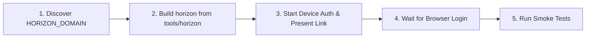

# Horizon CLI (`horizon`) Skill

This skill guides AI agents and developers through installing, authenticating, verifying, and using the **Horizon CLI (`horizon`)** to interact with the Horizon SDV API, Module Catalog, and Argo Workflows CI pipelines.

---

## Onboarding & Setup Workflow Overview



> [!IMPORTANT]
> **Prefer Building from Go Source (`tools/horizon`)**:
> Because the Developer Portal binary download endpoint (`/developer-portal/api/cli/v1/download/linux/amd64`) is behind Keycloak OAuth2 authentication, always prefer building `horizon` directly from `./tools/horizon` in the cloned `horizon-sdv` repository. Building from source requires zero prior authentication tokens and completes in a few seconds.

---

## Step-by-Step Installation & Authentication

### Step 1: Discover or Confirm `HORIZON_DOMAIN`

1. On a Horizon Cloud Workstation, `HORIZON_DOMAIN` is baked into `/usr/local/lib/horizon-mcp/mcp_registry_client.py`. Check the environment variable, existing config, or workstation MCP client first:
   ```bash
   HORIZON_DOMAIN="${HORIZON_DOMAIN:-$(python3 -c 'import sys; sys.path.insert(0, "/usr/local/lib/horizon-mcp"); import mcp_registry_client as m; print(m.HORIZON_DOMAIN)' 2>/dev/null)}"
   echo "Detected HORIZON_DOMAIN: ${HORIZON_DOMAIN}"
   ```
2. If `HORIZON_DOMAIN` is empty or equals `##DOMAIN##`, ask the user for their target Horizon domain (for example, `hrzn-exp.automobility.cloud`).

### Step 2: Build and Install `horizon` from `./tools/horizon`

Run the following from the root of the cloned `horizon-sdv` repository:

```bash
# 1. Ensure Go 1.22+ is available on PATH (check /usr/local/go/bin or install golang-go)
if ! command -v go >/dev/null 2>&1; then
  if [ -x /usr/local/go/bin/go ]; then
    export PATH="/usr/local/go/bin:$PATH"
  else
    sudo apt-get update && sudo apt-get install -y golang-go
  fi
fi

# 2. Build the horizon binary from tools/horizon
mkdir -p "$HOME/.local/bin"
GIT_SHA=$(git rev-parse --short HEAD 2>/dev/null || echo "dev")
BUILD_DATE=$(date -u +"%Y-%m-%dT%H:%M:%SZ")
(
  cd tools/horizon && \
  CGO_ENABLED=0 go build -trimpath \
    -ldflags "-s -w -X main.version=${GIT_SHA} -X main.buildDate=${BUILD_DATE}" \
    -o "$HOME/.local/bin/horizon" .
)

# 3. Also install into /usr/local/bin if passwordless sudo is available
sudo install -m 0755 "$HOME/.local/bin/horizon" /usr/local/bin/horizon 2>/dev/null || true
export PATH="$HOME/.local/bin:$PATH"

# 4. Verify binary execution
horizon version
```

*(Optional Alternative: Once authenticated, prebuilt binaries can also be downloaded from `https://${HORIZON_DOMAIN}/developer-portal/api/cli/v1/download/linux/amd64` using `Authorization: Bearer <access_token>`).*

### Step 3: Authenticate via Keycloak OAuth 2.0 Device Flow

1. Launch the device login command as a background task so you can capture the verification URL printed to `stderr`:
   ```bash
   horizon auth login --device --no-browser --domain "$HORIZON_DOMAIN" --write-config
   ```
2. Read the task output and present the clickable `https://<HORIZON_DOMAIN>/auth/realms/horizon/device?user_code=...` URL to the user:
   > **Authenticate Horizon CLI**:
   > Please open the following link in your browser and sign in with your Horizon account:
   > - `https://<HORIZON_DOMAIN>/auth/realms/horizon/device?user_code=XXXX-XXXX`
   >
   > *(If also setting up `mtkc`, present the MTK Connect API Key instructions in the same message so the user can complete both in one browser visit).*
3. Once the user approves the device login in their browser, `horizon auth login` automatically finishes polling, saves the OAuth token cache to `~/.config/horizon/token.json`, writes the default domain configuration to `~/.config/horizon/config.yaml`, and exits with code `0`.

### Step 4: Run First Verification & Smoke Tests

After authentication succeeds, run these read-only verification commands and report the results to the user:

```bash
# 1. Verify CLI version and build info
horizon version

# 2. Verify active Keycloak identity and token status
horizon auth whoami

# 3. Inspect saved CLI configuration (~/.config/horizon/config.yaml)
horizon config get

# 4. Fetch the active Horizon Module & Workflow Template Catalog
horizon catalog get

# 5. List recent and running Argo Workflows across enabled modules
horizon workflow list
```

---

## Horizon CLI Command Reference

### 1. Configuration & Authentication

```bash
# Initialize or inspect ~/.config/horizon/config.yaml
horizon config init --domain <HORIZON_DOMAIN>
horizon config get
horizon config set module <module-name>
horizon config set template <template-name>

# Login (device flow for interactive users, client-credentials for CI)
horizon auth login --device --no-browser --domain <HORIZON_DOMAIN> --write-config
horizon auth login --client-credentials --domain <HORIZON_DOMAIN> --client-id <id> --client-secret <secret>

# Refresh access token using cached OAuth refresh_token (no browser needed)
horizon auth refresh

# Display current authenticated subject, email, groups, and token expiry
horizon auth whoami

# Remove cached token
horizon auth logout
```

### 2. Catalog Discovery

Query `/v1/catalog` to inspect enabled modules, exposed workflow templates, and required parameters before submitting a workflow:

```bash
# Human-readable table of modules, templates, and parameter schemas
horizon catalog get

# JSON output for programmatic inspection
horizon catalog get --output json
```

### 3. Workflow Execution & Monitoring (`horizon workflow` / `horizon ci`)

All workflow commands are stateless and accept the `workflowName` returned by `submit` or `list`:

```bash
# Submit a workflow and stream logs until completion (exit 0=Succeeded, 1=Failed/Error, 2=Aborted)
horizon workflow submit \
  --module <module-name> \
  --template <template-name> \
  --params-json '{"key":"value"}' \
  --wait --logs

# Submit asynchronously and capture workflowName in JSON
horizon workflow submit \
  --module <module-name> \
  --template <template-name> \
  --params-file params.json \
  --output json -q

# List workflows (all or running-only)
horizon workflow list
horizon workflow list --running-only --output wide
horizon workflow running --limit 10
horizon workflow history --limit 10

# Inspect a specific workflow's status, parameters, and node phases
horizon workflow show <workflowName>
horizon workflow get <workflowName>

# Wait for completion or stream pod logs
horizon workflow wait --logs <workflowName>
horizon workflow logs <workflowName>

# Abort a running workflow or delete a finished workflow
horizon workflow abort <workflowName>
horizon workflow delete <workflowName>
```

### 4. Artifact Download

```bash
# Download an output artifact produced by a workflow
horizon workflow download-artifact -o ./artifact.tgz <workflowName> <artifactName>

# Generate a temporary signed GCS URL for an artifact
horizon workflow download-artifact --generate-signed-url --duration 3600 <workflowName> <artifactName>
```
