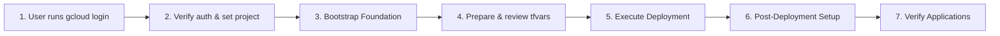

<!-- Copyright 2026 Google LLC
Modifications Copyright (c) 2026 Accenture, All Rights Reserved.

Licensed under the Apache License, Version 2.0 (the "License");
you may not use this file except in compliance with the License.
You may obtain a copy of the License at

        http://www.apache.org/licenses/LICENSE-2.0

Unless required by applicable law or agreed to in writing, software
distributed under the License is distributed on an "AS IS" BASIS,
WITHOUT WARRANTIES OR CONDITIONS OF ANY KIND, either express or implied.
See the License for the specific language governing permissions and
limitations under the License. -->

# Horizon SDV Deployment Skill

This skill provides an automated, streamlined procedure for deploying and managing the **Horizon SDV** platform on Google Kubernetes Engine (GKE) using Infrastructure as Code (Terraform) and GitOps (Argo CD).

> [!IMPORTANT]
> Follow [`rules/AGENTS.md`](../../rules/AGENTS.md), in particular **Deployment Parity with `deploy.sh`**: deploy with the standard scripts and do not change anything outside `.agents/`.

---

## Minimal Input & Interactive Authentication Principle

> [!IMPORTANT]
> **Streamlined User Interaction & Proactive Authentication**:
> 1. **GCP Authentication First**: At the start, ask the user to run `gcloud auth login --update-adc` in their own terminal. This authenticates both `gcloud` and Application Default Credentials (ADC). Never ask for verification codes in chat.
> 2. **Strict Wait for Authentication**: Do not run any GCP project or infrastructure command until `gcloud auth application-default print-access-token >/dev/null && gcloud auth list --filter=status:ACTIVE --format="value(account)"` succeeds.
> 3. **Essential Parameters**: Prompt the user for target **GCP Project ID** (`sdv_gcp_project_id`) and **Root Domain** (`sdv_root_domain`, e.g., `example.com`).
>
> All other values come from `terraform/env/terraform.tfvars.sample`, are derived, or are generated, and are confirmed by the user in one review table (see Phase 2):
> - **GCS State Bucket**: Proposed as `gs://<GCP_PROJECT_ID>-horizon-tfstate` (with object versioning & uniform bucket access).
> - **GCE Default Service Account**: Automatically queried via `gcloud`.
> - **Environment Name / Subdomain**: Proposed as `dev` (`https://dev.<HORIZON_DOMAIN>`).
> - **GCP Region & Zone**: Sample defaults `europe-west1` and `europe-west1-d`.
> - **Keycloak Admin Passwords and Argo CD Admin Password (`manual_secrets.s5`)**: Generated locally as strong random passwords.
> - **SCM Configuration**: `scm_repo_url` and `scm_repo_branch` are proposed from the current Git remote and branch, and `scm_auth_method` is asked (`none` works only for public repositories). Argo CD deploys `gitops/` from `scm_repo_url` at `scm_repo_branch`, never from the local folder, so the branch must exist on the remote and contain the changes to be deployed.
> - **Feature Flags**: Sample defaults (e.g. `sdv_dns_dnssec_enabled = true`, `sdv_enable_network_policies = true`, `sdv_enable_kms_encryption = false`).

---

## Deployment Workflow Overview



1. **[GCP Foundation & Bucket](./references/01_gcp_foundation.md)**: Ask the user to run `gcloud auth login --update-adc` in their terminal and verify it, configure active project, auto-discover GCE Service Account, create the state bucket with versioning, and configure OAuth2 credentials.
2. **[Terraform Configuration](./references/02_terraform_configuration.md)**: Copy `terraform.tfvars.sample`, fill required values, generate passwords, and confirm everything with the user in one review table before writing `terraform/env/terraform.tfvars`.
3. **[Deployment Execution](./references/03_deployment_execution.md)**: Run the standard `tools/scripts/deployment/deploy.sh` (native) or hand `container-deploy.sh` to the user. The [Cloud Build runner](./references/06_cloud_build_deployment.md) is an opt-in variant.
4. **[Post-Deployment Setup](./references/04_post_deployment_setup.md)**: Configure DNS nameservers, connect to GKE via Connect Gateway, configure Keycloak Google SSO, and assign RBAC user groups.
5. **[Cluster Applications Verification](./references/05_cluster_applications.md)**: Verify Developer Portal, Argo CD, Keycloak, Gerrit, Jenkins, MTK Connect, Headlamp, Grafana, Argo Workflows, Horizon API, and MCP Gateway Registry.

---

## Pre-Configuration Workflow & Questionnaire

When triggering the deployment:
1. Ask the user to run `gcloud auth login --update-adc` in their own terminal.
2. Prompt the user for essential parameters and **stop to wait for user input**:

> **To deploy Horizon SDV, please:**
> 1. **Authenticate Google Cloud**: Run `gcloud auth login --update-adc` in your terminal and tell me when it has finished.
> 2. **GCP Project ID**: Target Google Cloud Project ID (e.g. `my-project-123`).
> 3. **Root Domain**: Target primary domain name (e.g. `your-domain.com`).
>
> *(The agent will then verify the login, create the state bucket, discover the compute SA, generate secure admin passwords, and show you every `terraform.tfvars` value for approval before writing it.)*

---

## Step-by-Step Execution Guide

### Phase 1: Authentication & Foundation Bootstrap
1. **User authenticates**: the user runs `gcloud auth login --update-adc` in their own terminal.
2. **Verify**: `gcloud auth application-default print-access-token >/dev/null && gcloud auth list --filter=status:ACTIVE --format="value(account)"`. Stop if it fails.
3. **Set active GCP project**:
   ```bash
   gcloud config set project <GCP_PROJECT_ID>
   ```
4. **Enable all required platform APIs upfront** (this list is the single source; references link here):
   ```bash
   gcloud services enable \
     compute.googleapis.com \
     container.googleapis.com \
     dns.googleapis.com \
     secretmanager.googleapis.com \
     certificatemanager.googleapis.com \
     artifactregistry.googleapis.com \
     cloudresourcemanager.googleapis.com \
     orgpolicy.googleapis.com \
     serviceusage.googleapis.com \
     iam.googleapis.com \
     iamcredentials.googleapis.com \
     sts.googleapis.com \
     gkehub.googleapis.com \
     connectgateway.googleapis.com \
     monitoring.googleapis.com \
     oslogin.googleapis.com \
     autoscaling.googleapis.com \
     file.googleapis.com \
     iap.googleapis.com \
     networkconnectivity.googleapis.com \
     networkmanagement.googleapis.com \
     integrations.googleapis.com \
     aiplatform.googleapis.com \
     storage.googleapis.com \
     workstations.googleapis.com \
     spanner.googleapis.com \
     parametermanager.googleapis.com \
     --project=<GCP_PROJECT_ID>
   ```
   `orgpolicy` is needed for the pre-flight checks in step 5. If the user chose the Cloud Build variant, also enable it:
   ```bash
   gcloud services enable cloudbuild.googleapis.com --project=<GCP_PROJECT_ID>
   ```
5. **Early Organization Policy Pre-Flight Checks**:
   Check constraints that impact deployment before generating configuration. Use `--effective` so policies inherited from the folder or organization are included:
   ```bash
   # 1. Check Service Account Key creation policy
   gcloud org-policies describe constraints/iam.disableServiceAccountKeyCreation --project=<GCP_PROJECT_ID> --effective
   ```
   > [!IMPORTANT]
   > **User Prompt on Enforced Constraints**:
   > If `constraints/iam.disableServiceAccountKeyCreation` is enforced:
   > Explicitly inform the user: *"Your project enforces `constraints/iam.disableServiceAccountKeyCreation` (blocking SA key creation). Horizon SDV stores a key in Secret Manager for Jenkins dynamic GCE worker VM provisioning. Would you like to disable enforcement for this project, or proceed without dynamic GCE VM workers?"*
   > If the user approves, disable enforcement:
   > ```bash
   > gcloud resource-manager org-policies disable-enforce constraints/iam.disableServiceAccountKeyCreation --project=<GCP_PROJECT_ID>
   > ```

6. **Auto-discover default GCE compute service account**:
   ```bash
   PROJECT_NUM=$(gcloud projects describe <GCP_PROJECT_ID> --format="value(projectNumber)")
   COMPUTE_SA=$(gcloud iam service-accounts list --project=<GCP_PROJECT_ID> \
     --filter="email ~ [0-9]+-compute@developer.gserviceaccount.com" \
     --format="value(email)")
   ```
   **Cloud Build variant only**: grant the Cloud Build SA and Compute SA `roles/owner` for provisioning (see [06_cloud_build_deployment.md](./references/06_cloud_build_deployment.md)):
   ```bash
   gcloud projects add-iam-policy-binding <GCP_PROJECT_ID> \
     --member="serviceAccount:${PROJECT_NUM}@cloudbuild.gserviceaccount.com" \
     --role="roles/owner"
   gcloud projects add-iam-policy-binding <GCP_PROJECT_ID> \
     --member="serviceAccount:${COMPUTE_SA}" \
     --role="roles/owner"
   ```
7. **Auto-create GCS remote state bucket** if it doesn't already exist:
   ```bash
   BUCKET_NAME="<GCP_PROJECT_ID>-horizon-tfstate"
   gcloud storage buckets create gs://$BUCKET_NAME --project=<GCP_PROJECT_ID> --location=europe-west1 --uniform-bucket-level-access || true
   gcloud storage buckets update gs://$BUCKET_NAME --project=<GCP_PROJECT_ID> --versioning || true
   ```

### Phase 2: Prepare `terraform.tfvars` from the Sample
*Follow: [references/02_terraform_configuration.md](./references/02_terraform_configuration.md)*
1. Copy `terraform/env/terraform.tfvars.sample` to `terraform/env/terraform.tfvars`. If `terraform.tfvars` already exists, ask the user whether to reuse it.
2. Fill every `<REQUIRED>` value (project ID, compute SA, backend bucket, environment name, root domain, and `scm_password` when `scm_auth_method = "userpass"`). Ask the user for `scm_auth_method`; for `none` or `app`, set `scm_password = "unused"` (Terraform always stores it in Secret Manager as `scm-password-b64`, which rejects an empty value; nothing reads it for these methods).
3. Generate `sdv_keycloak_admin_password`, `sdv_keycloak_horizon_admin_password` and `manual_secrets.s5` (Argo CD admin) so they pass the validation rules in `terraform/env/variables.tf`.
4. Keep all other sample defaults unless the user changes them.
5. Show the user one review table of every value (user-supplied / derived / sample default / generated, passwords masked) and write the file only after approval.

### Phase 3: Run Deployment (Standard Scripts)
*Follow: [references/03_deployment_execution.md](./references/03_deployment_execution.md)*
```bash
cd tools/scripts/deployment

# Native (Linux, tools meet the minimum versions checked by deploy.sh): run by the agent
./deploy.sh -p
./deploy.sh -a

# Containerized: needs an interactive terminal, so the user runs it
./container-deploy.sh -p
./container-deploy.sh -a
```
Use the [Cloud Build runner](./references/06_cloud_build_deployment.md) only if the user asks for it or no local tooling is available, and state its differences first (see `rules/AGENTS.md`).

### Phase 4: Post-Deployment Configuration & User Handoff
*Follow: [references/04_post_deployment_setup.md](./references/04_post_deployment_setup.md)*
1. **Present Only the Locally-Generated Admin Passwords**:
   > [!IMPORTANT]
   > **Do NOT Proactively Output Terraform-Generated Service Passwords**:
   > Do **not** query or proactively display passwords generated natively by Terraform (such as Jenkins, Gerrit, Grafana, PostgreSQL, or MCP Gateway fallback admin passwords). All everyday user and administrator access is handled centrally via Keycloak Single Sign-On.
   >
   > Proactively show **only** the locally-generated administrator passwords (from `terraform.tfvars`):
   > - **Horizon Realm Admin** (`horizon-admin` / `sdv_keycloak_horizon_admin_password`)
   > - **Keycloak Root Superadmin** (`admin` / `sdv_keycloak_admin_password`)
   > - **Argo CD Admin** (`admin` / `manual_secrets.s5`) — break-glass access to Argo CD

2. **Present Clear Credentials & Usage Summary to User**:
   Provide the user with this explicit, clean breakdown:

   | Account | Username | Purpose & Where to Use |
   | :--- | :--- | :--- |
   | **Horizon SSO Admin** *(Recommended)* | `horizon-admin` | **Single Sign-On across all platform tools**.<br>Use when clicking **"LOG IN VIA KEYCLOAK"** in Argo CD, Jenkins, Gerrit, Grafana, Headlamp, and Developer Portal, or at `/auth/admin/horizon/console/`.<br>**One-time initial password:** Keycloak requires a new password at first login. The new password is not stored by Horizon. |
   | **Keycloak Root Superadmin** | `admin` | **Root Keycloak server administration only**.<br>Used at `/auth/admin/master/console/` to manage realms and server-wide settings. |
   | **Argo CD Admin** *(Break-glass)* | `admin` | Direct Argo CD login at `/argocd` if SSO is unavailable. |

   > [!NOTE]
   > After the first `horizon-admin` login, the value in `terraform.tfvars` and in `keycloak-horizon-admin-password-b64` no longer works. To reset it, log in at `/auth/admin/master/console/` as `admin`, switch to the `horizon` realm, then **Users** → `horizon-admin` → **Credentials** → **Reset password**.

   *(Fallback local admin credentials for individual services are safely stored in GCP Secret Manager and can be queried on-demand only if specifically requested for emergency break-glass scenarios)*.

3. **Query & Display Live Cloud DNS Nameservers from Google Cloud**:
   > [!IMPORTANT]
   > **Always Query Live Nameservers from GCP Source**:
   > Never hardcode or assume nameserver values. Always query the definitive nameservers directly from the Terraform-managed Cloud DNS zone in Google Cloud:
   > ```bash
   > ZONE_NAME="<ENV_NAME>-horizon-sdv-com"
   > gcloud dns managed-zones describe $ZONE_NAME --project=<GCP_PROJECT_ID> --format="value(nameServers)"
   > ```
   > Present the exact 4 returned nameservers to the user:
   > ```text
   > <ENV_NAME>.<ROOT_DOMAIN>.   IN   NS   <ACTUAL_NS_1>.
   > <ENV_NAME>.<ROOT_DOMAIN>.   IN   NS   <ACTUAL_NS_2>.
   > <ENV_NAME>.<ROOT_DOMAIN>.   IN   NS   <ACTUAL_NS_3>.
   > <ENV_NAME>.<ROOT_DOMAIN>.   IN   NS   <ACTUAL_NS_4>.
   > ```
   > Instruct the user to configure these NS delegation records in their DNS provider.
4. Connect to GKE via Connect Gateway (`gcloud container fleet memberships get-credentials`).
5. **Inspect & Verify Argo CD Sync Waves**:
   Verify that all multi-wave components have synchronized. The wave-by-wave table is in [04_post_deployment_setup.md §5.1](./references/04_post_deployment_setup.md#51-sync-wave-sequence--architecture).
   ```bash
   # Check overall application sync and health
   kubectl get applications -n argocd -o custom-columns=NAME:.metadata.name,HEALTH:.status.health.status,SYNC:.status.sync.status,MESSAGE:.status.operationState.message

   # If an application is OutOfSync / Sync Failed (e.g. max retries exceeded):
   kubectl patch application <APP_NAME> -n argocd --type merge -p '{"operation":{"sync":{"syncStrategy":{"hook":{"force":true}}}}}'
   ```
6. **Critical Post-Deployment Step: Assign Admin Users to `administrators` Group**:
   > [!IMPORTANT]
   > **Why Keycloak does not grant full admin rights automatically**:
   > By security design (Principle of Least Privilege), Keycloak provisions users (including `horizon-admin` and initial Google SSO users) with standard realm access, but does **not** grant cluster-wide write/sync permissions in Argo CD, Jenkins, or Grafana by default. Without joining the `administrators` group, Argo CD defaults to `role:readonly` (causing `permission denied: applications, sync`).
   >
   > **Required Action**:
   > In Keycloak Horizon Console (`/auth/admin/horizon/console/`), navigate to **Users** → Select `horizon-admin` (and your personal user) → **Groups** tab → **Join Group** → Select **`administrators`** → Click **Join**. Log out and log back into Argo CD / Jenkins.

7. Configure Keycloak Google Identity Provider, `broker link existing user` flow, and human admin user in the `horizon` realm.
8. Enable Developer Portal modules (`workloads-common`, `workloads-android`) and run Jenkins seed job.

---

## Detailed References

- [01_gcp_foundation.md](./references/01_gcp_foundation.md) — GCP IAM, GCS bucket auto-creation, and OAuth2 setup.
- [02_terraform_configuration.md](./references/02_terraform_configuration.md) — tfvars from the sample, password generation, and the review table.
- [03_deployment_execution.md](./references/03_deployment_execution.md) — Native, container and Cloud Build deployment commands.
- [04_post_deployment_setup.md](./references/04_post_deployment_setup.md) — DNS, Keycloak SSO, user groups, sync waves, and workload modules.
- [05_cluster_applications.md](./references/05_cluster_applications.md) — Applications list and URL reference.
- [06_cloud_build_deployment.md](./references/06_cloud_build_deployment.md) — Opt-in Cloud Build variant: how it differs from `deploy.sh`, IAM, and SCM configuration.
- [07_troubleshooting.md](./references/07_troubleshooting.md) — Solutions for common deployment and runtime errors.
- [08_service_account_keys.md](./references/08_service_account_keys.md) — Service account keys architecture, Jenkins GCE plugin, and organization policy.
