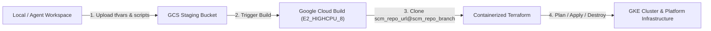

<!-- Copyright (c) 2026 Accenture and Google LLC, All Rights Reserved.

Licensed under the Apache License, Version 2.0 (the "License");
you may not use this file except in compliance with the License.
You may obtain a copy of the License at

        http://www.apache.org/licenses/LICENSE-2.0

Unless required by applicable law or agreed to in writing, software
distributed under the License is distributed on an "AS IS" BASIS,
WITHOUT WARRANTIES OR CONDITIONS OF ANY KIND, either express or implied.
See the License for the specific language governing permissions and
limitations under the License. -->

# Reference: Cloud Build Deployment Variant & SCM Configuration

This document describes the **opt-in** Google Cloud Build variant of the standard `tools/scripts/deployment/deploy.sh` flow and clarifies why manual GitHub App setup is not required. The default is `deploy.sh` (native) or `container-deploy.sh`; see `rules/AGENTS.md`, rule 4.

---

## 1. Zero Manual GitHub Setup by Default

> [!IMPORTANT]
> **Do Not Perform Manual GitHub App Setup**:
> You do **not** need to create a GitHub Organization App, generate RSA private keys, or configure GitHub App installation IDs (`sdv_github_app_id`, `sdv_github_app_install_id`, `sdv_github_app_private_key`).

For a public repository, the platform can be configured with:
```hcl
scm_type        = "github"
scm_auth_method = "none"
scm_repo_url    = "https://github.com/GoogleCloudPlatform/horizon-sdv.git"
scm_repo_branch = "main" # or active tracking branch
```
With `scm_auth_method = "none"`, Argo CD can sync a public repository without extra authentication keys or webhooks. In every deployment path, Argo CD deploys `gitops/` from `scm_repo_url` at `scm_repo_branch` (`terraform/modules/sdv-gke-apps/main.tf`), so local or unpushed gitops changes are not deployed.

---

## 2. Differences from `deploy.sh`

State these to the user before using the variant. They are the only permitted differences:

| Aspect | `deploy.sh` / `container-deploy.sh` | Cloud Build variant |
| :--- | :--- | :--- |
| Where Terraform runs | Local machine or local container | Cloud Build worker (`E2_HIGHCPU_8`) |
| Identity | User's ADC credentials | Cloud Build service account |
| Extra setup | None | `cloudbuild` and `orgpolicy` APIs, `roles/owner` for the Cloud Build and compute SAs, source staging in `gs://<sdv_gcp_backend_bucket>/cloudbuild-source` |

Everything else matches `deploy.sh` in container mode: the same deployer image (`horizon-sdv-deployer:latest` from `tools/scripts/deployment/container/Dockerfile`), clone of `scm_repo_url` at `scm_repo_branch` with `terraform.tfvars` copied in, the KMS bootstrap (honours `SKIP_KMS=true`), and `terraform init -upgrade -reconfigure` followed by plan / apply / destroy.

Limits of the variant:
- Only `scm_auth_method = "userpass"` or `"none"` is supported. `deploy.sh` prompts for a token in other cases; Cloud Build cannot, so it fails with a clear error. Use `container-deploy.sh` instead.
- `sdv_gcp_backend_bucket` must be set; there is no fallback name.
- Because Terraform runs from the remote branch, `cloud-deploy.sh` warns and asks for confirmation when the local tree has uncommitted changes or `HEAD` differs from `origin/<scm_repo_branch>`. `--yes` skips the prompt.
- Uploaded source is filtered by `scripts/gcloudignore` (passed with `--ignore-file`), which keeps `terraform/env/terraform.tfvars` in the upload. The repository root `.gcloudignore` is not used or changed.

---

## 3. Cloud Build Pipeline Architecture



### Key Advantages:
1. **Zero Local Dependencies**: No need to install Terraform, Docker Desktop, or specific CLI versions on your machine.
2. **Deterministic Execution**: Builds execute inside the standard deployer image (`ubuntu:24.04` with pinned versions of `terraform`, `gcloud`, and `docker`).

---

## 4. Running Deployments with Cloud Build

All deployment actions are driven via the Cloud Build helper script:

```bash
# Preview changes (Terraform Plan)
./.agents/plugins/horizon-ops/skills/horizon-deploy/scripts/cloud-deploy.sh --plan

# Apply infrastructure (Terraform Apply)
./.agents/plugins/horizon-ops/skills/horizon-deploy/scripts/cloud-deploy.sh --apply

# Destroy infrastructure
./.agents/plugins/horizon-ops/skills/horizon-deploy/scripts/cloud-deploy.sh --destroy

# Skip the confirmation prompt (non-interactive agents)
./.agents/plugins/horizon-ops/skills/horizon-deploy/scripts/cloud-deploy.sh --apply --yes

# Skip the KMS bootstrap (same as deploy.sh)
SKIP_KMS=true ./.agents/plugins/horizon-ops/skills/horizon-deploy/scripts/cloud-deploy.sh --apply

# View build history
./.agents/plugins/horizon-ops/skills/horizon-deploy/scripts/cloud-deploy.sh --status
```
