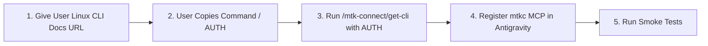

# MTK Connect CLI (`mtkc`) & MCP Skill

This skill guides AI agents and developers through installing, authenticating, configuring the built-in MCP server, and running the **MTK Connect CLI (`mtkc`)** via the `/mtk-connect/get-cli` installer endpoint to interact with physical and virtual testbenches and Cuttlefish / AAOS devices on Horizon SDV.

---

## Onboarding & Setup Workflow Overview



> [!IMPORTANT]
> **How `/mtk-connect/get-cli` Works (Unauthenticated Script Route + `AUTH` Env Var)**:
> - Just like `/get-agent`, `/get-tunnel`, and `/get-guacd`, the **`/mtk-connect/get-cli?platform=linux`** route is **unauthenticated** (`"authenticated": false` in `mtk-connect.yaml`), so anyone can fetch the installer shell script.
> - However, executing the script requires credentials passed via the **`AUTH` environment variable** (`curl -sSL "https://<HORIZON_DOMAIN>/mtk-connect/get-cli?platform=linux" | AUTH=<token> bash`) so the script can authenticate against `/api/v1/installer` to download the `mtkc` binary, log in (`mtkc auth login`), and rotate the bootstrap token into a persistent key (`mtkc auth rotate`).
> - **Fastest Way for the User to Get `AUTH`**: When the user opens **`https://<HORIZON_DOMAIN>/mtk-connect/docs/installation/cli-linux/`** in their browser, the page automatically generates a 5-minute bootstrap API key (`replace-auth.js`) and injects the ready-to-copy `AUTH=<base64_token>` directly into the `curl ... | AUTH=<token> bash` command block on the page.

---

## Step-by-Step Installation, Auth & MCP Setup

### Step 1: Discover `HORIZON_DOMAIN` & Prompt User for the `get-cli` Command / `AUTH` Token

1. Detect `HORIZON_DOMAIN` from the environment, `~/.config/horizon/config.yaml`, or `/usr/local/lib/horizon-mcp/mcp_registry_client.py`:
   ```bash
   HORIZON_DOMAIN="${HORIZON_DOMAIN:-$(python3 -c 'import sys; sys.path.insert(0, "/usr/local/lib/horizon-mcp"); import mcp_registry_client as m; print(m.HORIZON_DOMAIN)' 2>/dev/null)}"
   ```
2. Present the clickable MTK Connect Linux CLI installation docs URL to the user and pause for them to paste the command (or `AUTH` token):
   > **To install and configure the MTK Connect CLI (`mtkc`) and its MCP server:**
   > 1. Open the **MTK Connect Linux CLI Installation page** in your browser (sign in via Keycloak SSO if prompted):
   >    `https://<HORIZON_DOMAIN>/mtk-connect/docs/installation/cli-linux/`
   > 2. Copy the pre-filled install command from Step 1 on that page (which automatically includes your temporary `AUTH=...` token):
   >    ```bash
   >    curl -sSL "https://<HORIZON_DOMAIN>/mtk-connect/get-cli?platform=linux" | AUTH=<token> bash
   >    ```
   > 3. Paste that command (or just the `AUTH=<token>` value, or your MTK Connect username + API key) back into this chat.

### Step 2: Run `/mtk-connect/get-cli` with the `AUTH` Environment Variable

Once the user replies with the copied command, `AUTH` token, or username + API key, execute `/mtk-connect/get-cli?platform=linux` with `AUTH` set in the environment. The script automatically detects the CPU architecture, downloads the binary from `/api/v1/installer`, installs `mtkc` to `/usr/local/bin` or `~/.local/bin`, updates `PATH`, runs `mtkc auth login` + `mtkc auth rotate`, and runs `mtkc mcp install --silent`:

```bash
# 1. If the user provided username + API key instead of a base64 AUTH token, encode it:
if [ -z "${AUTH:-}" ] && [ -n "${MTKC_USERNAME:-}" ] && [ -n "${MTKC_API_KEY:-}" ]; then
  AUTH="$(printf '%s:%s' "${MTKC_USERNAME}" "${MTKC_API_KEY}" | base64 -w0)"
fi

# 2. Fetch the unauthenticated get-cli script and pass AUTH via environment variable to bash
curl -sSL "https://${HORIZON_DOMAIN}/mtk-connect/get-cli?platform=linux" | AUTH="${AUTH}" bash

# 3. Ensure ~/.local/bin and /usr/local/bin are on PATH in the current shell session
export PATH="$HOME/.local/bin:/usr/local/bin:$PATH"

# 4. Also copy to /usr/local/bin if installed to ~/.local/bin and passwordless sudo is available
if [ -x "$HOME/.local/bin/mtkc" ] && [ ! -x /usr/local/bin/mtkc ]; then
  sudo install -m 0755 "$HOME/.local/bin/mtkc" /usr/local/bin/mtkc 2>/dev/null || true
fi
```

### Step 3: Register the `mtkc` MCP Server in Antigravity

The `get-cli` script runs `mtkc mcp install --silent` (which configures Cursor, VS Code, Copilot, and Claude Desktop). To ensure Antigravity also loads the `mtkc` MCP server (`mtkc mcp serve`), register it in `~/.gemini/config/mcp_config.json` and `~/.gemini/antigravity/mcp_config.json`:

```bash
MTKC_BIN="$(command -v mtkc)"
python3 - "$MTKC_BIN" <<'PY'
import json
import sys
from pathlib import Path

mtkc_bin = sys.argv[1]
target_files = [
    Path.home() / ".gemini" / "config" / "mcp_config.json",
    Path.home() / ".gemini" / "antigravity" / "mcp_config.json",
]

for cfg_path in target_files:
    cfg_path.parent.mkdir(parents=True, exist_ok=True)
    data = {"mcpServers": {}}
    if cfg_path.exists():
        try:
            loaded = json.loads(cfg_path.read_text())
            if isinstance(loaded, dict):
                data = loaded
        except Exception:
            data = {"mcpServers": {}}
    mcp_servers = data.setdefault("mcpServers", {})
    mcp_servers["mtkc"] = {
        "command": mtkc_bin,
        "args": ["mcp", "serve"],
    }
    cfg_path.write_text(json.dumps(data, indent=2) + "\n")
    print(f"Configured mtkc MCP server in {cfg_path}")
PY
```

### Step 4: Run First Verification & Smoke Tests

After `get-cli` completes and the MCP server is registered, run these read-only verification commands and report the output to the user:

```bash
# 1. Check mtkc CLI & server version
mtkc version

# 2. Confirm active context and authentication status
mtkc auth status

# 3. List available testbenches
mtkc testbench list

# 4. List connected physical and virtual (Cuttlefish/AAOS) devices
mtkc device list
```

---

## `mtkc` CLI Command Reference

### 1. Authentication & Context Management

```bash
# Log in non-interactively and create/update context (handled automatically by get-cli)
mtkc auth login --server "https://<HORIZON_DOMAIN>/mtk-connect" --basic-auth "<BASE64_USER_KEY>"
mtkc auth login --server "https://<HORIZON_DOMAIN>/mtk-connect" --username "<USER>" --api-key "<KEY>"

# Check authentication status for current context
mtkc auth status

# Manage API keys or rotate current key
mtkc auth keys
mtkc auth rotate

# List or switch configuration contexts
mtkc context
```

### 2. Resource Inspection (Testbenches, Devices, Bookings, Artifacts)

All inspection commands support `-o table|json|yaml`:

```bash
# List and inspect testbenches
mtkc testbench list
mtkc testbench list -o json

# List and inspect devices (e.g. Cuttlefish / AAOS virtual devices)
mtkc device list
mtkc device list -o json

# Manage testbench and device bookings
mtkc booking

# List, upload, or download artifacts
mtkc artifact

# Inspect live OpenAPI schema
mtkc schema
```

### 3. Target Operations & Device Sessions

Interact with a specific `<testbench>/<device>` target directly from the CLI or agent:

```bash
# Run a command on a testbench or device (e.g. via ADB exec interface)
mtkc exec <testbench>/<device> -- <command>

# Stream logs from a device or testbench
mtkc log <testbench>/<device>

# Capture a screenshot from a device
mtkc screenshot <testbench>/<device>

# Copy files to/from or bidirectionally sync a directory with a testbench/device
mtkc cp <src> <dest>
mtkc sync <local-dir> <testbench>/<device>:<remote-dir>

# Open local device tunnels (e.g. local ADB forwarding)
mtkc tunnel
```

### 4. Built-in MCP Server (`mtkc mcp`)

```bash
# Start stdio MCP server (invoked automatically by Antigravity via mcp_config.json)
mtkc mcp serve

# Install/uninstall MCP config for VS Code, Cursor, Copilot, Claude
mtkc mcp install --silent
mtkc mcp uninstall
```
