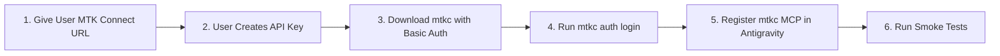

# MTK Connect CLI (`mtkc`) & MCP Skill

This skill guides AI agents and developers through installing, authenticating, configuring the built-in MCP server, and running the **MTK Connect CLI (`mtkc`)** to interact with physical and virtual testbenches and Cuttlefish / AAOS devices on Horizon SDV.

---

## Onboarding & Setup Workflow Overview



> [!IMPORTANT]
> **Secured Installer Download Flow (API Key Required Upfront)**:
> On Horizon SDV, the MTK Connect CLI installer endpoint (`/mtk-connect/api/v1/installer`) is a secured route protected by authentication.
> Therefore, the agent **must first provide the MTK Connect Portal URL** to the user and ask them to sign in, generate an API key in their profile, and paste their **MTK Connect Username** and **API Key** into the chat before downloading the `mtkc` binary.

---

## Step-by-Step Installation, Auth & MCP Setup

### Step 1: Discover `HORIZON_DOMAIN` & Prompt User for MTK Connect API Key

1. Detect `HORIZON_DOMAIN` from the environment, `~/.config/horizon/config.yaml`, or `/usr/local/lib/horizon-mcp/mcp_registry_client.py`:
   ```bash
   HORIZON_DOMAIN="${HORIZON_DOMAIN:-$(python3 -c 'import sys; sys.path.insert(0, "/usr/local/lib/horizon-mcp"); import mcp_registry_client as m; print(m.HORIZON_DOMAIN)' 2>/dev/null)}"
   ```
2. Present the clickable MTK Connect URL to the user and pause for their credentials:
   > **To download and configure the MTK Connect CLI (`mtkc`) and its MCP server:**
   > 1. Open **MTK Connect** in your browser and sign in with your Horizon account:
   >    `https://<HORIZON_DOMAIN>/mtk-connect`
   > 2. Click your user profile icon (top right) -> **Profile / API Keys** -> **Create API Key**.
   > 3. Paste your **MTK Connect Username** (your email/username shown in MTK Connect) and the generated **API Key** back into this chat.

### Step 2: Download and Install `mtkc` Using Basic Auth

Once the user provides `MTKC_USERNAME` and `MTKC_API_KEY`, download the CLI tarball from the secured `/mtk-connect/api/v1/installer` endpoint and install the `mtkc` binary:

```bash
# 1. Detect CPU architecture
ARCH="$(uname -m)"
case "${ARCH}" in
  x86_64|amd64) MTKC_ARCH="amd64" ;;
  aarch64|arm64) MTKC_ARCH="arm64" ;;
  *) echo "Unsupported architecture: ${ARCH}" >&2; exit 1 ;;
esac

# 2. Download and extract mtkc using HTTP Basic Auth
mkdir -p "$HOME/.local/bin"
curl -fsSL -u "${MTKC_USERNAME}:${MTKC_API_KEY}" \
  "https://${HORIZON_DOMAIN}/mtk-connect/api/v1/installer?component=cli&platform=linux&arch=${MTKC_ARCH}&ext=tgz" \
  | tar -xz -C "$HOME/.local/bin" mtkc
chmod +x "$HOME/.local/bin/mtkc"

# 3. Also install to /usr/local/bin if passwordless sudo is available
sudo install -m 0755 "$HOME/.local/bin/mtkc" /usr/local/bin/mtkc 2>/dev/null || true
export PATH="$HOME/.local/bin:$PATH"

# 4. Verify binary installation
mtkc version
```

### Step 3: Authenticate `mtkc` and Bootstrap Server Context

Configure the persistent `mtkc` context for `https://${HORIZON_DOMAIN}/mtk-connect`:

```bash
mtkc auth login \
  --server "https://${HORIZON_DOMAIN}/mtk-connect" \
  --username "${MTKC_USERNAME}" \
  --api-key "${MTKC_API_KEY}"

# Verify authentication status
mtkc auth status
```

### Step 4: Register the `mtkc` MCP Server in Antigravity

`mtkc` includes a built-in stdio MCP server (`mtkc mcp serve`). Because `mtkc mcp install` only writes to Cursor, VS Code, Copilot, and Claude config locations by default, register `mtkc mcp serve` directly into Antigravity's MCP configuration files (`~/.gemini/config/mcp_config.json` and `~/.gemini/antigravity/mcp_config.json`) in addition to running `mtkc mcp install --silent`:

```bash
# 1. Run standard IDE MCP installer
mtkc mcp install --silent || true

# 2. Register mtkc MCP server in Antigravity mcp_config.json files
MTKC_BIN="$(command -v mtkc)"
python3 - "$MTKC_BIN" <<'PY'
import json
import sys
from pathlib import Path

mtkc_bin = sys.argv[1]
target_files = [
    Path.home() / ".gemini" / "config" / "mcp_config.json",
    Path.home() / ".gemini" / "antigravity" / "mcp_config.json",
]

for cfg_path in target_files:
    cfg_path.parent.mkdir(parents=True, exist_ok=True)
    data = {"mcpServers": {}}
    if cfg_path.exists():
        try:
            loaded = json.loads(cfg_path.read_text())
            if isinstance(loaded, dict):
                data = loaded
        except Exception:
            data = {"mcpServers": {}}
    mcp_servers = data.setdefault("mcpServers", {})
    mcp_servers["mtkc"] = {
        "command": mtkc_bin,
        "args": ["mcp", "serve"],
    }
    cfg_path.write_text(json.dumps(data, indent=2) + "\n")
    print(f"Configured mtkc MCP server in {cfg_path}")
PY
```

### Step 5: Run First Verification & Smoke Tests

After authenticating and registering the MCP server, run these read-only verification commands and report the output to the user:

```bash
# 1. Check mtkc CLI & server version
mtkc version

# 2. Confirm active context and authentication status
mtkc auth status

# 3. List available testbenches
mtkc testbench list

# 4. List connected physical and virtual (Cuttlefish/AAOS) devices
mtkc device list
```

---

## `mtkc` CLI Command Reference

### 1. Authentication & Context Management

```bash
# Log in non-interactively and create/update context
mtkc auth login --server "https://<HORIZON_DOMAIN>/mtk-connect" --username "<USER>" --api-key "<KEY>"

# Check authentication status for current context
mtkc auth status

# Manage API keys or rotate current key
mtkc auth keys
mtkc auth rotate

# List or switch configuration contexts
mtkc context
```

### 2. Resource Inspection (Testbenches, Devices, Bookings, Artifacts)

All inspection commands support `-o table|json|yaml`:

```bash
# List and inspect testbenches
mtkc testbench list
mtkc testbench list -o json

# List and inspect devices (e.g. Cuttlefish / AAOS virtual devices)
mtkc device list
mtkc device list -o json

# Manage testbench and device bookings
mtkc booking

# List, upload, or download artifacts
mtkc artifact

# Inspect live OpenAPI schema
mtkc schema
```

### 3. Target Operations & Device Sessions

Interact with a specific `<testbench>/<device>` target directly from the CLI or agent:

```bash
# Run a command on a testbench or device (e.g. via ADB exec interface)
mtkc exec <testbench>/<device> -- <command>

# Stream logs from a device or testbench
mtkc log <testbench>/<device>

# Capture a screenshot from a device
mtkc screenshot <testbench>/<device>

# Copy files to/from or bidirectionally sync a directory with a testbench/device
mtkc cp <src> <dest>
mtkc sync <local-dir> <testbench>/<device>:<remote-dir>

# Open local device tunnels (e.g. local ADB forwarding)
mtkc tunnel
```

### 4. Built-in MCP Server (`mtkc mcp`)

```bash
# Start stdio MCP server (invoked automatically by Antigravity via mcp_config.json)
mtkc mcp serve

# Install/uninstall MCP config for VS Code, Cursor, Copilot, Claude
mtkc mcp install --silent
mtkc mcp uninstall
```
