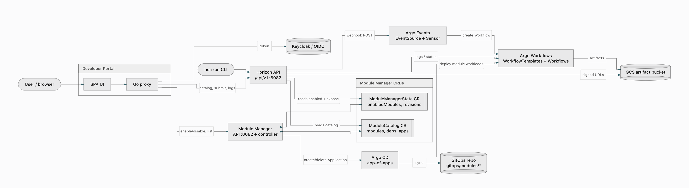
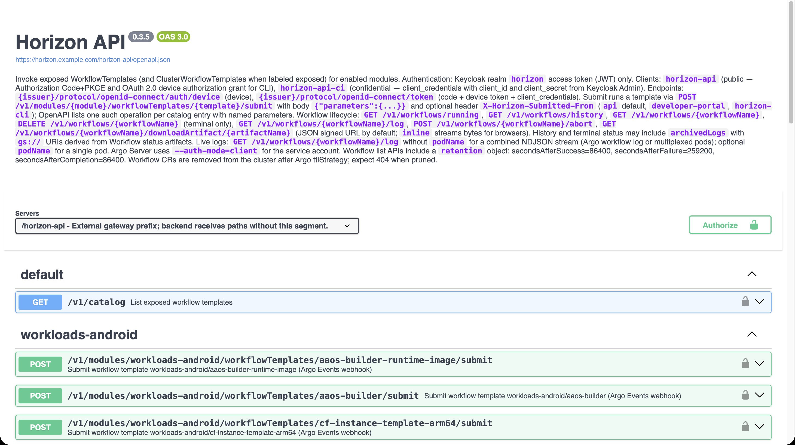
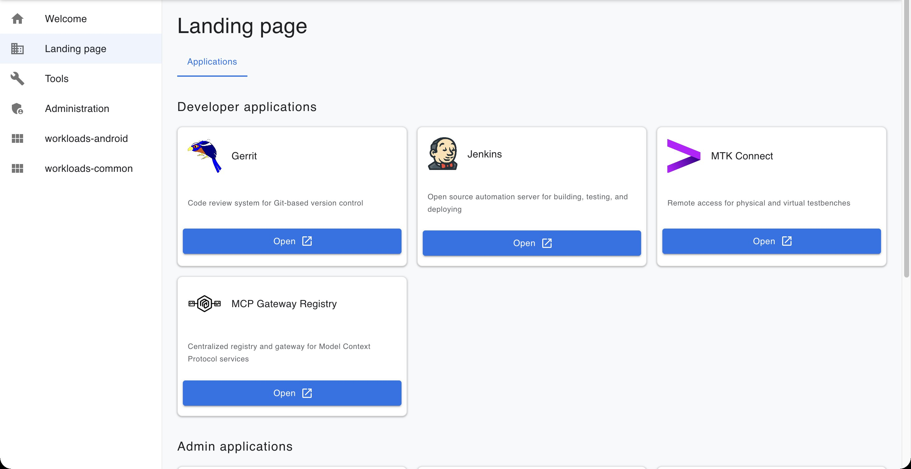
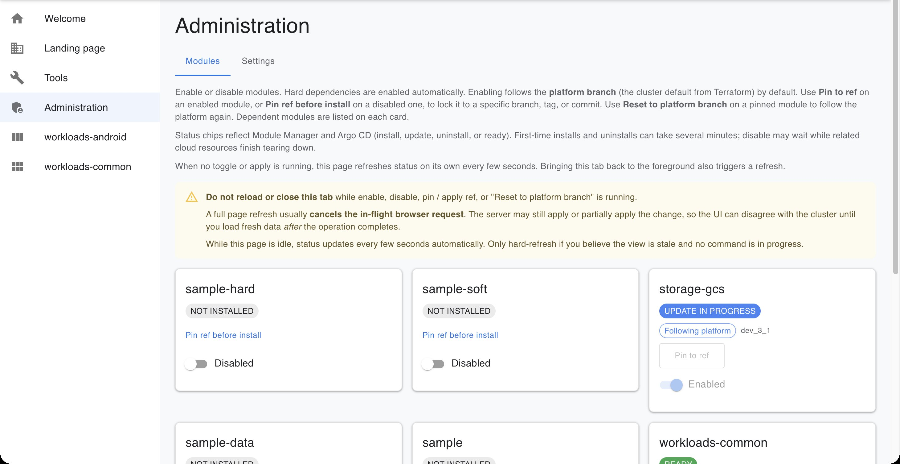
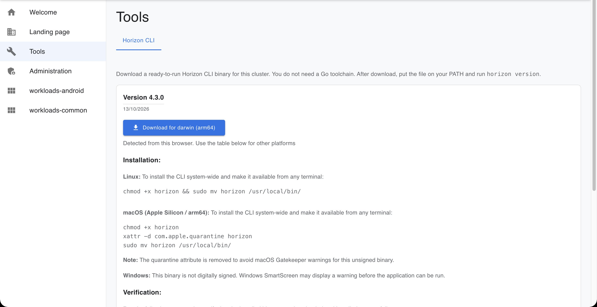

<!-- Copyright (c) 2026 Accenture, All Rights Reserved.

Licensed under the Apache License, Version 2.0 (the "License");
you may not use this file except in compliance with the License.
You may obtain a copy of the License at

        http://www.apache.org/licenses/LICENSE-2.0

Unless required by applicable law or agreed to in writing, software
distributed under the License is distributed on an "AS IS" BASIS,
WITHOUT WARRANTIES OR CONDITIONS OF ANY KIND, either express or implied.
See the License for the specific language governing permissions and
limitations under the License. -->

# Horizon modules overview

Horizon is built from modules. A module is an independently deployable unit of the platform: a Helm chart that brings its own workloads, workflow templates, applications and overview page. You can turn a module on or off in a running cluster without touching the rest of the platform. Module Manager is the control plane that does this. It knows which modules exist, which are enabled and which Git ref each one runs from.

This page explains the ideas you need before you work with modules. The pages in this folder are numbered in reading order:

1. This overview introduces modules, their dependencies and Module Manager.
2. The [Horizon Portal guide](02_horizon-portal.md) covers the portal and its tools.
3. [Horizon CLI](03_horizon-cli.md) covers installing the CLI and running workflows from a terminal or pipeline.
4. [Modularization Architecture](04_module-architecture.md) covers how the components interact.
5. [How to create a new module](05_creating-modules.md) is a step-by-step guide to building one.
6. [Interfaces](06_interfaces.md) is a reference for the Horizon API and Module Manager endpoints and the soft-feature contract.

The diagram shows the moving parts. You reach the platform through the Developer Portal, the Horizon CLI or the Horizon API, and you sign in through Keycloak each time. Module Manager holds the module records. Argo CD deploys whatever Module Manager enables. Argo Events and Argo Workflows run the workflows that modules expose, and their artifacts land in a GCS bucket.

## What a module gives you

Enabling a module creates an Argo CD application for it. Argo CD then deploys the module's workloads from `gitops/modules/`. Disabling the module deletes that application, and Argo CD removes the workloads again. Nothing about a module is wired in permanently, so the platform only runs what the cluster actually needs.

Once a module's workloads are ready, it gets its own tab in the Developer Portal. The tab shows an overview page that the module serves itself, so you can see what the module does without leaving the portal. It also lists any workflow templates and applications the module has chosen to expose. Visibility follows enablement. Exposed templates appear in the portal, the Horizon API and the CLI only while the module is enabled and ready. When you disable the module, they disappear and submissions are refused.

## How modules depend on each other

Modules can build on each other, and the catalog records how tightly. Horizon distinguishes two kinds of dependency:

| | Hard dependency | Soft dependency |
|---|---|---|
| Is it required? | Yes. The parent cannot run without it. | No. It only adds optional behavior. |
| Enabled with the parent? | Yes, before the parent. | No. You enable it separately. |
| Can you disable it while the parent is on? | No. Module Manager refuses. | Yes. The parent keeps running. |
| Sample pair | `sample` requires `sample-hard` | `sample` can use `sample-soft` |

When a soft dependency is enabled, the parent needs to find out so it can switch on the extra behavior. Module Manager passes that information to the parent's workloads as Helm values, as a ConfigMap, or both, depending on how the module is registered. The [soft-feature contract](06_interfaces.md#soft-feature-contract) gives the value and key names.

A module can also opt in to automatic cleanup. If its catalog entry sets `autoDisableWhenUnused`, Module Manager disables it when the last enabled module that depends on it, hard or soft, is disabled. This is off unless the module asks for it.

## What Module Manager does

Module Manager keeps two records as Kubernetes custom resources. `ModuleCatalog` lists every module the cluster knows about, with its chart path and dependencies. `ModuleManagerState` records which modules are enabled and which Git ref each one uses. Enable, disable and pin all go through Module Manager, so these records are always the source of truth.

When you enable a module, Module Manager enables its hard dependencies first, updates the state and creates the module's Argo CD application. When you disable a module, Module Manager checks whether another enabled module still requires it, and refuses if one does. Otherwise it removes the module from the enabled set and deletes its Argo CD application, and Argo CD removes the workloads. For modules that create cloud resources through Config Connector, such as `workloads-android`, Module Manager waits until those resources are gone.

Each module normally follows the cluster's platform branch. You can pin a single module to its own branch, tag or commit instead. Pinning is useful when you want to try a change to one module while the rest of the platform stays on the cluster default. Reset the module to the platform branch when you're done, and it follows the cluster default again, including on later platform upgrades.

Module Manager also serves the API the portal uses. It provides the module list, status and overview pages, and it finds the applications each module exposes.

## Three ways to work with modules

All three routes below use the same catalog and the same Keycloak sign-in. Choose the one that matches who, or what, is doing the work:

| Route | Use it when |
|---|---|
| [Horizon API](#horizon-api) | Another system, a script or CI needs to list templates, submit workflows, or collect logs and artifacts. |
| [Developer Portal](#developer-portal) | A person wants to open platform apps, read about a module, or run a workflow in the browser, or an operator is enabling, disabling or pinning modules. |
| [Horizon CLI](#horizon-cli) | A terminal session or pipeline needs to run workflows without a browser. |

### Horizon API

The Horizon API is the contract the other routes are built on. The endpoints are listed in [Horizon API endpoints](06_interfaces.md#horizon-api-endpoints). Its Swagger page is generated from the live catalog, so it always shows exactly the templates that enabled modules expose. `GET /v1/catalog` returns every template that enabled modules expose, with its parameters. Submitting a template starts a run, and you then follow that run through its status, logs and artifact downloads. You can also abort a run or look it up in history later. Every call needs a Keycloak access token for the `horizon` realm. The portal and the CLI call these same endpoints.

### Developer Portal

The Developer Portal is where people work in the browser. The landing page links to the platform applications, such as Gerrit, Jenkins and Argo CD, all from one signed-in session. Each enabled module appears in the sidebar once its workloads are ready. A module's page shows its overview, its workflow templates, the workflows currently running and their history.

The portal is also where operators manage modules. **Administration → Modules** is the portal's console for Module Manager. Each module has a card showing its status: not installed, installation or update in progress, uninstalling, or ready. From the card you can enable or disable the module, pin it to a ref, or reset it to the platform branch. Leave the tab open while an operation is running. Reloading cancels the browser's request, and the page can then show a state that doesn't match the cluster.

### Horizon CLI

The Horizon CLI gives you the same workflows from a terminal. Download a ready-built binary for your cluster from **Tools → Horizon CLI** in the portal. `horizon catalog get` lists the same exposed templates as the API. `horizon workflow submit` starts a run, and `logs` and `download-artifact` follow it. `abort` and `history` cover runs you started from the terminal. You sign in with Keycloak, and each run is tagged as submitted from the CLI. Use the CLI from scripts and pipelines, and the portal when someone needs to see the screen. The [Horizon CLI](03_horizon-cli.md) guide covers installation, sign-in and every command.

## Building your own module

Horizon doesn't discover modules automatically. To add one, you copy a sample chart into `gitops/modules/<name>`, starting from `sample-hard`, `sample` or `storage-gcs` depending on what you need. Next, add an entry to the `ModuleCatalog` that gives the module's name, chart path, overview service and dependencies. You then commit to the GitOps branch, sync `module-manager` so the catalog picks up the entry, and enable the module from **Administration → Modules**. The module's name must match everywhere it appears: the catalog, the module labels and the workflow Sensors. Module Manager supplies the repo URL and revision to your chart, so don't hard-code them.

[How to create a new module](05_creating-modules.md) walks through each step, including the overview service, workflow templates, Sensors and a final checklist.
