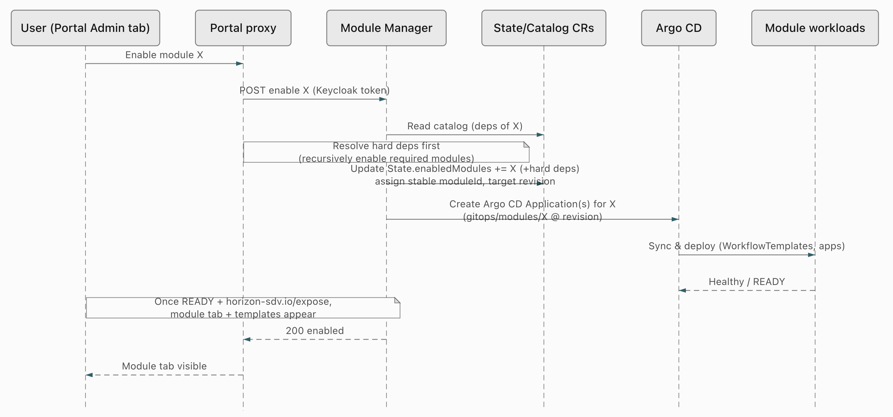
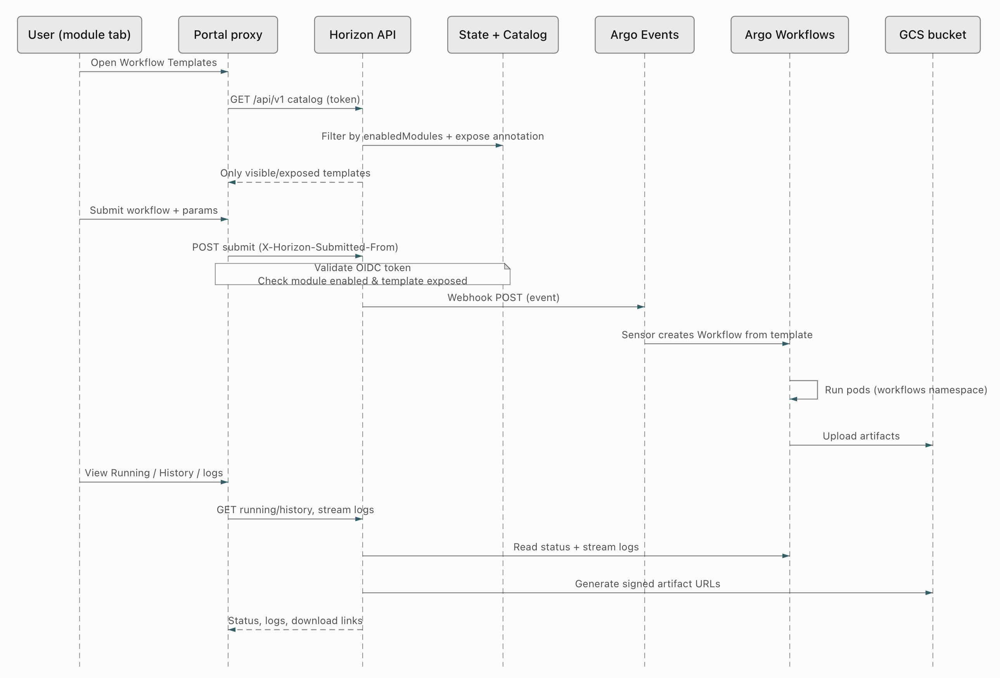
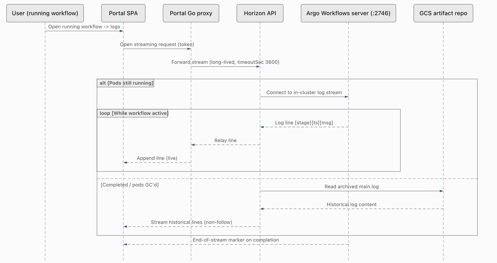
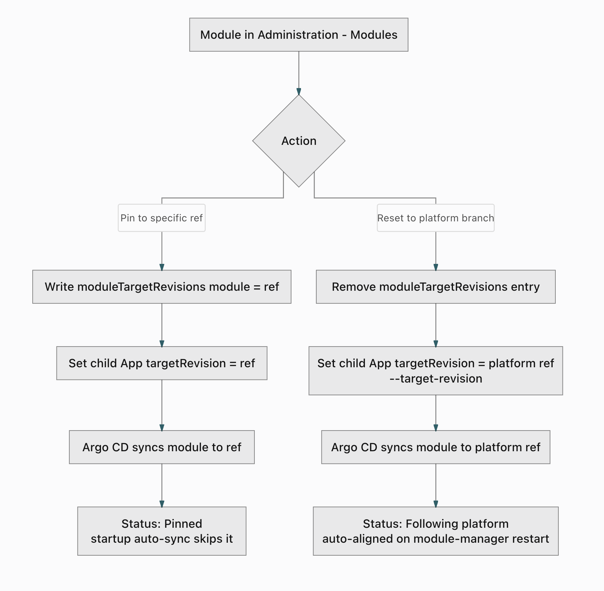
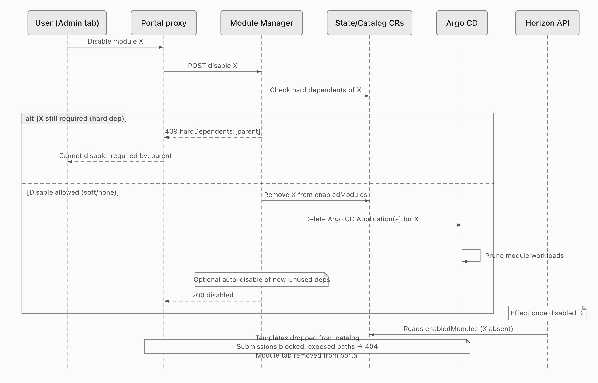

<!-- Copyright (c) 2026 Accenture, All Rights Reserved.

Licensed under the Apache License, Version 2.0 (the "License");
you may not use this file except in compliance with the License.
You may obtain a copy of the License at

        http://www.apache.org/licenses/LICENSE-2.0

Unless required by applicable law or agreed to in writing, software
distributed under the License is distributed on an "AS IS" BASIS,
WITHOUT WARRANTIES OR CONDITIONS OF ANY KIND, either express or implied.
See the License for the specific language governing permissions and
limitations under the License. -->

# Modularization Architecture

This page describes how the module components interact. For the concepts (modules, hard and soft dependencies, pinning), start with [Horizon modules overview](01_overview.md). The endpoints and the soft-feature contract are listed in [Interfaces](06_interfaces.md).

## Table of Contents

- [Component Overview](#component-overview)
- [Key Mechanics](#key-mechanics)
- [Enabling a module](#enabling-a-module)
- [API call and workflow run](#api-call-and-workflow-run)
- [Live workflow output streaming](#live-workflow-output-streaming)
  - [Security of the streaming path](#security-of-the-streaming-path)
- [Pinning and Resetting module Git refs](#pinning-and-resetting-module-git-refs)
- [Disabling a module](#disabling-a-module)

## Component Overview

The platform is composed of the Developer Portal (a Go proxy plus an SPA), the Module Manager (an API and a Kubernetes controller), the Horizon API, and the supporting Argo CD, Argo Events, Argo Workflows, Keycloak, and GCS services. The Developer Portal proxies user actions to the Module Manager (enable/disable, module list) and to the Horizon API (catalog, workflow submit, logs), with all requests authenticated through Keycloak.

## Key Mechanics

- **Module Manager is the source of truth** via two CRs: `ModuleCatalog` (what exists plus dependencies and apps) and `ModuleManagerState` (`status.enabledModules`, `moduleIds`, `moduleTargetRevisions`, `workflowsVisibility`).
- **Enable/disable is realized through Argo CD.** Module Manager creates or deletes one parent Argo CD Application per module; Argo CD then deploys or prunes the module's workloads from `gitops/modules/*`.
- **Visibility is recomputed, never static.** The Horizon API builds the catalog from enabled modules plus the `horizon-sdv.io/expose` label, and a resource must also be `READY`. Disable the module and the same endpoints return `404` or block the request.
- **Workflow submission is decoupled.** The Horizon API only POSTs to the Argo Events webhook; the Sensor materializes the Workflow, so the API stays stateless about execution and just reads back status, logs, and artifacts.
- **Log streaming is relayed, not stored by the API.** The Horizon API proxies a live stream from the Argo Workflows server while pods run. Once the pods are gone, the archived `main.log` in GCS is the source. The portal and Horizon API backends raise the load-balancer timeout (`timeoutSec: 3600`) to keep these long-lived streams open.

## Enabling a module

Enabling a module in the portal's Administration tab sends a request to the Module Manager, which resolves hard dependencies first, updates the `ModuleManagerState` CR, and creates the module's parent Argo CD Application, `mod-<module>`. The parent deploys the module chart, which usually creates child Applications for the module's workloads. The module's tab appears in the portal once the workloads are `READY`, and its workflow templates once they also carry the `horizon-sdv.io/expose` label.

## API call and workflow run

When a user opens a module's Workflow Templates, the Horizon API recomputes the catalog from the enabled modules and the `expose` label, returning only visible templates. On submit, the Horizon API validates the OIDC token and the module/template state, then POSTs an event to the Argo Events webhook. The Argo Events Sensor creates a Workflow from the template, Argo Workflows runs it, and artifacts land in GCS. Status, logs, and signed download URLs are read back through the Horizon API.

## Live workflow output streaming

Once a workflow is running, the portal streams its logs live rather than polling for a final blob. The SPA opens a long-lived streaming request that the Go proxy forwards to the Horizon API; the Horizon API in turn connects to the Argo Workflows server (`argo-workflows-server.<ns>.svc.cluster.local:2746`, set via `--argo-base-url`) and relays log lines back through the proxy to the browser as they are produced. The stream is newline-delimited JSON. Each line carries stage, timestamp, and message, heartbeat lines keep the connection alive, and the stream terminates with an explicit end marker when the workflow finishes.

The source of the logs depends on pod lifecycle:

- **While pods are running**, logs come directly from the Argo Workflows server's in-cluster log stream (near real time).
- **After pods are garbage-collected** (podGC) or the workflow has completed, the in-cluster stream is empty, so logs are served from the archived `main.log` that Argo uploads to the GCS artifact repository (`archiveLogs: true`). The portal loads each step's archived log through the Horizon API's artifact download endpoint.

Because these are long-lived connections, the default GKE load-balancer backend timeout (~15s) would cut the stream with a `504`. The portal and Horizon API backends therefore each set a `GCPBackendPolicy` with `timeoutSec: 3600` so catalog calls and log streams stay open.

### Security of the streaming path

The live-stream path is protected by several layers, all rooted in Keycloak/OIDC plus Kubernetes controls.

1. **Browser to Portal (edge auth + TLS).** The SPA requires a Keycloak login (public client `horizon-dev-portal`). TLS is terminated at the GKE Gateway (`secure: false` internally means TLS is handled at the edge, not disabled end-to-user).
2. **Portal Go proxy to Horizon API (confidential client).** The proxy authenticates to the Horizon API using a confidential Keycloak client (`horizon-api-ci`), with `HORIZON_API_CI_CLIENT_SECRET` injected from a Secret. The streaming request reaching the API carries a valid bearer token.
3. **Horizon API (OIDC validation).** The API validates tokens against Keycloak via `--oidc-issuer-url` (signature, issuer, expiry). Audience/client-id enforcement is optional and off by default (`oidcSkipClientIdCheck: true`, `oidcClientId: ""`); unless configured, it does not restrict `aud`/`azp`, only that the token is a valid Keycloak-issued one.
4. **Horizon API to Argo Workflows server (SA bearer + RBAC).** The Argo server runs with `--auth-mode=client` (SSO for humans). The Horizon API connects using its ServiceAccount bearer token, scoped by a Role in the workflows namespace that grants `argoproj.io` workflows, `pods` and `pods/log` (`horizon-api/templates/rbac.yaml`). Its ClusterRole (`rbac-cluster.yaml`) is read-only, for the module CRs and workflow templates. The log API is authenticated and authorized, not open.
5. **Network isolation.** The portal namespace has `default-deny-all` with explicit allows: DNS, HTTPS and HTTP egress (excluding the metadata server), Module Manager on `8082`, and the `horizon-api` namespace. The Argo server only accepts ingress on `2746`. These NetworkPolicies are applied when `enableNetworkPolicies` is true, which is the default.
6. **Archived logs (completed workflows).** Fallback historical logs live in the GCS artifact bucket, reached via Workload Identity (Google IAM), and artifacts are handed out as short-lived signed URLs — not public objects.

## Pinning and Resetting module Git refs

Each module's workloads are deployed by an Argo CD Application whose `targetRevision` decides which Git ref (branch, tag, or SHA) is synced. Module Manager tracks these per module and lets you either follow the platform branch or pin a module to a specific ref from **Administration → Modules**.

**Where the ref lives.** Module Manager starts with `--target-revision` (from `repo.revision`, i.e. the platform branch / `scm_repo_branch`). Per-module overrides are recorded in `ModuleManagerState.status.moduleTargetRevisions` (a map of module name → Git ref). The effective ref written to each module's parent Argo CD Application is: the per-module pin if one exists, otherwise the platform ref.

**Pin to specific ref.** Changing a module's Git ref in the portal writes that ref into `moduleTargetRevisions[module]` and updates the module's parent Argo CD Application (`mod-<module>`) to match: both its `targetRevision` and the `repo.revision` value it passes to the chart, so the child Applications follow. Argo CD then re-syncs the module to the chosen ref. The module now shows **Pinned**, and — importantly — the startup auto-sync **skips pinned modules**, so a pinned module will not be moved off its ref by a later platform upgrade. For a disabled module, **Pin ref before install** passes the ref with the enable request.

**Reset to platform branch.** This clears the per-module entry from `moduleTargetRevisions`, so the module falls back to the platform `--target-revision`. Module Manager sets the parent Application back to the platform ref and Argo CD re-syncs. The module then shows **Following platform**.

**Upgrade behavior.** When `module-manager` restarts (e.g. after a platform upgrade ships new charts/images), its startup auto-sync re-aligns every module that is **Following platform** to the new platform ref, and leaves **Pinned** modules untouched. (Legacy note: modules enabled under 4.0.0 recorded a ref per enable, which 4.1.0+ reads as an explicit pin — so after an in-place upgrade they appear **Pinned** on the old ref until you reset them.)

## Disabling a module

Disabling a module is guarded by hard-dependency checks: if the module is still required by an enabled parent, the Module Manager returns `409` with the blocking modules in `hardDependents`, and the portal shows "Cannot disable: required by: ...". When disable is allowed, the module is removed from `enabledModules` and its parent Argo CD Application is deleted. Argo CD cascades the deletion to the child Applications and prunes the workloads. For `workloads-android`, `workloads-common` and `remotive-topology`, Module Manager also tears down the child Application and waits for their Config Connector resources to be removed. Afterwards the Horizon API drops the module's templates from the catalog, blocks submissions, returns `404` for previously exposed paths, and the module's tab disappears from the portal.

If a module sets `autoDisableWhenUnused`, Module Manager checks after every enable and disable whether the last enabled module that depends on it (hard or soft) has gone, and disables it if so.

