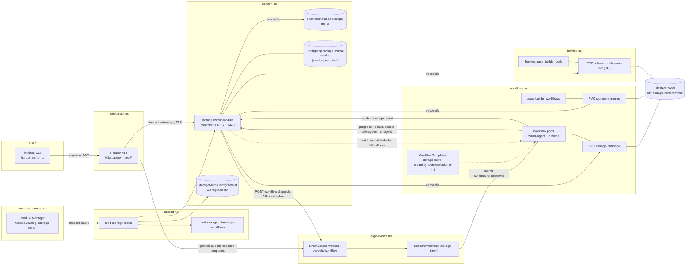

<!-- Copyright (c) 2026 Accenture, All Rights Reserved.

Licensed under the Apache License, Version 2.0 (the "License");
you may not use this file except in compliance with the License.
You may obtain a copy of the License at

        http://www.apache.org/licenses/LICENSE-2.0

Unless required by applicable law or agreed to in writing, software
distributed under the License is distributed on an "AS IS" BASIS,
WITHOUT WARRANTIES OR CONDITIONS OF ANY KIND, either express or implied.
See the License for the specific language governing permissions and
limitations under the License. -->

# TAA-1593 Storage Mirror Module: design

Status: proposal, revision 2. Baseline commit: `d494456`.

Revision 2 (2026-11-25) applies the review and the binding user decisions:

- Every run enters through Argo Events: exposed WorkflowTemplates plus one Sensor each. The controller dispatches API
  and scheduled runs to the same webhook and keeps state by watching module-labelled Workflows. Concurrency is Argo's
  semaphore and mutex (sections 3, 6.4, 9).
- No GitOps-declared `StorageMirror` CRs in v1, so module disable cannot hang on the finalizer (section 4.1).
- Config Connector keeps `roles/editor` + `roles/iam.serviceAccountTokenCreator` only. All IAM stays in Terraform; only
  the Filestore instance (mirror) and the two project buckets (storage-gcs) move to Config Connector (section 12).
- RBAC: `filestoreinstances.filestore.cnrm.cloud.google.com`, and namespace-wide PVC `create` in `jenkins` because
  `resourceNames` cannot limit `create` (section 13).

Revision 3 (2026-11-25, implementation) records what the implementation changed:

- **Catalog writer.** The mirror workflow pods (`mirror-agent`) write `metadata.yaml` under `flock` with an atomic
  rename, the way the Jenkins scripts did. The controller has **no** mount: a controller pod that mounts a claim the
  controller itself creates could never start. Each run reports the catalog and the share usage (`statfs`) to the
  controller, which keeps the last snapshot in ConfigMap `storage-mirror-catalog` (list, import, usage).
- **No controller PV/claim** (`storage-mirror-controller` dropped from section 5.2).
- **Retain delete** leaves the catalog entry as it is (it shows as unmanaged and can be imported); only purge changes the
  catalog (the delete run removes the entry).
- **Create** always starts the create run (no `"sync": false`). The API returns the `requestId`; the run ID appears in
  `status.currentRun` once the Workflow exists.
- **Semaphore value** `storage-mirror-semaphores/sync` is rendered by Helm from the same value as
  `StorageMirrorConfig.spec.concurrency.maxParallelSyncs`; the controller does not write it.
- **Pod resources** come from the module Helm values (`workflows.resources`), not from the CRD.
- **One agent step per template** runs init, fetch, prune-refs, lfs and gc in order (phases in the progress object),
  instead of one Argo step per phase.
- **Parameter `submittedBy`** is appended to the create and sync templates (Sensors map `body.horizonSubmittedBy` onto it)
  so `created_by` in the catalog is the real submitter.

The Storage Mirror module (catalog name `storage-mirror`) replaces the Jenkins jobs under
`Android/Environment/Mirror` with a Module Manager module. It owns the Filestore volume through Config Connector, a
controller with CRDs and a REST API, Argo WorkflowTemplates that do the git work, and Horizon API and Horizon CLI
commands. The on-disk layout and the `metadata.yaml` catalog of the Jenkins mirror stay as they are, so the existing
Jenkins and Argo builders keep reading the same paths.

## Table of contents

1. [Goal and scope](#1-goal-and-scope)
2. [Current state, code-verified](#2-current-state-code-verified)
3. [Architecture overview](#3-architecture-overview)
4. [Module package layout](#4-module-package-layout)
5. [Storage design](#5-storage-design)
6. [Controller and CRDs](#6-controller-and-crds)
7. [API](#7-api)
8. [Horizon CLI commands](#8-horizon-cli-commands)
9. [Workflows](#9-workflows)
10. [Progress reporting](#10-progress-reporting)
11. [git-lfs](#11-git-lfs)
12. [Config Connector moves](#12-config-connector-moves)
13. [Security](#13-security)
14. [Build-time consumption](#14-build-time-consumption)
15. [Test strategy](#15-test-strategy)
16. [Story breakdown](#16-story-breakdown)
17. [Assumptions and open questions](#17-assumptions-and-open-questions)
18. [Design alternatives considered](#18-design-alternatives-considered)
19. [Decision notes](#19-decision-notes)

---

## 1. Goal and scope

### Goal

Move the mirror off Jenkins and onto Argo Workflows, Module Manager, Horizon API and Horizon CLI, while the same files
stay on the same volume. One module, `storage-mirror`, does all of it:

- It registers itself in the Module Manager `ModuleCatalog` and installs and removes itself as an Argo CD app-of-apps
  (`mod-storage-mirror`).
- It owns the Filestore instance as a Config Connector `FilestoreInstance`, the PersistentVolumes and the
  PersistentVolumeClaims that let consumers mount it.
- It runs a controller (`storage-mirror-module`) that serves CRDs and an internal REST API, and keeps the catalog and
  status of every mirror.
- It ships Argo WorkflowTemplates for create, sync and delete, covering two mirror kinds: AOSP `repo` manifest mirrors
  and single-repository `git` mirrors.
- It reports sync progress all the way through to the CLI.

### In scope

| # | Item |
|---|---|
| P | Parity with the Jenkins mirror: create the volume, create or sync one mirror, sync all mirrors, delete one mirror, delete the whole setup, periodic sync, no shrinking, retries, timeout, `git gc` (section 2 lists every behaviour). |
| 1 | A single-repository mirror kind (`git clone --mirror` + `git remote update`) next to `repo` mirrors. |
| 2 | Structured sync progress while running, readable through the API and the CLI. |
| 3 | git-lfs, off by default, enabled per mirror or detected automatically (section 11). |
| 4 | The mirror's GCP resources move from Terraform to Config Connector shipped in the module. |
| 5 | The Storage GCS module's GCP resources that Config Connector can manage without IAM rights (the project buckets) move from Terraform to Config Connector in `storage-gcs-module`; IAM stays in Terraform. |
| L | The on-disk layout (`/mnt/mirror-filestore-pvc/horizon-mirrors/<dir>`, `metadata.yaml`) is kept. Anything new is added in a backward-compatible way. |
| N | No `storage-core` module. Storage Mirror owns its volume. |

### Out of scope (not designed, not blocked)

- Moving existing Filestore data, and running Jenkins and the module side by side during cutover. The design leaves
  room for both: adopting an existing instance (`volume.existingInstance`), importing `metadata.yaml` entries
  (`POST .../import`), and a Jenkins PVC with the old name (section 5.3).
- Removing the Jenkins mirror pipelines, the `sdv-mirror-zonal-rwx` StorageClass and the `MIRROR_PRESET_*` Jenkins
  environment.
- A Developer Portal page for mirrors (see Q4 in section 17).
- Sub-environments (`config.isSubEnvironment`). Like `storage-gcs`, the module renders on the main environment only
  (see Q3).

---

## 2. Current state, code-verified

### 2.1 Jenkins jobs and parameters

Jobs are defined by Job DSL under `workloads/android/pipelines/environment/mirror/*/groovy/job.groovy` in the folder
`Android/Environment/Mirror` (`workloads/android/pipelines/groovy/folders.groovy:43`).

| Job | Parameters (default) | Source |
|---|---|---|
| Docker Image Template | `NO_PUSH` (true), `IMAGE_TAG` (latest) | `docker_image_template/groovy/job.groovy:15-67` |
| Create Mirror Infra | `IMAGE_TAG`, `MIRROR_VOLUME_CAPACITY_GB` (2048; minimum 1024, steps of 256, increase only) | `create_mirror_infra/groovy/job.groovy:61-83` |
| Sync Mirror | `SYNC_ALL_EXISTING_MIRRORS` (false), `MIRROR_DIR`, `MIRROR_MANIFEST_URL` (`https://android.googlesource.com/platform/manifest`), `MIRROR_MANIFEST_REF` (`android-16.0.0_r3`), `MIRROR_MANIFEST_FILE` (`default.xml`), `REPO_SYNC_JOBS` (seed value, 3), `REPO_SYNC_TIMEOUT` (20h); since 2026-11-27 also `RUN_GARBAGE_COLLECTOR` (false, section 19) | `sync_mirror/groovy/job.groovy:61-153`, `workloads/seed/Jenkinsfile:93-99` |
| Delete Mirror | `CONFIRM_DELETE`, `MIRROR_DIR_TO_DELETE`, `DELETE_ENTIRE_MIRROR_SETUP` | `delete_mirror/groovy/job.groovy:57-102` |

- Every write job blocks the others globally: `blockOn('Android/Environment/Mirror/.*(Create|Delete|Sync).*')`
  (`sync_mirror/groovy/job.groovy:156`) and `buildBlocker` (`create_mirror_infra/Jenkinsfile:71`). Only one mirror
  operation runs at a time on the whole volume.
- The periodic sync is a cron trigger set by hand in the Jenkins UI (`sync_mirror/groovy/job.groovy:26-37`). Deleting a
  mirror does not remove it (`delete_mirror/groovy/job.groovy:51`).
- The folder help recommends `https://android.googlesource.com/mirror/manifest` (`folders.groovy:61`), but the job's
  default is `platform/manifest` (`sync_mirror/groovy/job.groovy:102`). See Q2.

### 2.2 Settings and how Jenkins gets them

- `gitops/workloads/values-jenkins.yaml:20-29`: image `horizon-sdv/mirror-workloads/env`, StorageClass
  `sdv-mirror-zonal-rwx`, PVC `sdv-mirror-filestore-pvc`, mount path `/mnt/mirror-filestore-pvc`, root subdirectory
  `horizon-mirrors`, network `sdv-network`, subnet `sdv-subnet`.
- These become Jenkins global environment variables `MIRROR_WORKLOADS_ENV_IMAGE_NAME` and `MIRROR_PRESET_*`
  (`values-jenkins.yaml:552-565`). The seed job substitutes them into the Job DSL (`workloads/seed/Jenkinsfile:300-308`).
- StorageClass `sdv-mirror-zonal-rwx`: `filestore.csi.storage.gke.io`, `tier: zonal`, `network: sdv-network`,
  `allowVolumeExpansion: true`, **`reclaimPolicy: Delete`** (`gitops/templates/jenkins-init.yaml:28-40`). Deleting the
  PVC deletes the Filestore instance and all its data.
- The Filestore CSI driver is enabled on the cluster (`terraform/modules/sdv-gke-cluster/main.tf:124-126`), and
  `file.googleapis.com` is enabled (`terraform/env/main.tf:154`).

### 2.3 Infrastructure (Terraform inside a Jenkins job)

- `workloads/android/pipelines/environment/mirror/terraform/main.tf:16-35` creates one
  `kubernetes_persistent_volume_claim_v1` (RWX, `<capacity>Gi`, namespace `jenkins`, StorageClass
  `sdv-mirror-zonal-rwx`). The Filestore instance is created **implicitly** by CSI dynamic provisioning, so it is named
  `pvc-<uid>` and no Terraform resource stands for it.
- State lives in the platform backend bucket under prefix `horizon-sdv-mirror-tf-state` (`terraform/backend.tf:17-19`).
- Validation: capacity 1024–102400 GiB in steps of 256 (`terraform/variables.tf:28-48`). Shrinking is refused through
  `prevent_mirror_pvc_downsizing` (`utils/utils.sh:138-152`, called from `create_mirror_infra.sh:33-36`).
- The job runs as `terraform-workloads-sa` (`create_mirror_infra/Jenkinsfile:45`). It is bound to `gke-tf-wl-sa`, which
  holds `roles/file.editor` and broad roles (`terraform/env/main.tf:347-375`), and to the cluster-wide PV/PVC role
  (`jenkins-init.yaml:101-135`).

### 2.4 Sync logic (`sync_mirror/sync_mirror.sh`, `utils/utils.sh`)

- **Paths.** `MIRROR_ROOT_SUBDIR_PATH=/mnt/mirror-filestore-pvc/horizon-mirrors`. The catalog is
  `${root}/metadata.yaml`, and its root key is the basename of the root directory, `horizon-mirrors`
  (`sync_mirror.sh:30-34`).
- **Create or update.** The script creates the mirror directory and the catalog entry if they are missing
  (`sync_mirror.sh:59-75`). If `.repo` is missing it runs `repo init -u <url> -b <ref> -m <file> --mirror`, then
  `repo forall` to delete `refs/changes/*` (`utils.sh:515-534`). If `.repo` exists it refuses a changed manifest URL
  (`sync_mirror.sh:90-93`, `utils.sh:350-369`). Ref, file and job count can change on each sync (`utils.sh:664-666`).
- **Sync.** `timeout --signal=TERM --kill-after=30s <timeout> repo sync -j<n> --optimized-fetch --prune
  --retry-fetches=3 --auto-gc --no-clone-bundle`, run in the background with a 5-minute heartbeat log. The job count is
  limited to `nproc` (`utils.sh:559-568`, `583-610`). On timeout (exit 124) the process group is killed, stale locks
  are removed, and there is no retry (`utils.sh:621-627`, `692-696`).
- **After a successful sync**, `repo forall -c "git gc --aggressive --prune=all"` runs (`utils.sh:637`).
  *Update 2026-11-27 (TAA-2207):* this now runs only when the new Sync Mirror parameter `RUN_GARBAGE_COLLECTOR` is
  checked (default false); see section 19.
- **Retries.** Up to 3 attempts (`utils.sh:660`). After a `cannot lock ref` error, `*.lock` files are removed and the
  sync retries (`utils.sh:20`, `438-444`, `706-711`). Otherwise jobs drop to 3 and then to 1, with a 60 s delay
  between attempts (`utils.sh:21`, `713-727`).
- **Status in the catalog.** `uninitialized` on insert, `syncing` before each attempt, `ready` together with
  `last_successful_sync_time="$(date)"` on success, `error` on failure (`utils.sh:340-341`, `671`, `682-683`, `690`).
- **Sync all.** Iterates `yq '.horizon-mirrors | keys'` and resyncs each entry with its stored parameters. It continues
  after a failure and fails the build at the end if any mirror failed (`sync_mirror.sh:143-205`). It assumes every entry
  is a `repo` mirror.
- **Pod.** The high-spec template (`sync_mirror/Jenkinsfile:143-254`) requests 98 CPU / 180000 Mi on the `android` node
  pool and has anti-affinity with `aaos_pod` and the cloud-workstation build pods (`166-180`). It runs as UID/GID 1000.
  A root busybox init container runs `chown :1000`, `chmod g+w` and `chmod g+s` on the mount root (`187-216`). The pod
  is marked `safe-to-evict: "true"` (`148`) even though a sync can run for 20 h. It uses image tag `:latest`
  regardless of `IMAGE_TAG` (`224`).
- **Prerequisite check.** The PVC must exist in namespace `jenkins` (`sync_mirror/Jenkinsfile:287`).

### 2.5 Catalog format (`metadata.yaml`)

All values are written as strings by `yq` (`utils.sh:241-251`, `319-346`, `389-391`):

```yaml
horizon-mirrors:
  my-mirror:
    name: my-mirror
    type: repo                          # always "repo" today
    manifest_url: https://android.googlesource.com/platform/manifest
    manifest_ref: android-16.0.0_r3
    manifest_file: default.xml
    repo_sync_jobs: "4"
    status: ready                       # uninitialized | syncing | ready | error
    last_successful_sync_time: "Wed Nov 25 03:12:44 UTC 2026"   # output of date(1)
    created_by: jane.doe
```

### 2.6 Delete

- **One mirror.** Fails if the directory is missing. Otherwise runs `rm -rf <root>/<dir>` and deletes the catalog
  entry (`delete_mirror.sh:42-59`, `utils.sh:398-432`). Requires `CONFIRM_DELETE` (`delete_mirror/Jenkinsfile:114`).
- **Whole setup.** Waits 10 s, then `terraform destroy` deletes the PVC. Because of `reclaimPolicy: Delete`, that also
  deletes the Filestore instance and all mirrors (`delete_mirror.sh:67-91`).

### 2.7 Image (`docker_image_template/Dockerfile:15-62`)

`debian:12-slim` with git, jq, yq v4.48.1, gcloud, kubectl, terraform, and `repo` checked against its GPG signature.
User `horizon-sdv-mirror-ops` runs as UID 1000 with a fake git identity. **There is no git-lfs.** The image is built by
a Jenkins BuildKit job and pushed to `horizon-sdv/mirror-workloads/env`.

### 2.8 Consumers

- **Jenkins `aaos_builder`.** When `USE_LOCAL_AOSP_MIRROR=true` it chooses a pod template that mounts PVC
  `${MIRROR_PRESET_FILESTORE_PVC_NAME}` **read-only** at `/mnt/mirror-filestore-pvc` (`builds/aaos_builder/Jenkinsfile:39`,
  `111-177`, mount at `158-160`, claim at `172-174`). It passes
  `MIRROR_DIR_FULL_PATH=/mnt/mirror-filestore-pvc/horizon-mirrors/${AOSP_MIRROR_DIR_NAME}` (`Jenkinsfile:246-247`).
  `aaos_initialise.sh:94-104` requires `${MIRROR_DIR_FULL_PATH}/.repo` and adds `--reference <mirror>` to
  `repo init --depth=1` (`aaos_initialise.sh:115-122`). The same parameters exist in the seed and in other jobs
  (`workloads/seed/Jenkinsfile:117-128`, `builds/gerrit`, `aaos_sdv_builder`, `dev_instance_build`,
  `warm_build_caches`).
- **Argo `aaos_builder` Helm chart.** It has **no mirror support today**. There is no mirror parameter, volume or
  environment variable (`builds/aaos_builder/helm/values.yaml`, `templates/workflow/workflowtemplates.yaml:183-233`,
  `_init.tpl:54-72`). Its workflow parameters are mapped by position in `sensors.yaml`, so new parameters must be
  appended (`workflowtemplates.yaml:115-117`). The chart is deployed by `workloads-android`
  (`gitops/modules/workloads-android/templates/application-workloads-android.yaml:51`, `68`).

### 2.9 Module framework facts used by this design

- **Catalog registration.** The singleton `ModuleCatalog` lives in
  `gitops/apps/module-manager/templates/module-catalog.yaml`. Module Manager creates `mod-<name>` and injects
  `moduleName`, `config` (MODULE_CONFIG), `repo.*` and `softFeaturesEnabled` (`docs/architecture/05_creating-modules.md:60-72`).
  Child Applications need the module labels and the `resources-finalizer.argocd.argoproj.io` finalizer (`05:100-108`).
- **Closest peer, `storage-gcs-module`.** Its controller runs in `horizon`, gated to the main environment
  (`templates/_helpers.tpl`), and exposes TLS on `:8443` and probes on `:8080` (`templates/deployment.yaml:59-63`). It
  keeps per-caller bearer tokens in Secret `storage-gcs-module-api-token`, copied to `horizon`, `workflows` and
  `horizon-api` (`templates/api-token-secret.yaml`), and a CA Secret (`templates/api-tls-secret.yaml`). It has
  NetworkPolicies (`templates/network-policies.yaml`) and a `ValidatingAdmissionPolicy` for CR invariants
  (`templates/validating-admission-policy.yaml`). Its image comes from MODULE_CONFIG `config.containerImages.storageGcsModule`
  (`terraform/modules/sdv-gke-apps/main.tf:551`, `terraform/modules/base/locals.tf:37-41`).
- **Horizon API → module proxy pattern.** `/v1/artifacts/*` proxies to storage-gcs with a token file and a CA file
  (`horizon-api-app/internal/api/artifacts.go:139-197`, `server.go:98-99`;
  `gitops/apps/horizon-api/templates/deployment.yaml:71-132`; URL set in `gitops/templates/horizon-api.yaml:44`). The
  OpenAPI document is assembled in `internal/catalog/catalog.go` (around `:660`). The CLI embeds a copy
  (`tools/horizon/internal/openapi_embed.json`) and registers command groups in `tools/horizon/cmd/root.go:91-98`.
- **Auth today.** Any valid Keycloak `horizon` realm JWT. `auth.Principal` holds only `Subject`
  (`internal/auth/oidc.go:43-59`). There are no role checks.
- **Argo Workflows.** The controller watches only `{prefix}workflows` (`gitops/templates/argo-workflows.yaml:34-35`).
  Defaults are `workflow-executor`, `archiveLogs: true` and a TTL of 24 h / 72 h (`:39-47`). Workflow pods may reach the
  internet only on 80/443 (`gitops/templates/namespaces.yaml`, `allow-workflow-pods-egress-to-internet`), and reach
  storage-gcs through a platform policy (`argo-workflows.yaml:357-389`).
- **Config Connector.** Cluster mode, Git-pinned 1.156.0 (`gitops/apps/configconnector-operator/README.md`). It runs
  as `gke-config-connector-sa` with `roles/editor` and `roles/iam.serviceAccountTokenCreator` only
  (`terraform/env/main.tf:452-496`). Editor cannot change IAM policies
  (`.agents/plugins/horizon-dev/skills/horizon-create-module/references/02_kcc_resources.md:160-163`). Precedents:
  `StorageBucket` with `deletion-policy: abandon` (`gitops/templates/argo-workflows-bucket.yaml`) and `IAMServiceAccount`
  (`gitops/modules/abfs-data-module/abfs-license-sa/templates/iam-service-account.yaml`).
- **Storage GCS GCP resources still in Terraform:**
  - GSA `gke-storage-gcs-module-sa`, with Workload Identity to `horizon/storage-gcs-module`, `roles/iam.serviceAccountTokenCreator`
    on itself, and `roles/storage.admin` limited by a condition to buckets named `{project}-*`
    (`terraform/env/main.tf:519-546`, applied by `terraform/modules/sdv-wi/main.tf:17`, `112`, `124`, `145`).
  - Custom role `horizonStorageGcsBucketCreator` and its binding (`terraform/modules/base/main.tf:88-104`).
  - Buckets `{project}-aaos` and `{project}-openbsw` (`terraform/modules/base/main.tf:223-235`). They are platform
    buckets, not storage-gcs resources (section 12.2).

---

## 3. Architecture overview



How the pieces work together:

1. **Module Manager.** The catalog entry `storage-mirror` points at `gitops/modules/storage-mirror-module`. Enabling it
   creates `mod-storage-mirror`, which deploys the controller, CRDs, RBAC, Secrets, NetworkPolicies, the
   `StorageMirrorConfig/default` CR and the overview, plus the child Application `mod-storage-mirror-argo-workflows`
   (WorkflowTemplates in `{prefix}workflows`). Disabling it removes the controller and the templates. The data, the
   Filestore instance, the PVs, the PVCs and the mirror CRs stay (section 5.5).
2. **Controller.** It reconciles `StorageMirrorConfig` into the volume (KCC `FilestoreInstance`, static PVs and PVCs
   per consumer namespace) and `StorageMirror` CRs into catalog entries and runs. The mirror workflows are the only writers
   of `metadata.yaml` (revision 3); the controller keeps a snapshot reported by every run. It starts runs the same way every other Horizon module does: it POSTs a `workflow-dispatch` body
   to the shared Argo Events webhook EventSource, and a module Sensor turns it into a Workflow. It **watches** every
   Workflow labelled `horizon-sdv.io/module: storage-mirror`, whoever submitted it, and keeps `metadata.yaml` and CR
   status in step with what those Workflows do. It also runs schedules and takes progress reports from the workflow
   pods.
3. **Argo Events and Argo Workflows.** One Sensor per WorkflowTemplate (`webhook-storage-mirror-<purpose>`) filters
   `body.workflowTemplateName` and maps the body fields onto Workflow parameters (the `sensor-submit-workflow`
   pattern of `sample-module`). The user-facing templates carry `horizon-sdv.io/module: storage-mirror` and
   `horizon-sdv.io/expose: "true"`, so they are also listed in the Horizon catalog and can be submitted from the
   Developer Portal or `horizon workflow submit`. The Workflows do the slow work on the RW PVC in `{prefix}workflows`:
   volume init, `repo`/`git` init, sync, gc and delete. **Concurrency is enforced by Argo**, not by the controller: an
   Argo semaphore (`storage-mirror-semaphores`, key `sync`) bounds parallel runs on the volume, and a per-mirror mutex
   serialises create, sync and delete of one mirror. That holds for every entry path.
4. **Horizon API** adds `/v1/storage-mirror/*`. Each call checks that the module is enabled (as submit does) and is
   proxied to the controller, following the `/v1/artifacts` pattern.
5. **Horizon CLI** adds `horizon mirror ...`, including `status --watch`. Run logs reuse `horizon workflow logs <run>`,
   because each run is an ordinary Argo workflow in `{prefix}workflows`.

---

## 4. Module package layout

### 4.1 Chart tree

```text
gitops/modules/storage-mirror-module/
├── Chart.yaml                       # name: storage-mirror-module, version 0.1.0
├── README.md                        # Module Metadata table (STATUS experimental, OWNER Accenture, ...)
├── values.yaml                      # moduleName "", repo.*, config.*, mirror defaults (section 6.2)
├── portal/overview.html
├── crds/
│   ├── storagemirrorconfigs.yaml    # storagemirror.horizon-sdv.io/v1alpha1 StorageMirrorConfig
│   └── storagemirrors.yaml          # storagemirror.horizon-sdv.io/v1alpha1 StorageMirror
├── templates/
│   ├── _helpers.tpl                 # storage-mirror-module.mainEnv (isSubEnvironment gate), names
│   ├── storagemirrorconfig.yaml     # StorageMirrorConfig "default" from values (Git source of truth)
│   ├── deployment.yaml              # controller, ns {prefix}horizon
│   ├── service.yaml                 # :8080 health, :8443 API
│   ├── serviceaccount.yaml          # storage-mirror-module (no WI; K8s API only)
│   ├── rbac.yaml                    # Roles/ClusterRole (section 13): horizon, workflows, jenkins, PVs
│   ├── api-token-secret.yaml        # callers: horizon-api, storage-mirror-agent, default
│   ├── api-tls-secret.yaml          # CA + server cert; ca.crt copied to workflows and horizon-api
│   ├── network-policies.yaml        # controller egress/ingress (section 13)
│   ├── validating-admission-policy.yaml   # RW PVC use, CR invariants (section 13)
│   ├── application-argo-workflows.yaml    # child app → argo-workflows/
│   └── module-overview-http.yaml    # nginx overview in storage-mirror-overview
└── argo-workflows/
    ├── Chart.yaml
    ├── values.yaml                  # workflowNamespace, images, controller URL, PVC names
    └── templates/
        ├── workflowtemplates-volume.yaml   # storage-mirror-volume-init
        ├── workflowtemplates-create.yaml   # storage-mirror-create (both kinds)
        ├── workflowtemplates-sync.yaml     # storage-mirror-sync (both kinds)
        ├── workflowtemplates-delete.yaml   # storage-mirror-delete
        ├── sensors.yaml                    # webhook-storage-mirror-{volume-init,create,sync,delete}
        ├── semaphore-configmap.yaml        # storage-mirror-semaphores {sync: "1"}
        ├── serviceaccount.yaml             # storage-mirror-sync (WI → existing gke-argo-workflows-sa)
        └── rbac.yaml                       # executor permissions (workflowtaskresults)
```

The names follow `.agents/plugins/horizon-dev/rules/AGENTS.md` rule 6: templates are `storage-mirror-<purpose>` and
Sensors are `webhook-storage-mirror-<purpose>`. `storage-mirror-create`, `storage-mirror-sync` and
`storage-mirror-delete` are exposed (`horizon-sdv.io/expose: "true"`). `storage-mirror-volume-init` is internal
(`"false"`); only the controller dispatches it.

There are no GitOps-declared `StorageMirror` CRs in v1. Argo CD would track such CRs, and on module disable it would
delete them together with the controller Deployment, so nothing would release the `storagemirror.horizon-sdv.io/data`
finalizer and `mod-storage-mirror` would hang in Deleting. Mirrors are created through the API, the CLI or the exposed
create template; the controller then owns the CR (section 6.4).

### 4.2 Image sources

| Image (Terraform `local.images` key) | Source directory | Contents |
|---|---|---|
| `storage-mirror-module-app` | `terraform/modules/sdv-container-images/images/storage-mirror-module/storage-mirror-module-app/` | Go controller-runtime manager and REST API (`cmd/manager`, `internal/controller`, `internal/api`, `internal/catalog`, `internal/progress`). Distroless nonroot, same Dockerfile pattern as `storage-gcs-module-app`. |
| `storage-mirror-sync` | `terraform/modules/sdv-container-images/images/storage-mirror-module/storage-mirror-sync/` | `debian:12-slim` with git, git-lfs, `repo` (same GPG check as `docker_image_template/Dockerfile:37-42`), yq, and the Go `mirror-agent` binary (built in a multi-stage step from `storage-mirror-module-app/cmd/mirror-agent`). It runs as UID 1000 like the Jenkins image. No terraform, gcloud or kubectl. |

Registration follows the existing images:

- `terraform/modules/base/locals.tf`: entries `"storage-mirror-module-app" = { directory = "storage-mirror-module", build_version = "0.1.0", deploy_version = "0.1.0" }`
  and the same for `"storage-mirror-sync"`. The build context is `images/<directory>/<name>`
  (`terraform/modules/sdv-container-images/main.tf:17-18`), so `tools/scripts/container-images/build.sh` picks them up
  without changes.
- `terraform/modules/sdv-gke-apps/main.tf` MODULE_CONFIG `containerImages`: `storageMirrorModule` and
  `storageMirrorSync`, next to `storageGcsModule` (`:551`). A new block `storageMirror: { network, zone }` comes from
  `var.sdv_network` and the cluster zone.

This drops the manual "Docker Image Template" step: images are built and versioned with the platform, as for
`storage-gcs-module-app`.

### 4.3 Catalog entry

`gitops/apps/module-manager/templates/module-catalog.yaml`:

```yaml
    - name: storage-mirror
      path: gitops/modules/storage-mirror-module
      overviewPath: portal/overview.html
      overviewService: mod-storage-mirror-overview
      overviewServiceNamespace: storage-mirror-overview
      # Owns persistent mirror data (Filestore). Never auto-disable.
      autoDisableWhenUnused: false
```

The module has no hard dependencies; Argo Workflows and Config Connector are platform components. `workloads-android`
gets a **soft** dependency on `storage-mirror` (`softDependencies: [storage-mirror]`, default `HelmValues` propagation),
so its `aaos-builder` source only renders the mirror volume when the module is enabled (section 14.2).

---

## 5. Storage design

### 5.1 Ownership: the module owns its volume (no `storage-core`)

The controller owns **one** Filestore instance per environment, declared as a KCC `FilestoreInstance`, plus **static**
PVs that point at its share. There is no dynamic-provisioning StorageClass in the data path.

Why:

- A CSI-provisioned instance gets an unpredictable name (`pvc-<uid>`) and is deleted with its PVC under
  `reclaimPolicy: Delete` (section 2.2). That is exactly the silent-data-loss case to avoid.
- PVCs are namespaced. Jenkins (`jenkins`), workflows (`workflows`) and the controller (`horizon`) each need their own
  claim on the same share. Static PVs can all name the same share; a dynamic PVC cannot be shared across namespaces.
- KCC is the requirement for "mirror GCP resources" (section 12.1), and `deletion-policy: abandon` protects the
  instance when its CR goes away.
- No other module needs a shared NFS layer today. Gerrit has its own `gerrit-rwx` class
  (`gitops/templates/gerrit.yaml:15-27`). A separate `storage-core` module would add a hard dependency and a second
  lifecycle for no current consumer.

### 5.2 Resources created by the controller

They are reconciled from `StorageMirrorConfig/default`. Argo CD does **not** track them, and they carry **no
ownerReference**, so Argo CD prune and Kubernetes garbage collection never delete them.

```yaml
apiVersion: filestore.cnrm.cloud.google.com/v1beta1
kind: FilestoreInstance
metadata:
  name: storage-mirror
  namespace: horizon                       # {prefix}horizon
  labels: { horizon-sdv.io/module: storage-mirror }
  annotations:
    cnrm.cloud.google.com/project-id: "<projectID>"
    cnrm.cloud.google.com/deletion-policy: abandon
spec:
  resourceID: sdv-storage-mirror           # or volume.existingInstance (adopt a CSI-created pvc-<uid>)
  location: <config.zone>                  # zonal tier, like sdv-mirror-zonal-rwx
  tier: ZONAL
  fileShares:
    - name: mirror
      capacityGb: 2048                     # StorageMirrorConfig.spec.volume.capacityGb
  networks:
    - networkRef: { external: projects/<projectID>/global/networks/sdv-network }
      modes: [MODE_IPV4]
---
apiVersion: v1
kind: PersistentVolume
metadata:
  name: storage-mirror-workflows-rw        # one PV per consumer claim (PVs bind 1:1)
  labels: { horizon-sdv.io/module: storage-mirror, storagemirror.horizon-sdv.io/access: rw }
spec:
  capacity: { storage: 2048Gi }
  accessModes: [ReadWriteMany]
  persistentVolumeReclaimPolicy: Retain
  storageClassName: storage-mirror-static  # binding key only; no provisioner exists for it
  claimRef: { namespace: workflows, name: storage-mirror-rw }
  csi:
    driver: filestore.csi.storage.gke.io
    volumeHandle: modeInstance/<zone>/sdv-storage-mirror/mirror
    volumeAttributes: { ip: <instance IP from KCC status>, volume: mirror }
    readOnly: false                        # true on the -ro and Jenkins PVs
```

| PV | PVC (namespace/name) | Access | Used by |
|---|---|---|---|
| `storage-mirror-workflows-rw` | `{prefix}workflows/storage-mirror-rw` | RW | Mirror WorkflowTemplates only (admission-enforced, section 13) |
| `storage-mirror-workflows-ro` | `{prefix}workflows/storage-mirror-ro` | RO (`csi.readOnly: true`, `ReadOnlyMany`) | Argo `aaos-builder` and other build workflows |
| `storage-mirror-jenkins` | `{prefix}jenkins/sdv-mirror-filestore-pvc` | RO by default | Existing Jenkins builders, unchanged |

NFS mounts are made by kubelet in the node's network namespace, so pod NetworkPolicies do not apply to port 2049 and
no NFS policy is needed.

### 5.3 Namespaces and mounts

- **Mount path is unchanged** in every pod: `/mnt/mirror-filestore-pvc`, mirrors under `horizon-mirrors/`. The values
  are `StorageMirrorConfig.spec.layout.mountPath` and `.rootSubdir`, and both are immutable (CEL `self == oldSelf`).
- **Jenkins** keeps claim name `sdv-mirror-filestore-pvc` in `jenkins`, so `builds/aaos_builder/Jenkinsfile:158-174`
  and `MIRROR_DIR_FULL_PATH` work without edits. If a PVC with that name already exists and lacks the module label (a
  legacy dynamic claim), the controller **does not touch it** and sets condition `ConsumersReady=False,
  reason=JenkinsClaimConflict`. That is the hook for the out-of-scope cutover.
- `consumers.jenkins.readOnly` defaults to `true`: the module is the only writer, and the legacy Jenkins Sync or Delete
  jobs fail loudly instead of racing the controller.
- The controller pod mounts nothing (revision 3). Workflow pods run as UID/GID 1000 and write under the setgid group
  1000 that `storage-mirror-volume-init` (like the Jenkins init container) established.

### 5.4 On-disk layout (kept, with additions only)

```text
/mnt/mirror-filestore-pvc/                 # share root; group 1000, g+ws (volume-init, parity with Jenkinsfile:187-216)
└── horizon-mirrors/                       # rootSubdir, also the metadata.yaml root key
    ├── metadata.yaml                      # catalog, same schema (section 2.5) plus optional keys below
    ├── <dir>/                             # kind repo: unchanged `repo init --mirror` tree (.repo/, <project>.git ...)
    ├── <dir>/                             # kind git (new): the bare mirror itself (HEAD, objects/, refs/, lfs/)
    └── .storage-mirror/                   # new, hidden; DNS-1123 names cannot start with "."
        ├── catalog.lock                   # flock held by mirror-agent while rewriting metadata.yaml
        └── progress/<dir>.json            # last progress snapshot written by mirror-agent
```

Backward-compatibility rules for `metadata.yaml`:

- Existing keys keep their names, string types and status values (`uninitialized|syncing|ready|error`). The controller
  rewrites the file with a node-preserving YAML encoder (unknown keys and key order survive). It writes to
  `metadata.yaml.tmp` and then calls `rename(2)`, which is atomic on NFS within one directory.
- `last_successful_sync_time` keeps the `date(1)` format. The RFC 3339 time goes to the new key
  `last_successful_sync_time_rfc3339`.
- New optional keys: `managed_by: storage-mirror-module`, `lfs`, `last_sync_attempt_time_rfc3339`. For `type: git`:
  `repository_url`, `branches`. Jenkins reads only fixed keys, so extra keys are harmless.
- `type: git` entries would break Jenkins *Sync All*, which assumes every entry is `repo` (section 2.4). Story S12 adds
  a three-line guard in `sync_mirror.sh` that skips non-`repo` entries. Until then, the controller refuses to create a
  `git` mirror while `consumers.jenkins.readOnly` is `false`.
- Directory names that are not valid DNS-1123 labels (Jenkins allowed any name) are kept. The CR gets a sanitised
  `metadata.name`, and the real directory goes in `spec.directory` (immutable).

### 5.5 Reclaim and retention of data

| Event | Effect on data |
|---|---|
| Module disable | Controller, templates and Secrets are deleted. CRDs carry `argocd.argoproj.io/sync-options: Delete=false,Prune=false`, so `StorageMirror` CRs, `FilestoreInstance`, PVs and PVCs (none tracked by Argo CD) remain. **No data is touched.** Re-enabling resumes. |
| `StorageMirror` deleted with `deletionPolicy: Retain` (default) | The finalizer is released at once; the directory and the catalog entry stay untouched. The mirror shows as `unmanaged` and can be re-imported. |
| `DELETE .../mirrors/{name}?purge=true&confirm={name}` | Explicit. Sets `deletionPolicy: Delete`, deletes the CR, the finalizer runs `storage-mirror-delete` (`rm -rf <dir>`), removes the catalog entry, then releases the finalizer. Parity with *Delete Mirror*. |
| Destroying the whole volume | Explicit and two-key: Git sets `StorageMirrorConfig.spec.volume.allowDestroy: true`, **and** an operator calls `DELETE /v1/storage-mirror/volume?confirm=<resourceID>`. Only then does the controller delete the PVCs and PVs, switch the KCC annotation to `deletion-policy: delete` and delete the `FilestoreInstance`. Parity with `DELETE_ENTIRE_MIRROR_SETUP`. |
| Controller down while a CR is deleted | The finalizer blocks. Nothing is deleted until the controller is back. |

### 5.6 Resize

- The capacity source is `StorageMirrorConfig.spec.volume.capacityGb` (changed in Git values, `volume.capacityGb`).
- CRD validation (CEL): `self >= oldSelf` (no shrinking, parity with `utils.sh:138-152`), `self >= 1024`,
  `self % 256 == 0`, `self <= 102400` (parity with `variables.tf:28-48`). The controller additionally rejects values the
  zonal tier cannot take above 10 TiB (A6) and reports `VolumeReady=False, reason=ResizeRejected`.
- The controller patches `FilestoreInstance.spec.fileShares[0].capacityGb`. Config Connector resizes in place, and the
  controller then updates `spec.capacity` on the static PVs so that `kubectl get pv` tells the truth. Mounted clients
  see the new size without a remount.

---

## 6. Controller and CRDs

### 6.1 What lives where

| Data | CRD | In memory | On disk |
|---|---|---|---|
| Global settings: volume, defaults, schedules, retention, concurrency, consumers | `StorageMirrorConfig/default` (spec from Git) | Parsed cron schedules | n/a |
| Volume state: instance IP, capacity, used/free bytes | `StorageMirrorConfig.status.volume` (usage from the last run's `statfs` report) | n/a | n/a |
| Mirror definition | `StorageMirror.spec` | n/a | Mirrored into `metadata.yaml` |
| Mirror lifecycle status | `StorageMirror.status.phase` and conditions | n/a | `metadata.yaml` `status`, `last_successful_sync_time` |
| Sync requests | Annotation `storagemirror.horizon-sdv.io/sync-requested-at` compared with `status.lastHandledSyncRequest` (CRD as internal API) | Dispatched-but-not-yet-seen request IDs per mirror (2 min TTL, de-duplication only) | n/a |
| Runs (the queue) | Argo `Workflow` objects in `{prefix}workflows`; pending ones wait on the Argo semaphore | Informer cache of module-labelled Workflows | n/a |
| Live progress (every 5 s) | `status.currentRun.progress`, throttled to every 15 s and on phase change | Latest report per run (served by the API) | `.storage-mirror/progress/<dir>.json` (agent) |
| Run history | `status.history[]`, bounded by `retention.syncHistoryLimit` | n/a | Argo archived logs in `{project}-argo-workflows` |
| Unmanaged entries (in `metadata.yaml` without a CR) | ConfigMap `storage-mirror-catalog` (snapshot reported by each run) | n/a | `metadata.yaml` |

All durable state is in CRs or on the volume. The controller runs as one replica with leader election (as
`storage-gcs-module`) and can restart at any point.

### 6.2 `StorageMirrorConfig` (singleton `default`, namespace `{prefix}horizon`)

```yaml
apiVersion: storagemirror.horizon-sdv.io/v1alpha1
kind: StorageMirrorConfig
metadata: { name: default, namespace: horizon }
spec:
  volume:
    resourceID: sdv-storage-mirror
    existingInstance: ""           # adopt an existing instance (e.g. pvc-<uid>) instead of creating one
    capacityGb: 2048
    tier: ZONAL
    zone: europe-west1-d           # from MODULE_CONFIG storageMirror.zone
    network: sdv-network
    reservedIpRange: ""            # optional
    allowDestroy: false
  layout:                          # immutable
    mountPath: /mnt/mirror-filestore-pvc
    rootSubdir: horizon-mirrors
  defaults:
    repo:
      manifestUrl: https://android.googlesource.com/platform/manifest   # parity with job.groovy:102 (Q2)
      manifestRef: android-16.0.0_r3                                    # "default branch" for repo kind
      manifestFile: default.xml
      syncJobs: 3                  # seed REPO_SYNC_JOBS default
      syncTimeout: 20h
    git:
      branches: ["*"]              # "default branches" for git kind: all heads; tags always fetched
      excludeRefs: ["refs/pull/*", "refs/changes/*", "refs/merge-requests/*"]
      syncTimeout: 6h
    lfs: Disabled                  # Disabled | Enabled | Auto (section 11)
  schedules:
    - name: nightly
      cron: "0 1 * * *"
      timeZone: UTC
      selector: {}                 # label selector over StorageMirror; {} = all
  concurrency:
    maxParallelSyncs: 1            # parity with the Jenkins global blockOn; also the Argo semaphore value
  retention:
    syncHistoryLimit: 10
    workflowTtlSecondsAfterSuccess: 86400
    workflowTtlSecondsAfterFailure: 259200
    pruneRefs: ["refs/changes/*"]  # parity with utils.sh:533
    gc: Aggressive                 # Aggressive (parity, utils.sh:637) | Auto | None
    staleAfterDays: 14             # sets condition Stale=True; never deletes
  resources:
    repo: { cpu: "98", memory: 180000Mi }   # parity with sync_mirror/Jenkinsfile:239-245
    git:  { cpu: "4",  memory: 16Gi }
  consumers:
    jenkins: { enabled: true, namespace: jenkins, claimName: sdv-mirror-filestore-pvc, readOnly: true }
    workflows: { rwClaimName: storage-mirror-rw, roClaimName: storage-mirror-ro }
  adoptExisting: false             # true: on start, import metadata.yaml entries as Retain CRs
status:
  observedGeneration: 3
  volume: { phase: Ready, ip: 10.x.y.z, capacityGb: 2048, usedBytes: 1.9e12, availableBytes: 1.6e11 }
  conditions: [VolumeReady, ConsumersReady, CatalogInSync, VolumeInitialized]
```

`StorageMirrorConfig` is the CRD that controls Storage Mirror at the top level, as the acceptance criteria require
(default manifest URL, default capacity, default branches, sync schedules, retention). Git (Helm values) is its only
writer; the API exposes it read-only. A `ValidatingAdmissionPolicy` restricts `metadata.name` to `default`.

### 6.3 `StorageMirror` (one per mirror, namespace `{prefix}horizon`)

```yaml
apiVersion: storagemirror.horizon-sdv.io/v1alpha1
kind: StorageMirror
metadata:
  name: aosp-16
  namespace: horizon
  labels: { storagemirror.horizon-sdv.io/kind: repo }
  annotations: { storagemirror.horizon-sdv.io/sync-requested-at: "2026-11-25T10:00:00Z" }
  finalizers: [storagemirror.horizon-sdv.io/data]
spec:
  kind: Repo                       # Repo | Git; immutable
  directory: aosp-16               # defaults to metadata.name; immutable
  repo:
    manifestUrl: https://android.googlesource.com/platform/manifest     # immutable (parity)
    manifestRef: android-16.0.0_r3
    manifestFile: default.xml
    syncJobs: 4
  # git:                           # when kind: Git
  #   url: https://github.com/org/repo.git                             # immutable; https only (Q8)
  #   branches: ["main", "release/*"]
  #   credentialsSecretRef: { name: my-git-creds }                     # basic-auth Secret in workflows ns
  lfs: Inherit                     # Inherit | Disabled | Enabled | Auto
  schedule: Inherit                # Inherit (config.schedules) | None | "<cron>"
  suspend: false
  syncTimeout: ""                  # empty = kind default
  deletionPolicy: Retain           # Retain | Delete
status:
  phase: Ready                     # Pending | Initializing | Syncing | Ready | Error | Deleting
  catalogStatus: ready             # value written to metadata.yaml
  lastSuccessfulSyncTime: "2026-11-25T03:12:44Z"
  lastHandledSyncRequest: "2026-11-25T10:00:00Z"
  lfsDetected: false
  currentRun: { workflowName: storage-mirror-sync-aosp-16-x7k2p, trigger: api, startedAt: ..., attempt: 1, progress: {...} }
  lastRun:    { workflowName: ..., result: Succeeded, finishedAt: ..., durationSeconds: 5400, message: "" }
  history: [ ... ]                 # last N lastRun objects
  conditions: [Ready, CatalogSynced, Stale, LfsDetected]
```

CEL rules: `spec.kind`, `spec.directory`, `spec.repo.manifestUrl` and `spec.git.url` are immutable; exactly one of
`repo` or `git` matches `kind`; `directory` matches `^[A-Za-z0-9][A-Za-z0-9._-]{0,99}$` and is not `metadata.yaml`.

### 6.4 Reconcile behaviour

**ConfigReconciler** (key `default`):

1. Ensure the `FilestoreInstance` exists (create, or acquire `existingInstance`). Wait for KCC `Ready=True`, read the
   IP, and apply capacity increases.
2. Ensure the static PVs and PVCs of section 5.2 exist for the enabled consumers. Never delete them except for the
   two-key destroy. Never modify foreign PVCs.
3. Once per volume: dispatch `storage-mirror-volume-init` (chown and chmod the root, create `horizon-mirrors/`,
   `metadata.yaml` (`horizon-mirrors: {}`) and `.storage-mirror/` if missing). The controller creates
   `metadata.yaml` itself if its own mount already allows it. Set `VolumeInitialized=True`.
4. Copy the usage of the last catalog report into `status.volume.usedBytes/availableBytes`.
5. Write `concurrency.maxParallelSyncs` into ConfigMap `storage-mirror-semaphores` key `sync` (the Argo semaphore).
6. Load the schedules. On each cron tick, set `sync-requested-at` on the matching, unsuspended mirrors (policy *Forbid*:
   skip mirrors that already have a Pending or Running Workflow). After a restart, a missed tick younger than 1 h fires
   once.

**Dispatch (how a run starts).** Every run enters through Argo Events, whatever triggered it:

| Trigger | Path |
|---|---|
| API / CLI (`create`, `sync`, batch `syncs`, purge `delete`) | Controller → `POST http://webhook-eventsource-svc.{prefix}argo-events.svc.cluster.local:12000/events/workflow` → Sensor → Workflow |
| Schedule tick, sync-requested annotation | Same as API; `horizonSubmittedFrom: api`, `horizonSubmittedBy: storage-mirror-scheduler` |
| Developer Portal / `horizon workflow submit` on an exposed template | Horizon API submit → same webhook → same Sensor |
| `volume-init` | Controller → webhook (template not exposed) |

The body follows the Horizon submit contract (`workflowTemplateName`, `workflowTemplateNamespace`, `horizonModule`,
`horizonSubmittedFrom`, `horizonSubmittedBy`, then one field per template parameter). The controller fills every
parameter from the CR merged with `StorageMirrorConfig.spec.defaults`, plus a `requestId` (UUID). Each Sensor maps
`body.requestId` onto the label `storagemirror.horizon-sdv.io/request-id` and `body.mirror` onto
`storagemirror.horizon-sdv.io/mirror`. The templates also set those labels through `spec.workflowMetadata`, so they are
present for portal submissions too. The webhook answers without a Workflow name, so the API returns `{requestId}`; the
run ID (Workflow name) appears in `status.currentRun` once the informer sees the Workflow.

**WorkflowWatcher** (informer on Workflows with `horizon-sdv.io/module=storage-mirror`):

1. Match the Workflow to a mirror by the `storagemirror.horizon-sdv.io/mirror` label (parameter `mirror`).
2. Pending or Running: set `status.currentRun` and phase `Initializing`, `Syncing` or `Deleting` (by template); write
   catalog `status: syncing`.
3. Succeeded or Failed: set `lastRun`, `history`, `phase`, the catalog `status` and `last_successful_sync_time`. An
   `Error` result keeps the previous data.
4. A `storage-mirror-create` Workflow for a mirror without a CR (submitted from the portal) makes the controller create
   the CR from the Workflow parameters (`deletionPolicy: Retain`, `created_by` from `horizon-sdv.io/submitted-by`).
   A successful `storage-mirror-delete` for a mirror removes its catalog entry and, if the CR exists, releases the
   finalizer and lets the CR go.

**MirrorReconciler** (key `<name>`):

1. Add the finalizer. (The create and sync runs upsert the `metadata.yaml` entry with Jenkins field names and
   `managed_by`.)
2. If the directory has never been created (`status.phase` is `Pending`) and no create Workflow exists, dispatch
   **create**.
3. If `sync-requested-at` is newer than `lastHandledSyncRequest`, set `lastHandledSyncRequest` and dispatch **sync**,
   unless a Pending or Running Workflow for this mirror exists or a request is still in flight (de-duplication). Argo
   holds queued runs at the semaphore; the controller does not queue.
4. On deletion: with `Retain`, release the finalizer (data and catalog entry stay). With `Delete`, dispatch
   **delete** once (annotation `storagemirror.horizon-sdv.io/delete-request-id`), then wait for the watcher to see it
   succeed.
5. `Stale=True` when `now - lastSuccessfulSyncTime > staleAfterDays`. Information only.

**Import** (`POST .../import` or `adoptExisting: true`): every `metadata.yaml` entry without a CR becomes a
`StorageMirror` with `deletionPolicy: Retain`. Its status comes from the file, and nothing is resynced until requested.

---

## 7. API

### 7.1 Internal REST API (controller, `https://storage-mirror-module.{prefix}horizon.svc.cluster.local:8443`)

All `/api/v1/*` routes need `Authorization: Bearer <caller token>` and `X-Horizon-User: <subject>`, which is recorded
as `created_by` and in audit logs. `/health` on `:8080` is unauthenticated.

| Method and path | Purpose | Notes |
|---|---|---|
| `GET /api/v1/mirrors` | List managed and unmanaged mirrors | Filters: `kind`, `phase`. Each item has `managed: true|false`. |
| `POST /api/v1/mirrors` | **Create** | Body is a `MirrorSpec` (below). `201` with the mirror. Always starts the create run; returns `requestId`. `409` if the name or directory exists (suggests `import`). |
| `GET /api/v1/mirrors/{name}` | **Get** | spec, status, catalog entry |
| `PATCH /api/v1/mirrors/{name}` | Update mutable fields | `manifestRef`, `manifestFile`, `syncJobs`, `branches`, `lfs`, `schedule`, `suspend`. `422` on immutable fields. |
| `POST /api/v1/mirrors/{name}/sync` | **Sync** one mirror | `202` with `{requestId}`, or `{runId}` of the existing run if one is already Pending or Running (idempotent). |
| `POST /api/v1/syncs` | **Batch sync** | Body `{"all": true}` or `{"mirrors": [..]}`. Returns per-mirror request IDs. Parity with *Sync All*. |
| `GET /api/v1/mirrors/{name}/status` | **Get sync status** | `phase`, `currentRun` with live `progress` (in-memory, at most 5 s old), `lastRun`, `pendingRequestId` |
| `GET /api/v1/mirrors/{name}/runs` | Run history | From `status.history` |
| `POST /api/v1/mirrors/{name}/sync/cancel` | Abort the running sync | Stops the Workflow. Locks are cleaned by the agent's TERM handler. |
| `DELETE /api/v1/mirrors/{name}` | **Delete** | Default unregisters (Retain). `?purge=true&confirm=<name>` deletes the data. `202`. |
| `POST /api/v1/import` | Import unmanaged catalog entries | Body `{"mirrors": [..]}` or `{}` for all |
| `GET /api/v1/volume` | Volume state | instance, tier, capacity, used, available, conditions |
| `DELETE /api/v1/volume?confirm=<resourceID>` | Two-key destroy (section 5.5) | `403` unless `allowDestroy`. `409` while mirrors exist, unless `force=true`. |
| `GET /api/v1/config` | Effective `StorageMirrorConfig` (read-only) | |
| `PUT /internal/v1/runs/{runId}/progress` | Agent progress report | Caller `storage-mirror-agent` only; `runId` must be a running workflow of this module |
| `POST /internal/v1/runs/{runId}/events` | Agent phase or attempt events (`attempt_failed`, `lfs_detected`) | Same |

`MirrorSpec` (create body):

```json
{ "name": "aosp-16", "kind": "repo",
  "repo": { "manifestUrl": "...", "manifestRef": "android-16.0.0_r3", "manifestFile": "default.xml", "syncJobs": 4 },
  "lfs": "inherit", "schedule": "inherit", "sync": true }
```

Fields left out take `StorageMirrorConfig.spec.defaults`. A `git` body has `"git": {"url": "...", "branches": [..],
"credentialsSecretName": ".."}`. Names are DNS-1123 labels of at most 63 characters.

`Progress` object (used by status, CR and CLI):

```json
{ "phase": "fetch", "state": "running", "attempt": 1, "maxAttempts": 3,
  "projectsDone": 812, "projectsTotal": 1204, "currentProject": "platform/frameworks/base",
  "refsUpdated": 0, "objectsReceived": 0, "objectsTotal": 0, "bytesReceived": 0,
  "lfsObjectsDone": 0, "lfsObjectsTotal": 0,
  "phasePercent": 67.4, "overallPercent": 55.9, "elapsedSeconds": 4210, "etaSeconds": 2030,
  "updatedAt": "2026-11-25T11:02:05Z", "message": "" }
```

Errors use `{"detail": "..."}`, the same as storage-gcs, so the Horizon API can pass them through.

### 7.2 Exposure through Horizon API

New routes in `horizon-api-app/internal/api/server.go`, implemented in a new `internal/api/mirrors.go`. They are a thin
proxy that copies the module's routes under `/v1/storage-mirror/` (for example `GET /v1/storage-mirror/mirrors`,
`POST /v1/storage-mirror/mirrors/{name}/sync`, `GET /v1/storage-mirror/volume`). The `/internal/*` routes are **not**
exposed.

- **Gating.** If `storage-mirror` is not in `ModuleManagerState.status.enabledModules`, every route returns `404`, the
  same behaviour as submit to a disabled module (`05_creating-modules.md:280-286`).
- **Transport.** It follows `artifacts.go:139-197`: flags `--mirror-module-url`, a token file
  `/etc/storage-mirror-token/horizon-api` (Secret `storage-mirror-module-api-token`, key `horizon-api`, optional
  volume), and a CA file `/etc/storage-mirror/ca.crt` (Secret `storage-mirror-module-api-tls`). It sets
  `X-Horizon-User` from `Principal.Subject` and passes `X-Horizon-Submitted-From`. The controller puts both into the
  webhook body (`horizonSubmittedBy`, `horizonSubmittedFrom`), and the Sensor maps them onto the usual Workflow label and
  annotation. Scheduled runs use `api` with `horizonSubmittedBy: storage-mirror-scheduler`.
- **Values.** `gitops/apps/horizon-api/values.yaml` gains `mirrorModuleUrl`, set in `gitops/templates/horizon-api.yaml`
  to `https://storage-mirror-module.{prefix}horizon.svc.cluster.local:8443`.
- **OpenAPI.** Add the paths in `internal/catalog/catalog.go`, next to `/v1/artifacts/*`, and refresh
  `tools/horizon/internal/openapi_embed.json`. Swagger then documents the API.
- **Logs and artifacts** of runs use the existing `/v1/workflows/{runId}`, `/log` and `/abort` routes, because runs are
  ordinary workflows in `{prefix}workflows`.

### 7.3 Auth

- Users: a Keycloak JWT, checked by the existing `withAuth` (`server.go:125-140`).
- Authorisation: read routes are open to any authenticated user. Mutating routes (create, patch, sync, batch, cancel,
  delete, import, volume destroy) require realm role `horizon-storage-mirror-admin`. This
  is on by default (`gitops/apps/horizon-api/values.yaml` `mirrorAdminRole: horizon-storage-mirror-admin`); `""` opts
  out (any signed-in user, as with the Jenkins jobs). `Principal` carries `realm_access.roles`
  (`internal/auth/oidc.go`).
- Provisioning: the `keycloak-post-horizon-api` job (wave 5, after `keycloak-post` created the groups) creates the realm
  role idempotently (`storage-mirror-role.mjs`) and grants it to the `administrators` group (the group Argo CD already
  maps to its admin role) and, as a composite, to `realm_admin`, so the initial realm administrator has it too. Other
  users or service accounts (for example `service-account-horizon-api-ci` for CI pipelines) get it by an explicit
  Keycloak role mapping.
- Horizon API → module: the per-caller bearer token `horizon-api`. The module also allows-lists which routes each caller
  may use: `storage-mirror-agent` only `/internal/*`, `horizon-api` only `/api/v1/*`.

---

## 8. Horizon CLI commands

A new command group `tools/horizon/cmd/mirror/` (`mirror.go` plus one file per verb), registered in `cmd/root.go`
beside `artifacts`. Client helpers go in `tools/horizon/internal/mirrors.go`, following `internal/artifacts.go`. All
verbs support `--json` (`horizon.IsJSON()`) and the common API flags (`horizon.AddAPIFlags`).

| Command | API |
|---|---|
| `horizon mirror list [--kind repo\|git] [--phase ...]` | `GET /v1/storage-mirror/mirrors` |
| `horizon mirror get <name>` | `GET .../mirrors/{name}` |
| `horizon mirror create <name> --kind repo [--manifest-url U] [--manifest-ref R] [--manifest-file F] [--sync-jobs N] [--schedule CRON\|none\|inherit] [--lfs ...] [--no-sync] [--wait]` | `POST .../mirrors` |
| `horizon mirror create <name> --kind git --url U [--branches a,b] [--credentials-secret S] [--lfs auto]` | `POST .../mirrors` |
| `horizon mirror update <name> [--manifest-ref R] [--manifest-file F] [--sync-jobs N] [--branches ...] [--lfs ...] [--schedule ...] [--suspend\|--resume]` | `PATCH .../mirrors/{name}` |
| `horizon mirror sync <name>... \| --all [--wait] [--watch]` | `POST .../mirrors/{name}/sync`, `POST .../syncs` |
| `horizon mirror status <name> [--watch] [--interval 5s]` | `GET .../mirrors/{name}/status` |
| `horizon mirror runs <name>` | `GET .../mirrors/{name}/runs` |
| `horizon mirror cancel <name>` | `POST .../mirrors/{name}/sync/cancel` |
| `horizon mirror delete <name> [--purge --yes]` | `DELETE .../mirrors/{name}` (`--purge` without `--yes` asks for the name to be typed) |
| `horizon mirror import [<name>...]` | `POST .../import` |
| `horizon mirror volume` | `GET .../volume` |
| `horizon mirror config` | `GET .../config` |

`--watch` redraws on stderr on a TTY and prints one line per update otherwise, like `workflow wait --logs`. It exits
non-zero if the run fails:

```text
aosp-16  Syncing  attempt 1/3  fetch  812/1204 projects  [#############.......]  55.9%  01:10:10 elapsed  ~00:33 left
  current: platform/frameworks/base     run: storage-mirror-sync-aosp-16-x7k2p   (horizon workflow logs <run>)
```

The group is also aliased as `horizon storage-mirror`.

---

## 9. Workflows

All templates live in `{prefix}workflows` with the label `horizon-sdv.io/module: storage-mirror`. `create`, `sync` and
`delete` carry `horizon-sdv.io/expose: "true"`; `volume-init` carries `"false"`. Each has a Sensor
`webhook-storage-mirror-<purpose>` in `{prefix}argo-events` (service account `sensor-submit-workflow`) whose filter
`body.workflowTemplateName` equals the template name and which maps the body fields onto the parameters by index, as
in `gitops/modules/sample-module/argo-workflows/templates/sensors.yaml`. New parameters are only ever appended. Every
template sets `spec.workflowMetadata.labels` (`horizon-sdv.io/module`) and `labelsFrom`
(`storagemirror.horizon-sdv.io/mirror: workflow.parameters.mirror`, `.../request-id: workflow.parameters.requestId`), so
the controller's watcher sees every run regardless of who submitted it. They run as KSA `storage-mirror-sync` (section 13)
with image `storage-mirror-sync` and the label `mirror_build_pod: "true"`, plus the Jenkins anti-affinity terms
(`sync_mirror/Jenkinsfile:166-180`), the `workloadLabel: android` nodeSelector and toleration, and
`cluster-autoscaler.kubernetes.io/safe-to-evict: "false"`. This fixes the `"true"` at `Jenkinsfile:148`.

| Template | Steps | Parameters |
|---|---|---|
| `storage-mirror-volume-init` | Root busybox step: `chown :1000`, `chmod g+ws` on the root (parity `Jenkinsfile:187-216`), then mkdir `horizon-mirrors/.storage-mirror` and create `metadata.yaml` if it is missing | `mountPath`, `rootSubdir` |
| `storage-mirror-create` | `preflight` (directory free, or already a matching mirror) → `init` (repo: `repo init -u -b -m --mirror` [`--git-lfs`]; git: `git clone --mirror --no-checkout <url> <dir>` plus refspec configuration) → **calls** the `sync` template (`templateRef`) | `mirror`, `directory`, `kind`, kind fields, `lfs`, `syncTimeout`, `runId` |
| `storage-mirror-sync` | `sync` (agent with retries) → `prune-refs` → `lfs` (optional) → `gc` → `report` | same as above |
| `storage-mirror-delete` | `rm -rf <root>/<dir>` with progress (bytes freed through `statfs` before and after) → `report` | `mirror`, `directory`, `runId` |

### 9.1 Per kind

- **`repo`**: parity with `utils.sh:538-731`. `mirror-agent` runs `repo sync -j<n> --optimized-fetch --prune
  --retry-fetches=3 --auto-gc --no-clone-bundle` under a pseudo-terminal (for progress, section 10), with jobs limited
  to `nproc`. `prune-refs` deletes `retention.pruneRefs` per project. `gc` runs `git gc --aggressive --prune=all` per
  project when `gc: Aggressive`, `git gc --auto` when `Auto`, and is skipped when `None`.
- **`git`**: `git remote update --prune` (fetch refspecs from `branches`: `+refs/heads/<b>:refs/heads/<b>` for each
  pattern, plus `+refs/tags/*:refs/tags/*`. `excludeRefs` are deleted after the fetch.) `--progress` is forced. `gc`
  follows the same policy on the single repository. Credentials come from `credentialsSecretRef`, mounted into a
  `git credential-store` file that exists only for the pod's lifetime.

### 9.2 Batch, concurrency, retries, timeout

- **Batch** (`POST /syncs`) dispatches one sync event per mirror. Argo runs at most `maxParallelSyncs` of them; the
  others stay Pending on the semaphore. Another mirror's failure does not affect the rest, and the batch result is the
  set of run results, as in `sync_mirror.sh:143-205`.
- **Concurrency is Argo's job**, so it holds for every entry path (API, schedule, portal, `argo submit`):
  - `synchronization.semaphores`: ConfigMap `storage-mirror-semaphores` key `sync` (value = `maxParallelSyncs`,
    written by the controller) on create, sync and delete.
  - `synchronization.mutexes`: `storage-mirror-{{workflow.parameters.directory}}` on create, sync and delete, so one
    mirror never has two writers.
  - `storage-mirror-volume-init` takes mutex `storage-mirror-volume`. It runs only before any mirror exists.
  - Plural `semaphores`/`mutexes` need Argo Workflows 3.6 or later. The platform chart 0.47.x ships 3.7.
- **Retries** happen inside the agent and keep the Jenkins semantics: 3 attempts; after a git lock error, remove
  `*.lock` and retry; otherwise jobs go `n`, then 3, then 1 with a 60 s pause; no retry after a timeout. Argo
  `retryStrategy` is `limit: 0` on `sync` (so retries do not compound) and `limit: 2` with backoff on the short `report`
  and `prune-refs` steps.
- **Timeout**: the agent applies `syncTimeout` (default 20 h repo, 6 h git) to the fetch with TERM, then KILL after
  30 s, and removes stale locks (parity `utils.sh:583-627`). Each step has `activeDeadlineSeconds = syncTimeout + 2h`
  as a backstop (covering gc).

### 9.3 GC and schedules

- *Update 2026-11-27 (TAA-2207):* repository gc defaults differ between the two paths. The module keeps
  `retention.gc: Aggressive` (parity with the old Jenkins behaviour; `None` turns it off). The Jenkins Sync Mirror job
  skips gc unless `RUN_GARBAGE_COLLECTOR` is checked. Section 19 records why.
- `ttlStrategy` from `retention.workflowTtl*`, `podGC: OnPodCompletion`, and logs archived to GCS by the platform
  default. The controller copies the result into `status.history` before the TTL removes the Workflow.
- Schedules are controller-driven (section 6.4), not CronWorkflows: the schedules live in the config CRD, the controller
  knows the full mirror list and can skip mirrors that are already running (*Forbid*). A schedule tick goes through the
  same webhook and Sensor as an API sync, with `horizonSubmittedBy: storage-mirror-scheduler`.

---

## 10. Progress reporting

End to end:

```text
repo / git / git-lfs  ──(pty or stderr)──▶ mirror-agent (sync pod)
   ├─ every 5 s ─ PUT /internal/v1/runs/{runId}/progress ──▶ controller (in-memory latest)
   │                                                           ├─ every 15 s / on phase change ─▶ StorageMirror.status.currentRun.progress
   │                                                           └─ GET /api/v1/mirrors/{name}/status ◀─ Horizon API ◀─ horizon mirror status --watch
   ├─ every 5 s ─ writes ${ARGO_PROGRESS_FILE} "done/total" ──▶ Argo node .status.progress (Argo UI, GET /v1/workflows/{run})
   ├─ every 30 s ─ stdout line "STORAGE_MIRROR_PROGRESS {json}" ──▶ archived log (post-mortem)
   └─ every 30 s ─ ${root}/.storage-mirror/progress/<dir>.json (readable without the controller)
```

How progress is parsed:

- **repo fetch phase.** `repo` draws its progress bar only when stderr is a TTY, so the agent runs it under a
  pseudo-terminal (`github.com/creack/pty`). It splits on `\r` and parses `Fetching: NN% (done/total) ... | <current
  project>`. The total also comes from `repo list -p` before the sync starts, so `projectsTotal` is known even if the
  first progress line is late. Fallback when no line parses for 2 minutes: count project git directories whose
  `FETCH_HEAD` mtime is after the run started.
- **git fetch phase.** `git fetch --progress` prints `Receiving objects: NN% (x/y), <bytes>` and `Resolving deltas` to
  stderr even without a TTY. Refs updated are counted from the `   <old>..<new>  <ref>` lines.
- **lfs.** `git lfs fetch` prints `Downloading LFS objects: NN% (x/y), <bytes>`.
- **gc and prune-refs.** The agent loops over the projects itself and counts them.
- **overallPercent** weights the phases: repo is init 2 %, fetch 78 %, prune-refs 2 %, lfs 3 %, gc 15 %; git is fetch
  85 %, lfs 5 %, gc 10 %. The weights are fixed so the bar never moves backwards.
- **state** is one of `queued`, `running`, `retrying` (with attempt and reason), `succeeded`, `failed` or `cancelled`.
  A report with `state` other than `running` is written to the CR at once.

If the agent cannot reach the controller (NetworkPolicy, restart), it keeps working. Progress is still in Argo, the logs
and the disk snapshot. The controller marks `currentRun.progress.stale=true` after 60 s without a report and reads
Argo's `N/M` progress instead.

---

## 11. git-lfs

**Included, off by default.** It is set per mirror with `lfs: Inherit|Disabled|Enabled|Auto`; the global default is
`StorageMirrorConfig.spec.defaults.lfs: Disabled`.

- **Image.** `storage-mirror-sync` installs the Debian `git-lfs` package. `git lfs install --system --skip-smudge`, so
  bare mirrors never smudge.
- **git kind.**
  - `Enabled`: after fetch, `git lfs fetch --all origin` stores the objects in `<dir>/lfs/objects`.
  - `Auto`: for each fetched branch tip, `git cat-file -p <tip>:.gitattributes`, if it exists, is checked for
    `filter=lfs`. If found, the fetch runs as for `Enabled` and `status.lfsDetected=true` is set. The check reads at most
    one blob per branch, so it costs almost nothing.
- **repo kind.**
  - `Enabled`: `repo init --git-lfs`, then `git lfs fetch --all` in each project.
  - `Auto`: the same `.gitattributes` check per project at the manifest revision, so only LFS projects fetch.
  - AOSP itself does not use LFS, so the default stays `Disabled`, which keeps sync time and the volume size as today.
- **Consumption caveat.** `repo init --reference` and `git clone --reference` share git objects through alternates, not
  LFS objects. To use the mirrored LFS objects, a consumer must fetch LFS content from the mirror path, for example
  `git config lfs.url file:///mnt/mirror-filestore-pvc/horizon-mirrors/<dir>`. git-lfs 3.x handles `file://` remotes
  with its standalone file transfer agent. The module README documents this, and builders that do not configure it
  still work and fetch LFS from upstream.
- **Size.** `git lfs fetch --all` downloads every historical LFS object. `lfsFetchScope: All|Branches` (default
  `Branches`: only objects reachable from the mirrored branch tips, `git lfs fetch origin <tips...>`) limits growth.

---

## 12. Config Connector moves

### 12.1 Storage Mirror

| GCP resource | Today | After (module chart or controller) | Deletion policy |
|---|---|---|---|
| Filestore instance | Created implicitly by CSI from the Terraform PVC in `workloads/android/pipelines/environment/mirror/terraform/main.tf:16-35` | `FilestoreInstance storage-mirror` (controller, section 5.2) | `abandon`; deleted only by the two-key destroy |
Config Connector runs as `gke-config-connector-sa` with `roles/editor` and `roles/iam.serviceAccountTokenCreator` only,
and that does not change. Editor can create and resize Filestore instances, but it cannot change any IAM policy, so
**every IAM binding stays in Terraform**.

What stays in Terraform, and why:

- **The sync pods' identity.** KSA `{prefix}workflows/storage-mirror-sync` is added to the `gke_sas` list of the existing
  `gke-argo-workflows-sa` (sa9, `terraform/env/main.tf:393-410`). That GSA already has the
  `{project}-argo-workflows` object access that log archiving needs, and the binding is a Terraform
  `google_service_account_iam_member` like every other Workload Identity binding. A dedicated KCC `IAMServiceAccount`
  would still need an `IAMPolicyMember` for Workload Identity, which Editor cannot create. Jenkins used the much broader
  `terraform-workloads-sa` → `gke-tf-wl-sa` (`terraform/env/main.tf:347-375`).
- `file.googleapis.com` (`terraform/env/main.tf:154`): it is a project-wide API that Gerrit's `gerrit-rwx` also needs.
- The CSI driver addon: it is cluster configuration.
- `roles/file.editor` on `gke-tf-wl-sa`: Jenkins still uses it until the Jenkins jobs are removed (out of scope).

The Jenkins `workloads/android/pipelines/environment/mirror/terraform/` directory is superseded. It is removed together
with the Jenkins jobs, out of scope here.

### 12.2 Storage GCS

*Update 2026-11-27 (TAA-2376):* with the new `kcc-buckets.yaml` template the storage-gcs chart version goes from 1.0.0
to 1.1.0 (`appVersion` unchanged: the module binary did not change), and the module README now opens with the Module
Metadata table required by `docs/architecture/05_creating-modules.md`.

With Config Connector limited to `roles/editor` and `roles/iam.serviceAccountTokenCreator`, the storage-gcs resources
split as follows.

| Resource | Terraform source | Decision | Why |
|---|---|---|---|
| Bucket `{project}-aaos` | `terraform/modules/base/main.tf:223-228` (`module.sdv_gcs`) | **Moves** to KCC `StorageBucket aaos` in `gitops/modules/storage-gcs-module/templates/kcc-buckets.yaml` | Editor can manage buckets. Same pattern as `gitops/templates/argo-workflows-bucket.yaml`. |
| Bucket `{project}-openbsw` | `base/main.tf:230-235` (`module.sdv_gcs_openbsw`) | **Moves** to KCC `StorageBucket openbsw` (same file) | Same |
| GSA `gke-storage-gcs-module-sa` | `terraform/env/main.tf:519-546` (sa13 via `sdv-wi`) | Stays | Its Workload Identity, self-TokenCreator and conditional `roles/storage.admin` bindings are IAM policy changes that Editor cannot make. They must stay in Terraform, and Terraform cannot bind to a GSA that only appears later through Argo CD (greenfield ordering). |
| WI, self `roles/iam.serviceAccountTokenCreator`, conditional `roles/storage.admin` | `sdv-wi/main.tf:112`, `124`, `145` | Stay | IAM bindings |
| Custom role `horizonStorageGcsBucketCreator` and its binding | `base/main.tf:88-104` | Stay | Creating a custom role needs `iam.roles.create`, which is not in Editor; the binding is an IAM change |

Bucket CR details:

- `{prefix}horizon` namespace, sync wave `-1`, `resourceID: {project}-aaos` / `{project}-openbsw`, location
  `config.storageLocation`, `uniformBucketLevelAccess: true`, the same settings as `terraform/modules/sdv-gcs/main.tf`.
- `cnrm.cloud.google.com/deletion-policy: abandon` and `argocd.argoproj.io/sync-options: Delete=false,Prune=false`:
  disabling `storage-gcs` never deletes these buckets or their data. Terraform's `force_destroy = true` is not carried
  over.
- Config Connector **acquires** the existing buckets by `resourceID` on brownfield. Terraform drops them with
  `removed { from = module.sdv_gcs; lifecycle { destroy = false } }` (and the same for `module.sdv_gcs_openbsw`), the
  pattern already used for `module.sdv_gcs_argo_workflows` (`base/main.tf:237-247`). They are also removed from
  `sdv_gke_cluster.depends_on`.
- Behaviour change (accepted, Q5): on a **fresh** install the two buckets exist only once `storage-gcs` has been
  enabled; afterwards they survive a disable. Consumers that rely on them: the Jenkins Android and OpenBSW jobs
  (`ANDROID_BUILD_BUCKET_ROOT_NAME` / `OPENBSW_BUILD_BUCKET_ROOT_NAME` in `gitops/workloads/values-jenkins.yaml`, used
  through `workloads/seed/Jenkinsfile`, `aaos_builder`, `bsw_builder` and the OpenBSW tests), the Argo `aaos-builder`
  storage step (`STORAGE_BUCKET_BASE`), the Horizon API artifact allowlist (`artifactsAllowedBuckets` in
  `gitops/templates/horizon-api.yaml`) and storage-gcs itself (`allowedBuckets`, `DEFAULT_ARTIFACT_BUCKET`).
- The stale comment at `terraform/modules/sdv-gke-apps/main.tf:264` is corrected.

### 12.3 Terraform changes both moves need

1. **No new IAM for Config Connector.** sa11 stays `roles/editor` + `roles/iam.serviceAccountTokenCreator`.
2. sa9 (`gke-argo-workflows-sa`) gains the `gke_sas` entry `{ gke_ns = "workflows", gke_sa = "storage-mirror-sync" }`.
3. `removed` blocks for `module.sdv_gcs` and `module.sdv_gcs_openbsw` (no state surgery needed: `removed` can target a
   whole module call).
4. Images and MODULE_CONFIG keys (section 4.2).

---

## 13. Security

- **Identities:**

  | KSA | Namespace | GCP identity | Kubernetes permissions |
  |---|---|---|---|
  | `storage-mirror-module` | `{prefix}horizon` | none | Own CRDs and status; `filestoreinstances.filestore.cnrm.cloud.google.com` (get, list, watch, create, patch, delete; delete is used only on the destroy path); PVCs in `horizon`; `persistentvolumes` (cluster-scoped: create, get, list, watch, patch, delete); PVCs in `jenkins` (see below); `workflows.argoproj.io` in `workflows` (get, list, watch, and patch for cancel through `spec.shutdown`; **no create**, runs come from Sensors); ConfigMap `storage-mirror-catalog` in `horizon` (create; update and patch by `resourceNames`); leases; events |
  | `storage-mirror-sync` | `{prefix}workflows` | `gke-argo-workflows-sa` (existing GSA; Terraform WI binding) | Executor minimum (`workflowtaskresults` create and patch) |

  RBAC `resourceNames` cannot restrict `create` (the name is not known at authorisation time). The controller therefore
  holds a Role in `{prefix}jenkins` with `create` on `persistentvolumeclaims` for the whole namespace (plus `get`, `list`
  and `watch`, which the informer needs), and a second rule with `delete` limited to
  `resourceNames: [sdv-mirror-filestore-pvc]` (volume destroy only). The same applies to the catalog
  ConfigMap in `horizon`. The chart cannot pre-create the Jenkins PVC itself: an Argo-tracked PVC would be deleted on module
  disable and leave its PV `Released`, which then needs manual `claimRef` surgery. Namespace-wide PVC create in
  `jenkins` is the accepted cost; the controller never creates any other name.

- **REST API:** the same scheme as storage-gcs. TLS on `:8443` with a chart-generated CA. Per-caller tokens in Secret
  `storage-mirror-module-api-token` (`horizon-api` copied to `horizon-api`, `storage-mirror-agent` copied to
  `workflows`, `default` kept in `horizon`). Routes are allow-listed per caller. Invalid token configuration fails
  closed.
- **Agent token scope:** a run may report only for its own `runId`, which must be a live Workflow in
  `{prefix}workflows` with label `horizon-sdv.io/module: storage-mirror` and a matching mirror label. The controller
  checks this against its informer cache.
- **User authorisation:** Keycloak JWT at the Horizon API, and an optional admin role for mutations (section 7.3, Q1).
  `purge` and volume destroy need the confirm parameter, and volume destroy also needs `allowDestroy` in Git.
- **Admission (`ValidatingAdmissionPolicy`, as in storage-gcs):**
  1. Pods in `{prefix}workflows` that mount claim `storage-mirror-rw` must use `serviceAccountName ==
     'storage-mirror-sync'` and carry label `horizon-sdv.io/storage-mirror-writer: "true"`. This keeps arbitrary build
     workflows on the RO claim.
  2. `StorageMirrorConfig` must be named `default`.
  3. On `StorageMirror` in `horizon`: `spec.git.url` must start with `https://`, and `spec.directory` must not contain
     `/` or `..`.
- **NetworkPolicy:**
  - Controller ingress: `:8080` from the node CIDRs (`config.probeSourceCIDRs`); `:8443` from `{prefix}horizon-api`
    and from `{prefix}workflows` pods labelled `horizon-sdv.io/storage-mirror-api-client: "true"`.
  - Controller egress: the API server (443) and the Argo Events webhook (`{prefix}argo-events`, 12000). It needs no GCP
    API. The platform policy `allow-webhook-ingress` (`gitops/templates/argo-events.yaml:49-75`) gains a `from` entry for
    `{prefix}horizon` pods labelled `app.kubernetes.io/name: storage-mirror-module`.
  - A platform policy `allow-workflow-pods-to-storage-mirror-module` in `gitops/templates/argo-workflows.yaml`, a copy
    of the storage-gcs one, and an egress rule from `horizon-api`.
  - Sync pods already have 80/443 egress to the internet. SSH and `git://` stay blocked, which is why only HTTPS is
    allowed (Q8).
- **Supply chain:** `repo` is checked against its GPG signature at image build (parity). The sync image has no cloud
  CLIs, and all images are built by Terraform with pinned versions.
- **Secrets:** git credentials are referenced by Secret name only and mounted read-only into the sync pod. They are
  never stored in the CR, the catalog or the logs: the agent masks URL userinfo.

---

## 14. Build-time consumption

### 14.1 Jenkins builders: no change

`aaos_builder`, `gerrit`, `aaos_sdv_builder`, `dev_instance_build` and `warm_build_caches` keep mounting
`sdv-mirror-filestore-pvc` read-only at `/mnt/mirror-filestore-pvc`, with
`MIRROR_DIR_FULL_PATH=/mnt/mirror-filestore-pvc/horizon-mirrors/${AOSP_MIRROR_DIR_NAME}`. The module provides that claim
(section 5.3), so `values-jenkins.yaml:20-29` and `aaos_initialise.sh` stay untouched. A mirror created through the API
under directory `X` is used in Jenkins with `AOSP_MIRROR_DIR_NAME=X`.

### 14.2 Argo `aaos_builder` Helm chart (new)

- `values.yaml`: `aospMirror: { enabled: false, claimName: storage-mirror-ro, mountPath: /mnt/mirror-filestore-pvc,
  rootSubdir: horizon-mirrors }`, plus `spec.useLocalAospMirror: "false"` and `spec.aospMirrorDirName: ""`.
- `workflowtemplates.yaml`: **append** the parameters `useLocalAospMirror` and `aospMirrorDirName` after `aiReviewRuntime`
  (positional `sensors.yaml` constraint, `:115-117`), and add the matching sensor mappings at the new indexes. When
  `aospMirror.enabled`, add the volume `aosp-mirror` (`persistentVolumeClaim.claimName: storage-mirror-ro, readOnly:
  true`).
- Mount it read-only at `mountPath` in `init`, `build` and every step that runs git in the checkout. `repo init
  --reference` uses alternates, so later git commands need the mirror objects (in Jenkins it is one pod; in Argo the
  steps are separate pods).
- `_env.tpl` adds `USE_LOCAL_AOSP_MIRROR` and `MIRROR_DIR_FULL_PATH={{mountPath}}/{{rootSubdir}}/{{workflow.parameters.aospMirrorDirName}}`
  to the common environment. `aaos_initialise.sh:94-104` then works unchanged.
- `_compute-vars.tpl` (or a small step) fails fast when `useLocalAospMirror=true` and `aospMirror.enabled=false`, or
  when the catalog `status` read from `metadata.yaml` on the RO mount is not `ready`. The second check needs no API
  call.
- `gitops/modules/workloads-android/templates/application-workloads-android.yaml` passes
  `aospMirror.enabled: {{ index .Values.softFeaturesEnabled "storage-mirror" | default false }}` to both
  `aaos_builder/helm` sources. The catalog entry gains `softDependencies: [storage-mirror]`.
- A `--dissociate` option (copying objects instead of alternates) is left to a follow-up. It would decouple the build
  pods from the mirror but costs disk and time.

---

## 15. Test strategy

| Level | What | Where |
|---|---|---|
| Unit (Go) | CRD defaulting and CEL (immutability, no shrink, capacity steps); catalog round-trip (Jenkins-written `metadata.yaml` fixtures read and rewritten byte-compatible, unknown keys kept, string types kept); dispatch body and de-duplication; Workflow-to-mirror mapping; schedule tick and missed-run handling; finalizer paths (Retain, Delete, controller absent) | `storage-mirror-module-app/internal/...` with `envtest`, following `storage-gcs-module-app` |
| Unit (agent) | Progress parsers against **recorded** `repo sync` pty output, `git fetch --progress` and `git lfs fetch` stderr (golden files); retry policy (lock error, then 3, then 1, no retry on timeout) with a fake `repo`; TERM handling and lock cleanup | `cmd/mirror-agent`, `internal/progress` |
| Horizon API | Proxy, gating on module enabled (`404`), token file and CA handling, role check, OpenAPI paths | `horizon-api-app/internal/api/mirrors_test.go` (pattern `artifacts_test.go`) |
| CLI | Command wiring, `--json`, `--watch` rendering (TTY and non-TTY), delete confirmation | `tools/horizon/cmd/mirror/*_test.go` |
| Helm | `helm template` and lint for the module and `aaos_builder` with `aospMirror.enabled` true and false; `.agents/plugins/horizon-dev/skills/horizon-create-module/scripts/lint-values.yaml`; check that the sensor parameter indexes are unchanged for existing parameters | CI |
| Kind e2e | In-cluster NFS server instead of Filestore (controller env `TEST_NFS_SERVER`, never set by the chart); Gitea over HTTPS with a 3-project manifest and an LFS repository; create, sync, batch (semaphore), mutex, cancel, controller restart mid-sync, Retain delete and import, purge, `flock` on NFS, CEL and admission | `tools/storage-mirror-e2e/run.sh` (README there) |
| API server e2e (no Docker) | Real kube-apiserver + etcd (envtest) with module, Argo Workflows full-schema and Argo Events CRDs; strict apply of the rendered module, templates and Sensors; controller as a local process against it; Workflows simulated; fake webhook records dispatch bodies | `tools/storage-mirror-e2e/run.sh --apiserver-only`; CEL and Argo schema also as `internal/crdtest` (`KUBEBUILDER_ASSETS`, `ARGO_CRDS_DIR`, `SM_RENDERED_TEMPLATES`) |
| GKE staging | Real zonal Filestore 1 TiB; small AOSP manifest branch; resize 1024 → 1280; **data-safety drills**: disable and re-enable the module (data and CRs intact), delete the CR with Retain, destroy refused without `allowDestroy`; Jenkins `aaos_builder` with `USE_LOCAL_AOSP_MIRROR` on a module-created mirror; Argo `aaos-builder` with `useLocalAospMirror` | dev environment |
| Brownfield | Volume previously created by the Jenkins job: acquire through `existingInstance`, import `metadata.yaml`, confirm the layout is untouched (checksums of `.repo/manifests`) | staging, before cutover (outside this story) |
| Sensors | `helm template` of the Sensors: filter value equals the template name, every template parameter has exactly one mapping at the right index, labels mapped | CI (render check) |
| storage-gcs KCC | Plan with the `removed` blocks shows no destroy; KCC acquires `{project}-aaos` and `{project}-openbsw`; disable leaves both buckets | staging |

---

## 16. Story breakdown

| ID | Story | Size | Depends on |
|---|---|---|---|
| S1 | Terraform prerequisites (section 12.3): sa9 WI entry for `storage-mirror-sync`; MODULE_CONFIG `storageMirror` and `containerImages.storageMirror*`; image entries in `base/locals.tf`; argo-events webhook ingress from the controller | S | n/a |
| S2 | Controller skeleton: CRDs, `StorageMirrorConfig` reconcile (FilestoreInstance, static PV and PVC, volume-init, statfs, resize), leader election, REST API with TLS and per-caller tokens, `/volume` and `/config` | L | S1 |
| S3 | Module chart: parent app, catalog entry, overview, README with metadata table, RBAC, NetworkPolicies, VAP, `Delete=false` protections, child Argo app with semaphore ConfigMap; main-env gating | M | S2 |
| S4 | `storage-mirror-sync` image and `mirror-agent` for **repo** kind: init and sync parity (retries, timeout, locks, prune-refs, gc), pty progress parser, Argo progress file, disk snapshot | L | S1 |
| S5 | WorkflowTemplates `volume-init`, `create`, `sync`, `delete` (repo kind) with mutex and semaphore, and their Sensors | M | S3, S4 |
| S6 | Controller run orchestration: MirrorReconciler, catalog writer (`metadata.yaml` compatible), webhook dispatch with de-duplication, Workflow watcher, batch, cancel, schedules, retention and history, progress ingestion, delete with Retain or Purge, import | L | S2, S5 |
| S7 | **git** kind: CRD fields, agent `git clone --mirror` and `remote update`, git progress parser, credentials Secret, templates | M | S6 |
| S8 | git-lfs: image, `Enabled` and `Auto` for both kinds, `lfsFetchScope`, README consumption note | S | S7 |
| S9 | Horizon API `/v1/storage-mirror/*` proxy, module gating, optional admin role, OpenAPI, values and Secret mounts, egress policy | M | S6 |
| S10 | Horizon CLI `horizon mirror ...` with `status --watch`, refreshed embedded OpenAPI | M | S9 |
| S11 | Argo `aaos_builder` mirror consumption (appended parameters, sensors, RO volume, readiness check) and `workloads-android` soft dependency | M | S3 |
| S12 | Jenkins compatibility: module-provided `sdv-mirror-filestore-pvc` (RO), conflict condition, `type != repo` guard in `sync_mirror.sh`, docs update in `docs/workloads/android/environment/mirror.md` | S | S2 |
| S13 | Storage GCS Config Connector move (section 12.2: the two project buckets) with Terraform `removed` blocks | S | n/a |
| S14 | E2E harness (kind, NFS, local git), staging data-safety drills, module docs (`docs/architecture` mentions, module README) | M | S6, S7, S9, S10, S11 |

Order: S1 → (S2, S4, S13 in parallel) → S3 → S5 → S6 → (S7 → S8), S9 → S10, S11, S12 → S14.

---

## 17. Assumptions and open questions

### Assumptions (non-blocking; chosen and recorded)

| # | Assumption |
|---|---|
| A1 | KCC 1.156 serves `FilestoreInstance` (`filestore.cnrm.cloud.google.com/v1beta1`) with `tier: ZONAL` and in-place `capacityGb` updates. The IP is read from the resource status (exact field to confirm against the installed CRD in S2). |
| A2 | The Filestore CSI driver supports static PVs with `volumeHandle: modeInstance/<zone>/<instance>/<share>` and several PVs pointing at one share. |
| A3 | Argo Workflows (`chartVersions.argo_workflows`) supports `ARGO_PROGRESS_FILE`, semaphores from a ConfigMap and mutexes (mutexes are already used in `cloud-workstations-module/argo-workflows/templates/images/workflowtemplates.yaml:41-43`). Schema verified against the v3.7.10 full CRDs (envtest, strict validation); runtime behaviour is covered by the kind harness, not yet run. |
| A4 | Argo CD honours `argocd.argoproj.io/sync-options: Delete=false` on CRDs when the parent Application is deleted with the resources finalizer. |
| A5 | `repo` shows its progress bar only on a TTY. The pty wrapper restores it, and the `FETCH_HEAD` heuristic covers the rest. |
| A6 | Zonal tier capacity: 1–9.75 TiB in 256 GiB steps, larger sizes in 2.5 TiB steps up to 100 TiB. The controller enforces the second rule, beyond the Jenkins validation. |
| A7 | One mirror volume per main environment. Sub-environments do not deploy the module (as `storage-gcs`). |
| A8 | Config Connector stays at `roles/editor` + `roles/iam.serviceAccountTokenCreator` (user decision). All IAM, for both modules, stays in Terraform. |
| A9 | Resource defaults for repo sync copy Jenkins (98 CPU / 180000 Mi). Operators can lower them in `StorageMirrorConfig.spec.resources`. |
| A10 | Every run enters through Argo Events (user decision). The webhook gives no Workflow name back, so the API returns a `requestId` and the run ID shows up in status a moment later. |
| A11 | Argo Workflows honours `spec.workflowMetadata.labelsFrom` expressions from a WorkflowTemplate referenced by `workflowTemplateRef`, so module labels exist on portal-submitted runs too. The Sensors set the same labels as a second source. Schema verified (envtest); runtime check in the kind harness (`create-repo`). |

### Open questions (non-blocking; default in bold)

| # | Question | Options | Default |
|---|---|---|---|
| Q1 | (closed) Who may run mutating mirror operations? | n/a | **Realm role `horizon-storage-mirror-admin`, provisioned by `keycloak-post-horizon-api` for `administrators` and `realm_admin`, enforced by default; `mirrorAdminRole: ""` opts out** |
| Q2 | Default manifest URL: `platform/manifest` (job default) or `mirror/manifest` (folder help, full AOSP mirror)? | either | **`platform/manifest` + `android-16.0.0_r3` (job parity, ~1.9 TiB)** |
| Q3 | Should sub-environments mount the main volume read-only? | no / RO PV per sub-environment | **No in v1; the design allows adding `consumers.extra[]` later** |
| Q4 | Developer Portal mirror page? | none / module overview with links / full page | **Overview HTML with CLI and API usage; portal page is a follow-up** |
| Q5 | (closed) Where do the project buckets live? | n/a | **storage-gcs module via Config Connector (`abandon` + `Delete=false`); on a fresh install they exist only once storage-gcs is enabled (section 12.2 lists the consumers)** |
| Q6 | (closed) Config Connector IAM permissions | n/a | **Not granted; IAM stays in Terraform** |
| Q7 | Jenkins claim read-only by default once the module is on? | RO / RW | **RO (single writer)** |
| Q8 | SSH git URLs for git mirrors? | HTTPS only / add port 22 egress and SSH key Secrets | **HTTPS only in v1** |

No question blocks the design.

---

## 18. Design alternatives considered

| Topic | Options | Choice | Reason |
|---|---|---|---|
| Volume ownership | separate `storage-core` module / module-owned dynamic StorageClass / **module-owned KCC FilestoreInstance + static PVs** | KCC + static PVs | Deterministic name, `abandon` safety, one share across 3+ namespaces, meets the KCC requirement; no extra module lifecycle (section 5.1) |
| Who creates the volume objects | Helm (Argo-tracked) / **controller (untracked, no ownerRef)** | Controller | Module disable or Argo prune cannot delete data; resize and conflict logic need code anyway |
| Controller namespace | own `storage-mirror` / **`{prefix}horizon`** | `horizon` | Same as storage-gcs; a module-owned namespace would be deleted on disable and take the CRs and PVCs with it |
| Catalog | CRs only / new file / **`metadata.yaml` kept + CRs** | Both; mirror workflows write the file (flock), the controller keeps a snapshot | Layout kept for Jenkins and humans; CRs give the K8s and API view; import possible |
| Who runs git | controller pod / Kubernetes Jobs / **Argo WorkflowTemplates** | Argo | Acceptance criterion; logs archived and visible through the existing Horizon workflow API |
| How runs are started | **Argo Events webhook → Sensor → Workflow for every trigger** / controller creates `Workflow` directly | Argo Events | User decision and acceptance criterion: same sensor-submit pattern as other modules; the controller keeps state correct by watching module-labelled Workflows |
| Template exposure | **`expose: "true"` on create, sync, delete** / not exposed | Exposed | Acceptance criterion; safe because concurrency lives in Argo and the watcher adopts portal-submitted runs |
| Schedules | Jenkins cron / Argo CronWorkflow per schedule / **controller cron from `StorageMirrorConfig`** | Controller | Schedules in a CRD (acceptance criterion), skips running mirrors ("Forbid"), same dispatch path as the API |
| Concurrency | global lock only (Jenkins) / controller queue / **Argo semaphore + per-mirror mutex** | Argo | Holds for every entry path, including portal submits; parity default `1` |
| GitOps-declared mirrors | **none in v1** / Helm-rendered CRs with `Delete=false` | None | Argo-tracked CRs with a finalizer would hang module disable |
| Progress transport | parse logs in the controller / Argo progress `N/M` only / **agent push to controller + Argo progress + log line + disk snapshot** | Push plus fallbacks | Structured fields (projects, refs, percent, state), low latency, survives a controller outage |
| repo progress source | `repo sync --verbose` text / **pty-parsed progress bar** + `FETCH_HEAD` fallback | pty | `repo` hides the bar without a TTY; verbose output gives no totals |
| Sync logic | reuse `utils.sh` in bash / **port to Go `mirror-agent` with the same semantics** | Go agent | Progress parsing needs to own the subprocess; testable with golden files; the bash behaviour is the spec |
| Config writes | API PATCH of `StorageMirrorConfig` / **Git only, API read-only** | Git | GitOps source of truth; avoids drift with Argo CD |
| git kind layout | `<dir>/<repo>.git` / **`<dir>` is the bare mirror** | `<dir>` | Simple `--reference <root>/<dir>` for consumers; kind detectable on disk (`.repo` versus `HEAD`) |
| git-lfs | exclude / always on / **opt-in per mirror with `Auto` detection** | Opt-in | AOSP does not need it; avoids size growth; cheap `.gitattributes` detection |
| Mirror runtime image | Jenkins-built `mirror-workloads/env` / module-built via workflow / **Terraform-built `storage-mirror-sync`** | Terraform | Versioned with the platform, no manual image job, no cloud CLIs inside |
| Builder access | RW claim everywhere / **separate RO claim + admission on the RW claim** | RO + VAP | Builders cannot damage mirrors; only the sync identity writes |
| Delete semantics | always purge / **Retain by default, purge with confirm, volume destroy two-key** | Retain | Data safety requirement; explicit documented operator actions |
| Horizon API surface | generic workflow submit only / **dedicated `/v1/storage-mirror/*` proxy** | Proxy | Covers list, get and status, which submit cannot; same pattern as `/v1/artifacts` |
| storage-gcs IAM | **keep in Terraform** / KCC with extra Config Connector IAM roles | Terraform | User decision: Config Connector gets no IAM-admin roles; only the buckets move |
| Mirror sync identity | KCC `IAMServiceAccount` + `IAMPolicyMember` / **existing `gke-argo-workflows-sa` with a Terraform WI entry** | Existing GSA | No IAM change through Config Connector; that GSA already archives workflow logs |

---

## 19. Decision notes

Dated notes; earlier sections keep their original text and point here.

- **2026-11-27, TAA-2207 (gc in the Jenkins Sync Mirror job): default off, Jenkins only.** The user decided that the
  Jenkins job gets a `RUN_GARBAGE_COLLECTOR` boolean parameter, default false, so `git gc --aggressive --prune=all` no
  longer runs after every sync (before, it always ran). `repo sync --auto-gc` still runs. The change is scoped to Jenkins:
  the module keeps `retention.gc: Aggressive` as its default (settable to `Auto` or `None` in Git). The two paths
  therefore have different defaults (Jenkins off, module on); this is intentional, because the user limited the change
  to Jenkins.
- **2026-11-27, TAA-2371-1 (controller child Application): the controller stays in the parent chart.** The parent
  chart renders the controller Deployment, RBAC and policies directly, as storage-gcs-module does; only the Argo
  WorkflowTemplates and Sensors are a child Application (`mod-storage-mirror-argo-workflows`), because Argo CD must
  validate them after the Argo CRDs exist. The user chose not to add a separate controller child Application; the AC
  wording is to be aligned instead.
- **2026-11-27, TAA-2371-5 and TAA-2376-4 (README metadata).** The storage-mirror README now starts with the Module
  Metadata table, followed by an Overview section with the former intro paragraphs. The storage-gcs README gained the
  same table (chart version 1.1.0).
