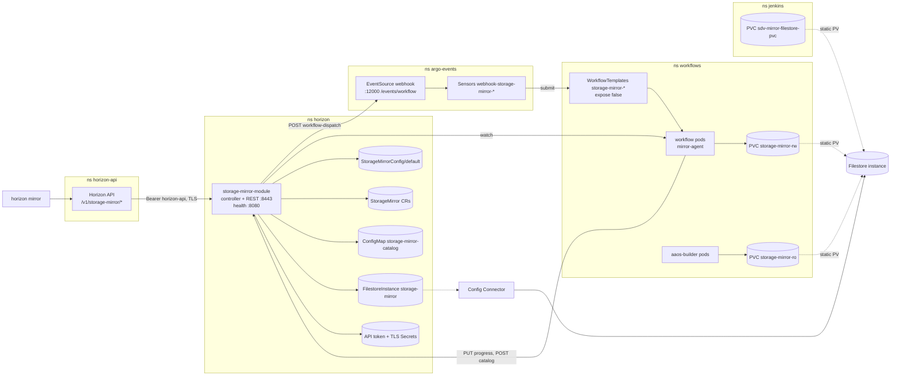
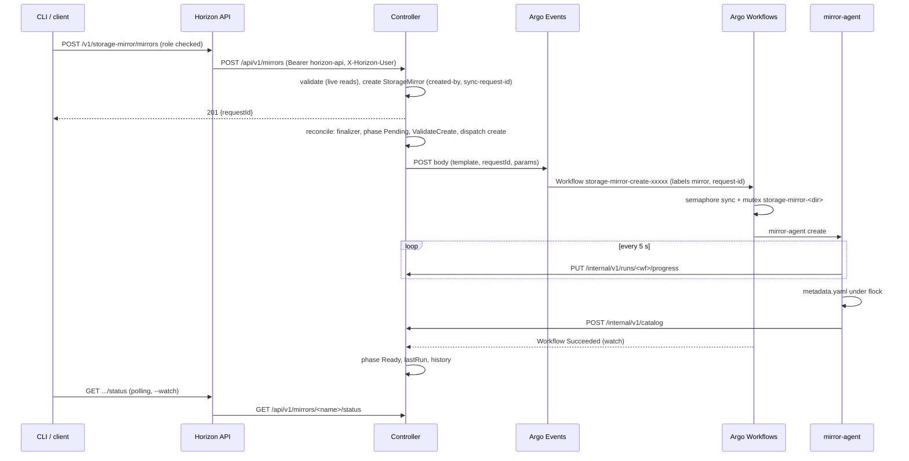
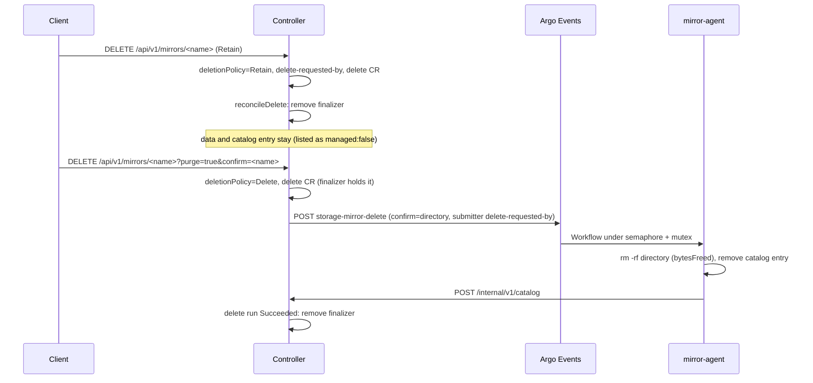

<!-- Copyright (c) 2026 Accenture, All Rights Reserved.

Licensed under the Apache License, Version 2.0 (the "License");
you may not use this file except in compliance with the License.
You may obtain a copy of the License at

        http://www.apache.org/licenses/LICENSE-2.0

Unless required by applicable law or agreed to in writing, software
distributed under the License is distributed on an "AS IS" BASIS,
WITHOUT WARRANTIES OR CONDITIONS OF ANY KIND, either express or implied.
See the License for the specific language governing permissions and
limitations under the License. -->

# TAA-1593 Storage Mirror module: Low Level Design (as built)

This document describes the Storage Mirror module as implemented by the TAA-1593 change set (`git diff main...HEAD` on
the TAA-1593 branch, excluding `docs/`). Every statement is taken from that code, its charts, CRDs, Terraform,
scripts, tests and test harness, or from baseline code they integrate with. It is not a statement of intent.

Verification markers:

- **verified by test** names the unit test (`TestName`), the envtest suite (`internal/crdtest`), the API-server
  scenario of the harness (`sim:` prefix, `run.sh --apiserver-only`) or the kind scenario (`run.sh`).
- **not verified at runtime** marks behaviour that no test exercises (real GCP, Argo CD, Horizon CLI end to end).

Every citation is `<path>:<lines>`. Paths are relative to the repository root, or start with one of these prefixes:

| Prefix | Path |
|---|---|
| `CTL/` | `terraform/modules/sdv-container-images/images/storage-mirror-module/storage-mirror-module-app/` |
| `AGT/` | `terraform/modules/sdv-container-images/images/storage-mirror-module/storage-mirror-sync/` |
| `CH/` | `gitops/modules/storage-mirror-module/` |
| `WF/` | `gitops/modules/storage-mirror-module/argo-workflows/` |
| `HAPI/` | `terraform/modules/sdv-container-images/images/horizon-api/horizon-api-app/` |
| `KC/` | `terraform/modules/sdv-container-images/images/keycloak/keycloak-post-horizon-api/` |
| `CLI/` | `tools/horizon/` |
| `E2E/` | `tools/storage-mirror-e2e/` |
| `AAOS/` | `workloads/android/pipelines/builds/aaos_builder/helm/` |

## 1. Summary and scope

The module adds, as a Module Manager module named `storage-mirror`:

- Two CRDs in group `storagemirror.horizon-sdv.io/v1alpha1` (`CTL/api/v1alpha1/groupversion_info.go:26`):
  `StorageMirrorConfig` (singleton `default`) and `StorageMirror` (one per mirror).
- A controller (`storage-mirror-module-app`) that creates its REST API Secrets, a Config Connector `FilestoreInstance`,
  static PersistentVolumes and claims for the share, starts mirror runs by posting to the Argo Events webhook, derives
  mirror status from Argo Workflows and serves a REST API (`CTL/cmd/manager/main.go:46-165`).
- A workflow image (`storage-mirror-sync`) with `mirror-agent`, `git`, `git-lfs` and `repo` that runs create, sync,
  delete and volume initialisation inside Argo workflow pods (`AGT/cmd/mirror-agent/main.go:15-75`,
  `AGT/Dockerfile:29-54`).
- Four WorkflowTemplates, none exposed to the Horizon API catalog, and four Sensors
  (`WF/templates/workflowtemplates.yaml:14-18`, `WF/templates/sensors.yaml:14-98`).
- Two mirror kinds: `repo` (AOSP `repo init --mirror` / `repo sync`) and `git` (one bare repository), each with
  optional git-lfs (`AGT/internal/mirror/agent.go:317-365`, `AGT/internal/mirror/agent.go:563-590`).
- A Horizon API proxy at `/v1/storage-mirror/*` (`HAPI/internal/api/mirrors.go:54-75`) with an enforced Keycloak
  realm role (`gitops/apps/horizon-api/values.yaml:74`) created by the Keycloak post job
  (`KC/storage-mirror-role.mjs:29-74`).
- Horizon CLI command `horizon mirror` (`CLI/cmd/mirror/mirror.go:33-43`).
- The on-disk layout and catalog of the Jenkins mirror jobs (`/mnt/mirror-filestore-pvc/horizon-mirrors/<dir>`,
  `metadata.yaml`) (`CH/values.yaml:67-70`, `AGT/internal/catalog/catalog.go:15-37`).

Outside the module the change set also moves the GCS buckets `{project}-aaos` and `{project}-openbsw` from Terraform to
Config Connector in `storage-gcs-module` (section 12), lets `aaos-builder` mount the read-only mirror claim
(section 13), makes the Jenkins Sync All job skip non-`repo` catalog entries, and adds a default-off
`RUN_GARBAGE_COLLECTOR` parameter to the Jenkins Sync Mirror job (section 13).

Scope limit in code: the module renders only in the main environment (`CH/templates/_helpers.tpl:17-22`); every module
template is wrapped in that condition.

## 2. Architecture and components



| Component | Namespace | Identity | Source |
|---|---|---|---|
| Controller Deployment `storage-mirror-module` (1 replica), Service, ServiceAccount | `{prefix}horizon` | SA `storage-mirror-module` | `CH/templates/deployment.yaml:15-136` |
| Overview nginx `mod-storage-mirror-overview` | `storage-mirror-overview` | default SA | `CH/templates/module-overview-http.yaml:18-119` |
| Child Application `mod-storage-mirror-argo-workflows` | `argocd` | n/a | `CH/templates/application-argo-workflows.yaml:17-61` |
| WorkflowTemplates, semaphore ConfigMap, SA `storage-mirror-sync` | `{prefix}workflows` | SA `storage-mirror-sync` | `WF/templates/workflowtemplates.yaml:20-285` |
| Sensors | `{prefix}argo-events` | SA `sensor-submit-workflow` (baseline) | `WF/templates/sensors.yaml:18-98` |
| Horizon API proxy | `{prefix}horizon-api` | Keycloak user token | `HAPI/internal/api/mirrors.go:77-168` |

Namespaces are `{namespacePrefix}horizon`, `workflows`, `jenkins`, `horizon-api`, `argo-events`
(`CH/templates/_helpers.tpl:24-42`).

## 3. Package layout

### 3.1 Module chart and catalog entry

| Item | Value | Source |
|---|---|---|
| Catalog entry | `name: storage-mirror`, `path: gitops/modules/storage-mirror-module`, overview service `mod-storage-mirror-overview` in `storage-mirror-overview`, `autoDisableWhenUnused: false` | `gitops/apps/module-manager/templates/module-catalog.yaml:123-129` |
| Soft dependency | `workloads-android` lists `softDependencies: [storage-mirror]` | `gitops/apps/module-manager/templates/module-catalog.yaml:81-83` |
| Parent chart | `storage-mirror-module` 0.1.0, appVersion 0.1.0 | `CH/Chart.yaml:15-20` |
| Child chart | `storage-mirror-module-argo-workflows` 0.1.0 | `WF/Chart.yaml:15-19` |
| CRDs | `CH/crds/storagemirrorconfigs.yaml`, `CH/crds/storagemirrors.yaml`, generated by `CTL/hack/update-crds.sh:26-44` (controller-gen v0.20.0) | `CH/crds/storagemirrors.yaml:14-24` |
| Templates | `storagemirrorconfig.yaml`, `deployment.yaml`, `rbac.yaml`, `network-policies.yaml`, `validating-admission-policy.yaml`, `application-argo-workflows.yaml`, `module-overview-http.yaml`, `_helpers.tpl` | `CH/templates/` |
| Child templates | `workflowtemplates.yaml`, `sensors.yaml`, `_helpers.tpl` | `WF/templates/` |
| Portal page | static `portal/overview.html` served by nginx | `CH/templates/module-overview-http.yaml:41-43` |

The API Secrets are not chart templates; the controller creates them (section 11.2).

### 3.2 Images

| Image | Version in Terraform | Build | Runtime | Source |
|---|---|---|---|---|
| `storage-mirror-module-app` | 0.1.0 | `golang:${GO_VERSION}-bookworm`, `go build ./cmd/manager` | `gcr.io/distroless/static-debian12:nonroot` | `terraform/modules/base/locals.tf:51-55`, `CTL/Dockerfile:15-34` |
| `storage-mirror-sync` | 0.1.0 | `golang:${GO_VERSION}-bookworm`, `go build ./cmd/mirror-agent` | `debian:12-slim` + `git git-lfs python3 gnupg curl ca-certificates`, `repo` launcher verified with GPG key `8BB9AD79…5C65`, user `horizon-sdv-mirror-ops` (UID 1000) | `terraform/modules/base/locals.tf:56-60`, `AGT/Dockerfile:17-54` |
| `horizon-api-app` | 1.1.2 → 1.2.0 | baseline | baseline | `terraform/modules/base/locals.tf:155-159` |
| `keycloak-post-horizon-api` | 1.0.0 → 1.1.0 | adds `storage-mirror-role.mjs` | baseline | `terraform/modules/base/locals.tf:131-135`, `KC/Dockerfile:20` |

Go modules: controller `storage-mirror-module` (go 1.27.0, controller-runtime v0.23.3, k8s.io/api v0.35.5,
robfig/cron v3.0.1, sigs.k8s.io/yaml v1.6.0) (`CTL/go.mod:15-28`); agent `storage-mirror-sync` (go 1.27.0,
creack/pty v1.1.24, gopkg.in/yaml.v3 v3.0.1) (`AGT/go.mod:15-23`). Both Dockerfiles take the Go image patch from the
`GO_VERSION` build argument (`CTL/Dockerfile:15-16`, `AGT/Dockerfile:17-18`), which Terraform passes to every image from
`tools.go.version` in `versions.yaml` (`terraform/modules/base/locals.tf:34`, `terraform/modules/base/main.tf:215-221`).

Image references reach the charts through MODULE_CONFIG `containerImages.storageMirrorModule` and
`containerImages.storageMirrorSync` (`terraform/modules/sdv-gke-apps/main.tf:558-559`).

## 4. CRDs

Both CRDs carry `argocd.argoproj.io/sync-options: Delete=false,Prune=false` (`CH/crds/storagemirrors.yaml:23`,
`CH/crds/storagemirrorconfigs.yaml:23`). Behaviour of Argo CD on module disable: **not verified at runtime**.

CEL and OpenAPI rules are applied to a real kube-apiserver 1.35 in **`internal/crdtest` `TestConfigCEL`,
`TestMirrorCEL`** (`CTL/internal/crdtest/crd_test.go:114-219`) and in the kind and API-server scenarios `CEL: ...`
(**verified by test**).

### 4.1 StorageMirrorConfig (`smc`)

Namespaced, status subresource, print columns Volume and Capacity. Rule: `self.metadata.name == 'default'`
(`CTL/api/v1alpha1/types.go:262-276`). The chart renders the single object `default` in `{prefix}horizon` with sync
wave 2 and no finalizer (`CH/templates/storagemirrorconfig.yaml:15-66`).

`spec.volume` (`CTL/api/v1alpha1/types.go:63-97`):

| Field | Type | Default | Validation | Used by |
|---|---|---|---|---|
| `resourceID` | string | `sdv-storage-mirror` | immutable | Filestore name (`CTL/internal/volume/volume.go:57-66`) |
| `existingInstance` | string | | immutable | replaces `resourceID` as the GCP instance name (`CTL/internal/volume/volume.go:59-61`) |
| `capacityGb` | int64 | (chart 2048) | required, 1024..102400; CEL `self < 10240 ? (self % 256 == 0 && self <= 9984) : self % 2560 == 0`; `self >= oldSelf` | instance and PV size (`CTL/api/v1alpha1/types.go:74-80`) |
| `tier` | string | `ZONAL` | | `CTL/internal/volume/volume.go:113-116` |
| `zone` | string | | required | instance location, CSI volume handle |
| `network` | string | | required | `projects/<project>/global/networks/<network>` (`CTL/internal/volume/volume.go:106-109`) |
| `reservedIpRange` | string | | | optional instance network field (`CTL/internal/volume/volume.go:110-112`) |
| `shareName` | string | `mirror` | | file share name (`CTL/internal/volume/volume.go:68-74`) |
| `allowDestroy` | bool | false | | Git half of the volume destroy (`CTL/internal/api/volume.go:70-73`) |

The capacity CEL rule is the same rule as `ValidateCapacity` (`CTL/internal/volume/volume.go:273-291`).
**Verified by test** `TestConfigCEL` (10000, 10496, 11000 rejected; 12800 accepted) and `TestValidateCapacity`.

`spec.layout` (`CTL/api/v1alpha1/types.go:99-109`), whole object immutable (`self == oldSelf`): `rootSubdir` (default
`horizon-mirrors`, pattern `^[A-Za-z0-9][A-Za-z0-9._-]{0,99}$`, so a single path component). The controller uses it as
the catalog root key (`CTL/internal/controller/config_controller.go:336-343`); mirror-agent derives the same key as the
basename of the root directory (`AGT/internal/catalog/catalog.go:56-57`). The pod mount path is not a CRD field; it is
the chart value `mirror.layout.mountPath` rendered into the WorkflowTemplates
(`CH/templates/application-argo-workflows.yaml:46`). **Verified by test** `TestConfigCEL` (`a/b` rejected).

`spec.defaults` (`CTL/api/v1alpha1/types.go:111-147`): `repo.{manifestUrl, manifestRef, manifestFile, syncJobs,
syncTimeout}`, `git.{branches, excludeRefs, syncTimeout}`, `lfs` (enum `Disabled|Enabled|Auto`, default `Disabled`).
Read by `dispatch.MirrorRunParams` (`CTL/internal/dispatch/dispatch.go:186-239`).

`spec.schedules[]` (`CTL/api/v1alpha1/types.go:149-159`): `name`, `cron`, `timeZone` (default `UTC`), `selector` (label
selector over StorageMirror labels; empty selects all). Read by the scheduler (section 5.4).

`spec.retention` (`CTL/api/v1alpha1/types.go:161-175`):

| Field | Default | Behaviour |
|---|---|---|
| `syncHistoryLimit` | 10 | length of `status.history` (`CTL/internal/controller/status.go:33-36`, `CTL/internal/controller/status.go:186-197`) |
| `pruneRefs` | | `pruneRefs` run parameter (`CTL/internal/dispatch/dispatch.go:193`) |
| `gc` | `Aggressive` (enum `Aggressive|Auto|None`) | `gc` run parameter (`CTL/internal/dispatch/dispatch.go:192`) |
| `staleAfterDays` | 14 | `Stale` condition (`CTL/internal/controller/status.go:91-100`) |

`spec.consumers` (`CTL/api/v1alpha1/types.go:177-210`): `jenkins.{enabled, namespace=jenkins,
claimName=sdv-mirror-filestore-pvc, readOnly}`, `workflows.{namespace=workflows, rwClaimName=storage-mirror-rw,
roClaimName=storage-mirror-ro}`.

`spec.adoptExisting` (`CTL/api/v1alpha1/types.go:225-227`): import catalog entries without a CR (section 5.7).

The Argo semaphore value (`mirror.concurrency.maxParallelSyncs`) is a chart value only and is not part of the CRD
(`CH/values.yaml:87-89`, `WF/templates/workflowtemplates.yaml:240-252`).

Status (`CTL/api/v1alpha1/types.go:230-260`): `observedGeneration`, `volume.{phase, instanceName, ip, capacityGb,
usedBytes, availableBytes, usageReportedAt}`, `volumeInitRequestId`, `volumeInitRequestedAt`, `conditions`.

Conditions set by the controller (`CTL/internal/controller/config_controller.go:110-212`,
`CTL/internal/controller/config_controller.go:262-292`):

| Type | Status / Reason |
|---|---|
| `VolumeReady` | `True/Ready`; `False/Provisioning`, `False/InstanceError`, `False/Destroyed` |
| `ConsumersReady` | `True/Bound`; `False/JenkinsClaimConflict`, `False/Error` |
| `ResizeAccepted` | `True/Steady`, `True/Resizing`, `False/ResizeRejected` |
| `VolumeInitialized` | `True/CatalogReported`; `False/Pending` |

`status.volume.phase` values: `Provisioning`, `Ready`, `Destroyed` (`CTL/internal/controller/config_controller.go:123`,
`CTL/internal/controller/config_controller.go:150-153`).

### 4.2 StorageMirror (`smir`)

Namespaced, status subresource; rule `size(self.metadata.name) <= 63`; print columns Kind, Phase, Progress
(`.status.currentRun.progress.overallPercent`), Last-Sync (`CTL/api/v1alpha1/types.go:454-470`).

`spec` (`CTL/api/v1alpha1/types.go:319-352`), with rule `self.kind == 'Repo' ? !has(self.git) : (has(self.git) &&
!has(self.repo))` (`CTL/api/v1alpha1/types.go:320`):

| Field | Type | Default | Validation |
|---|---|---|---|
| `kind` | string | | required, enum `Repo|Git`, immutable |
| `directory` | string | (`metadata.name` at use) | pattern `^[A-Za-z0-9][A-Za-z0-9._-]{0,99}$`, immutable, `!= 'metadata.yaml'` |
| `repo.manifestUrl` | string | | immutable |
| `repo.manifestRef`, `repo.manifestFile` | string | | |
| `repo.syncJobs` | int32 | | minimum 1 |
| `git.url` | string | | required, pattern `^https://`, immutable |
| `git.branches` | []string | | |
| `git.credentialsSecretRef.name` | string | | Secret in the workflows namespace |
| `lfs` | string | `Inherit` | enum `Inherit|Disabled|Enabled|Auto` |
| `schedule` | string | `Inherit` | `Inherit`, `None` or a cron expression (not validated by the CRD) |
| `suspend` | bool | | |
| `syncTimeout` | string | | GNU timeout format, not validated by the CRD |
| `deletionPolicy` | string | `Retain` | enum `Retain|Delete` |

Sources: `CTL/api/v1alpha1/types.go:287-317` (repo, git, secret ref), `CTL/api/v1alpha1/types.go:319-352` (spec).
`DirectoryOrName()` returns `spec.directory` or `metadata.name` (`CTL/api/v1alpha1/types.go:485-491`). A `Repo` mirror
without `spec.repo` passes the CRD; the API and the controller then require a manifest URL and ref from the config
defaults (section 5.3).

`status` (`CTL/api/v1alpha1/types.go:424-452`): `observedGeneration`, `phase`, `catalogStatus`,
`lastSuccessfulSyncTime`, `lastHandledSyncRequest`, `pendingRequestId`, `pendingRequestAt`, `lfsDetected`,
`currentRun`, `lastRun`, `history[]`, `conditions`.

`RunStatus` (`CTL/api/v1alpha1/types.go:401-422`): `workflowName`, `template`, `requestId`, `submittedBy`, `phase`,
`startedAt`, `finishedAt`, `message`, `progress`.

`Progress` (`CTL/api/v1alpha1/types.go:354-399`): `phase`, `state`, `attempt`, `maxAttempts`, `projectsDone`,
`projectsTotal`, `currentProject`, `refsUpdated`, `objectsReceived`, `objectsTotal`, `bytesReceived`, `bytesFreed`
(delete runs), `lfsObjectsDone`, `lfsObjectsTotal`, `phasePercent`, `overallPercent`, `elapsedSeconds`, `etaSeconds`,
`updatedAt`, `stale`, `message`.

Phases (`CTL/api/v1alpha1/types.go:39-44`): `Pending`, `Initializing`, `Syncing`, `Ready`, `Error`, `Deleting`.
Conditions: `Ready` (reason = phase), `Stale` (`Fresh`/`NotSyncedRecently`), `Dispatched` (`InvalidSpec`,
`DispatchFailed`, `Suspended`), `Deleted` (`DeleteFailed`) (`CTL/internal/controller/status.go:91-105`,
`CTL/internal/controller/mirror_controller.go:186-213`, `CTL/internal/controller/mirror_controller.go:308`).

Labels and annotations used on CRs, Workflows and Secrets:

| Key | Where | Source |
|---|---|---|
| `storagemirror.horizon-sdv.io/data` | finalizer on every StorageMirror | `CTL/api/v1alpha1/types.go:46-47` |
| `horizon-sdv.io/module=storage-mirror` | Workflows, PVs, PVCs, FilestoreInstance, catalog ConfigMap, API Secrets | `CTL/api/v1alpha1/types.go:55`, `CTL/api/v1alpha1/types.go:60` |
| `storagemirror.horizon-sdv.io/mirror` | Workflows | `CTL/api/v1alpha1/types.go:56` |
| `storagemirror.horizon-sdv.io/request-id` | Workflows | `CTL/api/v1alpha1/types.go:57` |
| `storagemirror.horizon-sdv.io/kind` | StorageMirror (`repo`/`git`) | `CTL/api/v1alpha1/types.go:58`, `CTL/internal/api/mirrors.go:237` |
| `storagemirror.horizon-sdv.io/access` | PVs (`rw`/`ro`) | `CTL/api/v1alpha1/types.go:59`, `CTL/internal/volume/volume.go:203` |
| `storagemirror.horizon-sdv.io/sync-requested-at`, `sync-request-id`, `sync-requested-by`, `submitted-from` | StorageMirror annotations (sync or create request) | `CTL/api/v1alpha1/types.go:49`, `CTL/internal/controller/mirror_controller.go:45-56` |
| `storagemirror.horizon-sdv.io/created-by` | StorageMirror annotation | `CTL/api/v1alpha1/types.go:53` |
| `storagemirror.horizon-sdv.io/delete-request-id`, `delete-requested-by` | StorageMirror annotations (purge run ID and submitter) | `CTL/api/v1alpha1/types.go:50-52` |
| `storagemirror.horizon-sdv.io/imported-status`, `imported-by` | imported StorageMirror annotations | `CTL/internal/controller/status.go:27-28`, `CTL/internal/controller/import.go:95` |
| `storagemirror.horizon-sdv.io/volume-destroyed` | StorageMirrorConfig annotation | `CTL/internal/controller/config_controller.go:46-47` |

## 5. Controller

### 5.1 Process

`main` (`CTL/cmd/manager/main.go:46-165`):

- Environment: `MANAGER_NAMESPACE` (default `horizon`), `WORKFLOW_NAMESPACE` (`workflows`), `JENKINS_NAMESPACE`
  (`jenkins`; empty disables the Jenkins claim cache), `GOOGLE_CLOUD_PROJECT`, `EVENTS_WEBHOOK_URL`,
  `HORIZON_API_NAMESPACE` (`horizon-api`), `API_TOKEN_SECRET` (`storage-mirror-module-api-token`), `API_TLS_SECRET`
  (`storage-mirror-module-api-tls`), `API_SERVICE_NAME` (`storage-mirror-module`), `API_TLS_ADDR` (`:8443`),
  `API_HTTP_ADDR` (`:8080`), `POD_NAMESPACE`, `TEST_NFS_SERVER`, `TEST_NFS_PATH` (`CTL/cmd/manager/main.go:48-71`,
  `CTL/cmd/manager/main.go:117-122`, `CTL/cmd/manager/main.go:143-153`).
- Before the manager starts, `secrets.Ensure` creates or reuses the API Secrets with an uncached client and returns the
  token map and server certificate (`CTL/cmd/manager/main.go:63-82`; section 11.2).
- Cache: default namespace is the controller namespace; PVCs are cached in the controller, workflows and Jenkins
  namespaces; Workflows (unstructured) in the workflows namespace only (`CTL/cmd/manager/main.go:83-101`).
- Leader election ID `storage-mirror-module.storagemirror.horizon-sdv.io`; metrics and probe servers disabled
  (`CTL/cmd/manager/main.go:102-107`).
- Registers `ConfigReconciler`, `MirrorReconciler` and the `Scheduler` runnable (`CTL/cmd/manager/main.go:123-137`).
- API server: `Client` and `Reader` are the manager client (cache reads), `APIReader` is the manager API reader
  (`CTL/cmd/manager/main.go:139-142`). Every read that a write or a dispatch decision depends on uses `APIReader`
  (`CTL/internal/api/server.go:48-83`; section 9.1).
- Starts the health server (`GET /health`) and the TLS API (min TLS 1.2, in-memory certificate) in goroutines before
  `mgr.Start`; both run independently of leader election (`CTL/cmd/manager/main.go:143-159`). The Deployment has 1
  replica (`CH/templates/deployment.yaml:26`).

### 5.2 Run dispatch through Argo Events

`dispatch.Dispatcher.Dispatch` (`CTL/internal/dispatch/dispatch.go:130-169`) posts JSON to `EVENTS_WEBHOOK_URL`
(chart: `http://webhook-eventsource-svc.{prefix}argo-events.svc.cluster.local:12000/events/workflow`,
`CH/templates/deployment.yaml:70-71`) with a 25 s timeout; non-2xx is an error. The webhook does not return a Workflow
name; the controller correlates runs by `requestId` (24 hex characters, `CTL/internal/dispatch/dispatch.go:90-95`).

Body (`CTL/internal/dispatch/dispatch.go:97-128`): `workflowTemplateName`, `workflowTemplateNamespace`,
`horizonModule=storage-mirror`, `horizonSubmittedBy`, `horizonSubmittedFrom` (default `api`) and one field per template
parameter except `horizonSubmittedFrom`. Values containing CR or LF are rejected; `requestId` is required.

Parameter order (shared with the chart; **verified by test** `TestParamOrderMatchesChart`):

| Template | Parameters (index 0..n) | Source |
|---|---|---|
| `storage-mirror-create`, `storage-mirror-sync` | 0 `horizonSubmittedFrom`, 1 `requestId`, 2 `mirror`, 3 `directory`, 4 `kind`, 5 `manifestUrl`, 6 `manifestRef`, 7 `manifestFile`, 8 `syncJobs`, 9 `gitUrl`, 10 `gitBranches`, 11 `gitCredentialsSecret`, 12 `lfs`, 13 `syncTimeout`, 14 `pruneRefs`, 15 `excludeRefs`, 16 `gc`, 17 `submittedBy` | `CTL/internal/dispatch/dispatch.go:47-54`, `WF/templates/_helpers.tpl:21-23` |
| `storage-mirror-delete` | 0 `horizonSubmittedFrom`, 1 `requestId`, 2 `mirror`, 3 `directory`, 4 `confirm` | `CTL/internal/dispatch/dispatch.go:56-57`, `WF/templates/_helpers.tpl:24-26` |
| `storage-mirror-volume-init` | 0 `horizonSubmittedFrom`, 1 `requestId` | `CTL/internal/dispatch/dispatch.go:59-60`, `WF/templates/_helpers.tpl:27-29` |

`MirrorRunParams` (`CTL/internal/dispatch/dispatch.go:186-239`) merges the mirror with `StorageMirrorConfig` defaults:

| Parameter | Value |
|---|---|
| `mirror`, `directory`, `kind` | `metadata.name`, `DirectoryOrName()`, lower-case kind |
| `gc`, `pruneRefs` | `retention.gc`, `retention.pruneRefs` joined by `,` |
| `lfs` | `spec.lfs`, or `defaults.lfs` when `Inherit`/empty, else `Disabled`; lower case |
| git: `gitUrl`, `gitBranches`, `gitCredentialsSecret`, `excludeRefs`, `syncTimeout` | spec, `defaults.git.branches`, secret name, `defaults.git.excludeRefs`, spec → defaults → `6h` |
| repo: `manifestUrl`, `manifestRef`, `manifestFile`, `syncJobs`, `syncTimeout` | spec → defaults; file → `default.xml`; jobs → 3; timeout → `20h` |

`ValidateCreate` (`CTL/internal/dispatch/dispatch.go:171-184`) requires `gitUrl` for git, and `manifestUrl` and
`manifestRef` for repo, in the merged parameters of a create.

**Verified by test** `TestMirrorRunParamsDefaults`, `TestBodyCarriesEveryParameter`, `TestBodyRejectsMultiline`,
`TestDispatchPosts`; kind scenarios `create repo mirror`, `create git mirror`.

### 5.3 MirrorReconciler

Watches StorageMirror, module Workflows in the workflows namespace (mapped to the CR named by the `mirror` label) and
a channel the REST API uses to wake it (`CTL/internal/controller/mirror_controller.go:122-145`).

Reconcile (`CTL/internal/controller/mirror_controller.go:147-225`):

1. List the mirror's Workflows (`ListRuns`, label `horizon-sdv.io/module=storage-mirror` and `mirror=<name>`, oldest
   first; `CTL/internal/controller/workflows.go:110-127`).
2. CR not found: nothing happens. Workflows of a mirror without a CR (deleted, or posted straight to the webhook) are not
   adopted; `POST /api/v1/import` brings their catalog entry under management
   (`CTL/internal/controller/mirror_controller.go:154-160`).
3. `StorageMirrorConfig/default` missing: requeue after 1 minute.
4. Deletion timestamp set: delete handling (section 5.5).
5. Add the finalizer `storagemirror.horizon-sdv.io/data`.
6. `ComputeStatus` (below). `active` = current run, pending request, or an in-memory in-flight dispatch.
7. If no `storage-mirror-create` run exists, phase is `Pending`, nothing is active and the mirror was not imported
   (no `imported-status` annotation): if `ValidateCreate` fails, `Dispatched=False/InvalidSpec` and no dispatch;
   otherwise dispatch create (`CTL/internal/controller/mirror_controller.go:185-197`,
   `CTL/internal/controller/mirror_controller.go:227-232`).
8. Else if `sync-requested-at` differs from `status.lastHandledSyncRequest`: record it as handled; if active the request
   is folded into the active run; if `spec.suspend` the `Dispatched` condition becomes `False/Suspended`; otherwise
   dispatch sync (`CTL/internal/controller/mirror_controller.go:198-215`).
9. Write status; requeue after 15 s while a run is current or pending, else after 10 minutes.

An imported mirror therefore waits for a sync request; the sync run creates the mirror when its directory is missing
(section 8.2). **Verified by test** `TestImportedUninitializedWaitsForSync`, `TestCreateNotDispatchedWithoutManifest`,
`TestWorkflowWithoutCRIsNotAdopted`; `sim: a create Workflow without a StorageMirror is not adopted`.

`dispatchMirror` (`CTL/internal/controller/mirror_controller.go:254-274`) uses the `sync-request-id` annotation as
`requestId` unless it is empty, equal to the pending ID or already present in `lastRun`/`history`, in which case a new ID
is generated. Submitter: `created-by` annotation for create, `sync-requested-by` for sync, else `storage-mirror-module`.
Submitted from: `submitted-from` annotation.

In-flight guard (`CTL/internal/controller/mirror_controller.go:74-113`): after a dispatch the controller remembers
`(mirror, requestId, time)` until a Workflow with that request ID appears or `pendingRequestTTL` (2 min,
`CTL/internal/controller/mirror_controller.go:53`) passes. **Verified by test** `TestNewMirrorDispatchesCreateOnce`
(stale CR read without `pendingRequestId` does not dispatch twice) and `sim: sync while a request is pending is folded
into it`.

`ComputeStatus` (`CTL/internal/controller/status.go:30-106`):

- A Workflow whose request ID equals `pendingRequestId` clears it; a pending request older than 2 minutes is dropped.
- Finished runs are upserted into `history` (newest first, limit `syncHistoryLimit`, default 10) and become `lastRun`
  if not older; a Succeeded create or sync updates `lastSuccessfulSyncTime`; the live progress entry is forgotten.
- The active run becomes `currentRun` with progress from the live store (section 8.5), else from Argo's `N/M` node
  progress marked `stale`, else the previous progress of the same run.
- Phase (`CTL/internal/controller/status.go:109-140`): active create → `Initializing`/catalog `syncing`; active delete
  → `Deleting`; other active run → `Syncing`/`syncing`; last run Succeeded → `Ready`/`ready`; last run not Succeeded →
  `Error`/`error`; `imported-status` annotation `ready` → `Ready`, `uninitialized` → `Pending`, other → `Error`;
  previous phase; else `Pending`/`uninitialized`. A deletion timestamp forces `Deleting`.
- `Ready` condition is True for `Ready`, or `Syncing` with a previous successful sync.

Status writes skip progress-only changes within 15 s (`statusChanged`,
`CTL/internal/controller/mirror_controller.go:384-410`). **Verified by test** `TestRunsDriveStatusAndProgress`,
`TestSyncRequestDispatchesAndDeduplicates`; kind scenarios `repo mirror reaches Ready`, `sync finishes Ready`,
`Syncing phase with fetch progress observed`, `cancelled run leaves phase Error`, `history keeps the run across the
restart`.

Run model (`CTL/internal/controller/workflows.go:35-95`): template from label
`workflows.argoproj.io/workflow-template` or `spec.workflowTemplateRef.name`; mirror and request ID from labels or the
`mirror`/`requestId` parameters; submitter from annotation `horizon-sdv.io/submitted-by`. `Active()` = phase empty,
`Pending` or `Running`.

### 5.4 Scheduler

`Scheduler` runs on the leader only (`CTL/internal/controller/scheduler.go:32-46`), ticks every minute, and on start
looks back one hour for missed ticks (`CTL/internal/controller/scheduler.go:49-71`). Each tick
(`CTL/internal/controller/scheduler.go:80-114`) skips suspended and deleting mirrors, computes the latest due time in
`(previous tick, now]` and, unless a run is current, pending or started at or after that time, calls `RequestSync` with
submitter `storage-mirror-scheduler` and submitted-from `api`.

`DueAt` (`CTL/internal/controller/scheduler.go:116-163`): `schedule: None` → never; `Inherit`/empty → every config
schedule whose selector matches the mirror labels, in its `timeZone`; any other value is parsed as a 5-field cron (or
descriptor) in UTC. Parser: minute, hour, day of month, month, day of week, descriptors
(`CTL/internal/controller/scheduler.go:43`).

`RequestSync` (`CTL/internal/controller/scheduler.go:175-189`) merge-patches annotations `sync-requested-at` (RFC 3339
nano), `sync-request-id`, `sync-requested-by`, `submitted-from`; the MirrorReconciler dispatches.

**Verified by test** `TestDueAt`. Scheduled runs on a cluster: **not verified at runtime**.

### 5.5 Finalizer and delete semantics

`reconcileDelete` (`CTL/internal/controller/mirror_controller.go:288-348`):

- `deletionPolicy` other than `Delete` (Retain): remove the finalizer. No Workflow runs; the data and catalog entry
  stay.
- `Delete`: if `delete-request-id` is set and its `storage-mirror-delete` run Succeeded, remove the finalizer; if that
  run finished otherwise, set `Deleted=False/DeleteFailed` and retry in 1 minute; while it is active or was requested
  less than 2 minutes ago, wait. While a create or sync is active, wait. Otherwise dispatch `storage-mirror-delete` with
  `confirm = directory` and submitter = `delete-requested-by` annotation (else `storage-mirror-module`), store
  `delete-request-id`, set phase `Deleting`.

The REST API sets `deletionPolicy` and `delete-requested-by` before deleting: `Retain` without `purge`, `Delete` with
`purge=true` and `confirm` equal to the name or directory (`CTL/internal/api/mirrors.go:540-573`).

**Verified by test** `TestDeleteRetainReleasesFinalizer`, `TestDeletePurgeWaitsForDeleteRun` (submitter from
`delete-requested-by`), `TestCreateSyncDelete`; API-server scenarios `sim: CR kept until the delete run succeeds`,
`sim: CR released after the delete run`, `sim: Retain delete releases the CR without a delete run`; kind scenarios
`retain delete removes the CR`, `retain delete keeps the data`, `purge: CR released after the delete run`,
`purge: directory removed`, `purge: catalog entry removed`.

### 5.6 ConfigReconciler and volume

Watches `StorageMirrorConfig`, module Workflows without a `mirror` label (volume-init), the `FilestoreInstance`
(unless the test driver is active) and the API wake channel (`CTL/internal/controller/config_controller.go:84-107`).
Only the object named `default` is reconciled (`CTL/internal/controller/config_controller.go:110-114`).

Reconcile (`CTL/internal/controller/config_controller.go:110-177`):

1. Annotation `volume-destroyed=true`: `volume.phase=Destroyed`, `VolumeReady=False/Destroyed`, stop.
2. Ensure the FilestoreInstance (below). Without `Ready=True` and an IP: `Provisioning`, requeue in 30 s.
3. Ensure consumers: static PVs and claims (below).
4. Catalog: volume-init and usage (section 5.8).
5. Requeue after 1 minute while `VolumeInitialized` is not True, else after 5 minutes.

`ensureInstance` (`CTL/internal/controller/config_controller.go:179-212`): `ValidateCapacity`
(`CTL/internal/volume/volume.go:273-291`: 1024..102400; below 10240 a multiple of 256 and at most 9984; from 10240 a
multiple of 2560). Missing instance → create. Larger `capacityGb` → update `spec.fileShares[0].capacityGb`
(`ResizeAccepted=True/Resizing`); smaller → `ResizeRejected`, no update.

FilestoreInstance object (`CTL/internal/volume/volume.go:95-125`): `filestore.cnrm.cloud.google.com/v1beta1`, name
`storage-mirror` in the controller namespace, annotations `cnrm.cloud.google.com/project-id` and
`cnrm.cloud.google.com/deletion-policy: abandon`, spec `resourceID`, `location=zone`, `tier`,
`fileShares[{name, capacityGb}]`, `networks[{networkRef.external, modes:[MODE_IPV4], reservedIpRange?}]`. The IP is read
from the first `ipAddresses` entry under `status.observedState.networks`, `status.networks` or `spec.networks`
(`CTL/internal/volume/volume.go:169-190`). **Verified by test** `TestFilestoreInstanceAbandonAndShape`,
`TestInstanceIPAndReady`, `TestConfigReconcileCreatesInstanceThenClaims`. Against real Config Connector: **not verified
at runtime**.

Consumers (`CTL/internal/volume/volume.go:76-93`):

| PV | Claim | Access | Condition |
|---|---|---|---|
| `storage-mirror-workflows-rw` | `workflows/storage-mirror-rw` | RWX | always |
| `storage-mirror-workflows-ro` | `workflows/storage-mirror-ro` | ROX, CSI `readOnly` | always |
| `storage-mirror-jenkins` | `jenkins/sdv-mirror-filestore-pvc` | ROX if `jenkins.readOnly`, else RWX | `jenkins.enabled` |

PV (`CTL/internal/volume/volume.go:192-221`): capacity `<capacityGb>Gi`, reclaim `Retain`, storage class
`storage-mirror-static` (binding key, no provisioner), pre-bound `claimRef`, CSI driver `filestore.csi.storage.gke.io`,
volume handle `modeInstance/<zone>/<instance>/<share>`, attributes `ip`, `volume=<share>`. Claim
(`CTL/internal/volume/volume.go:244-266`): same class, `volumeName` = PV, request `ClaimRequestGb` (1024 GiB) whatever
the share size, module label. The claims bind statically by `volumeName`, so the request is only a lower bound for
binding; Kubernetes does not resize statically bound claims, so only the PV follows a resize
(`CTL/internal/volume/volume.go:40-43`).

`ensureConsumers` (`CTL/internal/controller/config_controller.go:214-241`): an existing claim without the module label
is reported as a conflict (`ConsumersReady=False/JenkinsClaimConflict`) and left untouched; an existing PV without the
module label is an error; an existing PV gets its capacity updated (`CTL/internal/controller/config_controller.go:243-260`);
claims are created only when missing. **Verified by test** `TestConsumersAndPV` (claim request fixed at 1Ti while the PV
is 20Ti), `TestConfigReconcileCreatesInstanceThenClaims` (foreign Jenkins claim untouched); kind scenarios `Jenkins claim
sdv-mirror-filestore-pvc is Bound`, `Jenkins PV is read-only`.

Test volume driver: with `TEST_NFS_SERVER` set, no FilestoreInstance is created or watched, `instanceName=test-nfs`,
and PVs use an `nfs:` source (`CTL/internal/controller/config_controller.go:129-134`,
`CTL/internal/controller/config_controller.go:227-230`, `CTL/internal/volume/volume.go:223-242`). The chart never sets
it (`CH/templates/deployment.yaml:57-79`). **Verified by test** `TestConfigReconcileTestNFSDriver`; used by both harness
modes.

### 5.7 Import

`Import` (`CTL/internal/controller/import.go:72-106`) creates a `Retain` StorageMirror for each catalog entry whose
directory has no CR (optionally limited to given names), skipping `git` entries without `repository_url`. Name:
`CRName(dir)` (lower case, invalid characters to `-`, at most 63, fallback `mirror`;
`CTL/internal/controller/import.go:33-44`). Spec from the entry: `type git` → `Git{url=repository_url, branches}`, else
`Repo{manifest_url, manifest_ref, manifest_file, repo_sync_jobs}`; annotations `imported-status=<status>`, `created-by`,
`imported-by=<source>` (`CTL/internal/controller/import.go:46-70`). Called by `POST /api/v1/import` (source
`api:<user>`) and by the ConfigReconciler when `adoptExisting` is true (source `adoptExisting`,
`CTL/internal/controller/config_controller.go:283-290`). Imported mirrors are never created automatically (section 5.3).

**Verified by test** `TestImportCreatesRetainCRs`, `TestImportedUninitializedWaitsForSync`; kind `import brings it back
under management`.

### 5.8 Catalog snapshot

The agent is the only writer of `metadata.yaml` (section 6). The controller keeps the last report in ConfigMap
`storage-mirror-catalog` in its namespace with keys `metadata.yaml`, `usage.json`, `reportedAt` (RFC 3339)
(`CTL/internal/catalog/catalog.go:34-40`, `CTL/internal/catalog/catalog.go:102-126`), written by
`POST /internal/v1/catalog` after the YAML parses with the configured root key (`CTL/internal/api/volume.go:182-209`).

While the ConfigMap does not exist, `VolumeInitialized=False/Pending` and `maybeVolumeInit`
(`CTL/internal/controller/config_controller.go:294-334`) dispatches `storage-mirror-volume-init` with submitter
`storage-mirror-module` unless a volume-init run is active or the last request is younger than 2 minutes (no Workflow
with its ID seen) or 15 minutes (Workflow seen) (`CTL/internal/controller/config_controller.go:49-55`). When the
ConfigMap exists: `VolumeInitialized=True/CatalogReported`; `usage.json` sets `status.volume.usedBytes`,
`availableBytes`, `usageReportedAt`. The volume destroy deletes the ConfigMap (section 9.1).

**Verified by test** `TestVolumeInitLostDispatchIsResent`, `TestCatalogReportAndUnmanagedList`; `sim: volume-init
dispatched once`; kind `volume-init reported the catalog (VolumeInitialized=True)`.

## 6. Storage and on-disk layout

Paths (`AGT/internal/mirror/config.go:102-103`, `AGT/internal/mirror/config.go:129-136`, `CH/values.yaml:67-70`):

| Path | Content |
|---|---|
| `/mnt/mirror-filestore-pvc` | share root, group 1000 with setgid (volume-init) |
| `/mnt/mirror-filestore-pvc/horizon-mirrors/` | root subdirectory |
| `…/horizon-mirrors/metadata.yaml` | catalog |
| `…/horizon-mirrors/<directory>/` | one mirror; `repo`: `.repo/` plus bare project repositories; `git`: one bare repository |
| `…/horizon-mirrors/.storage-mirror/catalog.lock` | flock file |
| `…/horizon-mirrors/.storage-mirror/progress/<directory>.json` | last progress snapshot of a run |

Volume-init permissions step (`WF/templates/workflowtemplates.yaml:210-236`), as root in busybox: `chown :1000` and
`chmod g+ws` on the share root, create `.storage-mirror/progress`, `chown -R :1000` the root subdirectory,
`chmod -R g+ws .storage-mirror`, `chmod g+ws` the root subdirectory.

### 6.1 metadata.yaml

Format (`AGT/internal/catalog/catalog.go:15-37`, `AGT/internal/catalog/catalog.go:186-206`): one top-level key equal to
the root subdirectory name (`horizon-mirrors`), one mapping per mirror directory, every value a YAML string (`!!str`),
two-space indent; an empty root is written as `{}`. Unknown keys and key order are preserved (yaml.v3 node tree). Writes
run under an exclusive `flock` on `catalog.lock` (polled every 0.5 s, 5-minute timeout) and replace the file atomically
through a temp file, `fsync`, `chmod 0664` and `rename` (`AGT/internal/catalog/catalog.go:218-280`).

Keys written by the agent (`AGT/internal/mirror/agent.go:152-205`, `AGT/internal/mirror/agent.go:214-222`,
`AGT/internal/mirror/agent.go:249-256`, `AGT/internal/mirror/agent.go:413-418`, `AGT/internal/mirror/agent.go:457-460`,
`AGT/internal/mirror/agent.go:654-657`):

| Key | Kind | Written | Value |
|---|---|---|---|
| `name` | both | entry creation | directory |
| `type` | both | entry creation | `repo` or `git` |
| `manifest_url` | repo | entry creation | manifest URL |
| `manifest_ref`, `manifest_file`, `repo_sync_jobs` | repo | creation and after init; `repo_sync_jobs` also lowered on retry | strings |
| `repository_url` | git | entry creation | upstream URL |
| `branches` | git | creation and after init | comma-separated patterns |
| `status` | both | `uninitialized` on creation, `syncing` per fetch attempt, `ready` on success, `error` on failure | |
| `last_successful_sync_time` | both | `""` on creation, then on success | `date(1)` layout `Mon Jan _2 15:04:05 MST 2006` in UTC |
| `created_by` | both | entry creation | `SM_SUBMITTED_BY` or `storage-mirror-module` |
| `managed_by` | both | every run | `storage-mirror-module` |
| `lfs` | both | every run | `disabled`, `enabled` or `auto` |
| `last_sync_attempt_time_rfc3339` | both | each fetch attempt | RFC 3339 UTC |
| `last_successful_sync_time_rfc3339` | both | on success | RFC 3339 UTC |

Delete removes the whole entry. The first group of keys (`name` … `created_by`) is the set the Jenkins scripts write
(`workloads/android/pipelines/environment/mirror/utils/utils.sh:333-342`).

**Verified by test** `TestRoundTripKeepsJenkinsFormat`, `TestSetKeepsOrderAndQuotesNumbers`, `TestEmptyRootFromJenkins`,
`TestUpdateCreatesAndRewritesAtomically`; kind `catalog entry in Jenkins format (type repo, status ready, created_by)`
and the `metadata.yaml` captured from NFS in a kind run (section 16.3). `flock` on NFS: kind `flock on the NFS share
blocks a second locker` (**verified by test**; kind nodes share the host kernel, so locking between two separate NFS
clients is **not verified at runtime**).

## 7. Workflows and Sensors

### 7.1 Common pod settings

From `WF/templates/_helpers.tpl:31-171`:

- Workflow metadata: label `horizon-sdv.io/module=storage-mirror`; `labelsFrom` `request-id` ←
  `workflow.parameters.requestId` and (not for volume-init) `mirror` ← `workflow.parameters.mirror`
  (`WF/templates/_helpers.tpl:37-48`). **Verified by test**: schema in `TestWorkflowTemplatesAgainstArgoSchema`; runtime
  in kind `Workflow carries labelsFrom request-id and mirror labels`.
- `serviceAccountName: storage-mirror-sync`, `podGC: OnPodCompletion`, `ttlStrategy` 86400 s after success and 259200 s
  after failure (`WF/templates/_helpers.tpl:50-56`, `WF/values.yaml:58-59`).
- Pod labels `mirror_build_pod=true`, `horizon-sdv.io/storage-mirror-api-client=true`,
  `horizon-sdv.io/storage-mirror-writer=true`; annotation `cluster-autoscaler.kubernetes.io/safe-to-evict: "false"`;
  pod `runAsUser/runAsGroup 1000` (`WF/templates/_helpers.tpl:57-67`).
- Volumes: `mirror` = claim `storage-mirror-rw`; `api-tls` = Secret `storage-mirror-module-api-tls`
  (`WF/templates/_helpers.tpl:68-74`).
- Agent container (`WF/templates/_helpers.tpl:105-171`): image `syncImage`, `IfNotPresent`, command
  `mirror-agent <op>`; one env `SM_<PARAM>` per template parameter except `horizonSubmittedFrom` (snake case, upper
  case); `SM_DEFAULT_*` from the Helm defaults; `SM_RUN_ID={{workflow.name}}`, `SM_MOUNT_PATH`, `SM_ROOT_SUBDIR`,
  `SM_CONTROLLER_URL`, `SM_CONTROLLER_CA_FILE=/etc/storage-mirror/tls/ca.crt`, `SM_CONTROLLER_TOKEN` from Secret key
  `storage-mirror-agent` (optional); requests = limits from `resources.<repo|git|light>`; `runAsNonRoot`, no privilege
  escalation, all capabilities dropped; mounts `mirror` at `mountPath` and `api-tls` at `/etc/storage-mirror/tls`
  (read-only), a sibling of the credentials mount, so no Secret mount is nested inside another
  (`WF/templates/_helpers.tpl:163-170`).
- Android scheduling for the repo step (`WF/templates/_helpers.tpl:77-103`): `nodeSelector workloadLabel=android`,
  toleration `workloadType=android:NoSchedule`, required anti-affinity against pods with `aaos_pod`,
  `cloud_ws_horizon_asfp_build_pod`, `cloud_ws_horizon_android_studio_build_pod`.

### 7.2 WorkflowTemplates

All four templates carry `horizon-sdv.io/expose: "false"`; runs enter only through the Sensors, posted by the
controller (`WF/templates/workflowtemplates.yaml:14-18`).

| Template | Synchronization | Steps | Source |
|---|---|---|---|
| `storage-mirror-create` | semaphore `storage-mirror-semaphores/sync`; mutex `storage-mirror-{{directory}}` | `run-repo` if kind ≠ `git`; `run-git` if git without credentials; `run-git-credentials` otherwise | `WF/templates/workflowtemplates.yaml:20-132` |
| `storage-mirror-sync` | same | same | same |
| `storage-mirror-delete` | same semaphore and mutex | `main`: agent `delete`, `light` resources, deadline `delete` | `WF/templates/workflowtemplates.yaml:133-175` |
| `storage-mirror-volume-init` | mutex `storage-mirror-volume` | `permissions` (busybox, root) then `catalog` (agent `init-volume`) | `WF/templates/workflowtemplates.yaml:176-239` |

Defaults of the create template (`WF/templates/workflowtemplates.yaml:45-99`): `kind=repo`, manifest URL/ref/file,
`syncJobs`, `gitBranches`, `lfs` from `defaults`; sync leaves `kind`, manifest fields, `syncJobs`, `gitBranches`, `lfs`
empty (filled from the catalog by the agent). Both: `pruneRefs` from `retention.pruneRefs`, `excludeRefs` from
`defaults.git.excludeRefs`, `gc` from `retention.gc` (lower case).

Deadlines (`WF/values.yaml:54-57`): repo 93600 s, git 28800 s, delete 21600 s. Resources (`WF/values.yaml:44-53`):
repo 98 CPU / 180000Mi, git 4 CPU / 16Gi, light 1 CPU / 2Gi.

`run-git-credentials` adds volume `git-credentials` from the Secret named by `gitCredentialsSecret`, mounted at
`/etc/storage-mirror/git-credentials` (`WF/templates/workflowtemplates.yaml:121-131`). **Verified by test**: kind
`private git mirror reaches Ready (credentials Secret mounted)` against a private Gitea repository
(`E2E/manifests/seed.sh:84-96`, `E2E/scenarios.sh:175-185`).

Other objects: ConfigMap `storage-mirror-semaphores` with `sync: <maxParallelSyncs>`
(`WF/templates/workflowtemplates.yaml:240-252`); ServiceAccount `storage-mirror-sync` with
`iam.gke.io/gcp-service-account: gke-argo-workflows-sa@<project>.iam…` when `projectID` is set
(`WF/templates/workflowtemplates.yaml:253-266`); RoleBinding to the platform Role `argo-workflowtaskresults`
(`WF/templates/workflowtemplates.yaml:267-285`).

Not in the Horizon API catalog: **verified by test** `TestStorageMirrorTemplatesNotInCatalog`
(`HAPI/internal/catalog/storage_mirror_expose_test.go:30-80`), which renders the four templates and runs them through
the catalog ingestion (`HAPI/internal/catalog/catalog.go:152-179`).

Concurrency at runtime: **verified by test** kind `semaphore: at most 1 mirror workflow Running at a time` and
`mutex: two runs of one mirror never Running together`.

### 7.3 Sensors

One Sensor per template, `webhook-storage-mirror-<op>` in `argo-events` (`WF/templates/sensors.yaml:18-98`):

- Event bus `default`; SA `sensor-submit-workflow`; dependency on EventSource `webhook`, event `workflow-dispatch`,
  filter `body.workflowTemplateName == storage-mirror-<op>` (`WF/templates/sensors.yaml:31-44`).
- Trigger `argoWorkflow` `submit` of a Workflow with `generateName: storage-mirror-<op>-`, label
  `horizon-sdv.io/module=storage-mirror`, `workflowTemplateRef` and one empty argument per parameter
  (`WF/templates/sensors.yaml:45-66`).
- Parameter mapping (`WF/templates/sensors.yaml:67-97`): annotation `horizon-sdv.io/submitted-by` ←
  `body.horizonSubmittedBy`; label `horizon-sdv.io/submitted-from` ← `body.horizonSubmittedFrom` (default `api`); label
  `request-id` ← `body.requestId`; label `mirror` ← `body.mirror` (when the template has it);
  `spec.arguments.parameters.<i>.value` ← `body.<param>`, except `submittedBy` ← `body.horizonSubmittedBy`; every
  missing field defaults to `""`.

Neither the Sensors nor the EventSource filter on `horizon-sdv.io/expose`. The webhook itself admits ingress from
`argo-events`, `horizon-api` and the controller pod (`gitops/templates/argo-events.yaml:48-80`). Sensor submission at
runtime: **verified by test** (all kind run scenarios start Workflows through the Sensors).

## 8. Sync agent (`mirror-agent`)

### 8.1 Entry and configuration

`mirror-agent create|sync|delete|init-volume` (`AGT/cmd/mirror-agent/main.go:35-75`); SIGTERM/SIGINT cancel the
context; exit 1 with a masked error on failure. Configuration from `SM_*` (`AGT/internal/mirror/config.go:82-127`),
including `SM_GIT_CREDENTIALS_DIR` (default `/etc/storage-mirror/git-credentials`, used if the directory exists),
`ARGO_PROGRESS_FILE`, retry policy fixed at 3 attempts and 60 s delay. Empty `directory` → mirror name.

`ApplyDefaults` (`AGT/internal/mirror/config.go:148-221`): empty parameters are taken first from the existing catalog
entry (`type`, manifest fields, `repo_sync_jobs`, `repository_url`, `branches`, `lfs`), then from `SM_DEFAULT_*`. Repo:
jobs → 3, timeout → default repo timeout (`20h`); manifest URL and ref required. Git: branches → `*`; timeout → default
git timeout (`6h`); URL must start with `https://` (tests may allow `file://`). `lfs` must be `disabled|enabled|auto`.
`ParseTimeout` accepts Go durations and GNU forms (`20h`, `90m`, `3600`, `1d`) (`AGT/internal/mirror/config.go:223-248`).
`ValidateDirectory` uses the CRD pattern, rejects `metadata.yaml` and `..` (`AGT/internal/mirror/config.go:138-146`).

**Verified by test** `TestSyncUsesCatalogParameters`, `TestValidateDirectory`, `TestParseTimeout`.

### 8.2 Create and sync flow

`syncFlow` (`AGT/internal/mirror/agent.go:116-205`), shared by create and sync (sync of a missing mirror creates it;
create of an existing entry continues as sync):

1. Read the catalog; apply defaults; refuse a changed type, manifest URL or repository URL (`immutableMatches`,
   `AGT/internal/mirror/agent.go:224-236`).
2. Start progress reporting every 5 s (section 8.5).
3. Credentials for git (`AGT/internal/mirror/agent.go:280-310`): `username`/`password` files → temporary
   `credential.helper store` file and `GIT_CONFIG_GLOBAL`; `GIT_TERMINAL_PROMPT=0` always.
4. Catalog: insert the entry if missing (status `uninitialized`); set `managed_by`, `lfs`.
5. `mkdir -p` the mirror directory (mode `02775`).
6. Phase `init`:
   - repo (`AGT/internal/mirror/agent.go:317-331`): if `.repo/` exists reuse it, else
     `repo init -u <url> -b <ref> -m <file> --mirror` (`--git-lfs` when `lfs=enabled`), 1 h timeout.
   - git (`AGT/internal/mirror/agent.go:337-365`): an existing bare repository must have the same `remote.origin.url`; a
     non-empty non-repository directory is an error; branches `*` → `git clone --mirror --progress` (the clone is the
     first fetch); otherwise `git init --bare`, `remote add origin`. Refspecs (`AGT/internal/mirror/agent.go:369-393`):
     `*` → `+refs/*:refs/*` and `remote.origin.mirror=true`; else `+refs/heads/<p>:refs/heads/<p>` per pattern plus
     `+refs/tags/*:refs/tags/*`.
7. Catalog: repo → `manifest_ref`, `manifest_file`, `repo_sync_jobs`; git → `branches`.
8. Phase `fetch` with retries (section 8.3).
9. Phase `prune-refs` (`AGT/internal/mirror/agent.go:520-546`): patterns = `pruneRefs` (+ `excludeRefs` for git); a
   trailing `/*` becomes a prefix; matching refs are deleted with `git update-ref --stdin` in every project.
10. Phase `lfs` (section 8.4).
11. Phase `gc` (`AGT/internal/mirror/agent.go:592-606`): `none` → skip; `auto` → `git gc --auto --quiet`; otherwise
    `git gc --aggressive --prune=all --quiet` in every project. The module default is `Aggressive`
    (`CH/values.yaml:90-94`); the Jenkins Sync Mirror job defaults to no gc (section 13), a user decision that scoped
    the default-off change to Jenkins only.
12. Catalog: `status=ready`, both success times.

Projects (`AGT/internal/mirror/agent.go:480-501`): git → the mirror itself; repo → every bare `*.git` directory under
the mirror except the top-level `.repo/`.

On return (`finish`, `AGT/internal/mirror/agent.go:238-265`): on error, catalog `status=error`; progress state
`succeeded`, `failed` or `cancelled` (context cancel); catalog reported to the controller; final progress published.

**Verified by test** `TestGitMirrorEndToEnd`, `TestGitBranchSubset`, `TestManifestURLIsImmutable`; kind `repo mirror
tree (.repo and project repositories)`, `prune-refs removed refs/changes/*`, `git mirror is a bare repository with
refs`, `next sync after cancel recovers to Ready`, `private mirror has the upstream ref`, `credentials do not appear in
metadata.yaml`.

### 8.3 Fetch retries and timeouts

`fetchWithRetries` (`AGT/internal/mirror/agent.go:397-466`):

- Jobs = `syncJobs`, at least 1, capped at the CPU count.
- Up to 3 attempts. Each attempt sets catalog `status=syncing` and `last_sync_attempt_time_rfc3339`.
- repo: `repo sync -j<jobs> --optimized-fetch --prune --retry-fetches=3 --auto-gc --no-clone-bundle` under a pty.
- git: `git remote update --prune` under a pty.
- Cancel → remove `*.lock` files, return. Timeout (`SyncTimeout`) → remove locks, fail without retry.
- Git lock error in the output tail → remove locks, retry at once.
- repo otherwise: after attempt 1 jobs drop to 3 if higher; before the last attempt jobs drop to 1; catalog
  `repo_sync_jobs` updated; wait 60 s.

Runner (`AGT/internal/runner/runner.go:65-171`): own process group (or new session with pty, 250×50), hard timeout from
the context, then SIGTERM to the group, SIGKILL after 30 s grace; output lines split on CR or LF, credentials masked in
URLs (`AGT/internal/runner/runner.go:60-63`), last 64 KiB kept for error matching.

**Verified by test** `TestRepoRetriesFollowJenkinsPolicy`, `TestTimeoutIsNotRetried`, `TestTTYAndTimeout`,
`TestLinesAndExitCode`, `TestMask`; kind `cancel: HTTP 202`, `cancelled run leaves phase Error`, `catalog status error
after cancel`.

### 8.4 git-lfs

`lfs` (`AGT/internal/mirror/agent.go:548-590`): `disabled` → skip. `auto` → per project, LFS is used if any `refs/heads`
tip has a `.gitattributes` containing `filter=lfs`. When used (or `enabled`), `Reporter.SetLFSDetected` is called and
`git lfs fetch origin <refs…>` runs in batches of 50 branch refs per project. The image runs
`git lfs install --system --skip-smudge` (`AGT/Dockerfile:42-47`). For `repo` with `lfs=enabled`, `repo init` also gets
`--git-lfs` (`AGT/internal/mirror/agent.go:323-326`).

**Verified by test** `TestGitLFSAutoDetectAndFetch` (git-lfs 3.6.1, file remote); kind `git-lfs auto detected`,
`LFS objects fetched into the mirror` (Gitea over HTTPS).

### 8.5 Progress parsing and reporting

Tracker (`AGT/internal/progress/progress.go:69-163`): phases `init`, `fetch`, `prune-refs`, `lfs`, `gc`, `delete`
(`AGT/internal/progress/progress.go:27-35`); states `running`, `retrying`, `succeeded`, `failed`, `cancelled`
(`AGT/internal/progress/progress.go:37-44`). Overall percent uses fixed weights and never decreases:

| Kind | init | fetch | prune-refs | lfs | gc | delete |
|---|---|---|---|---|---|---|
| repo | 2 | 78 | 2 | 3 | 15 | |
| git | 2 | 83 | 0 | 5 | 10 | |
| delete | | | | | | 100 |

Parsed lines (`AGT/internal/progress/progress.go:165-234`, ANSI codes stripped):

| Pattern | Effect |
|---|---|
| `Fetching: P% (n/N) … \| project`, `Fetching projects: …`, `Syncing: P% (n/N) … \| …` (repo) | phase `fetch`, percent, projects done/total, current project unless `None` or `..…` |
| `Downloading LFS objects: P% (n/N)` | phase `lfs`, LFS objects |
| `Receiving objects` / `Resolving deltas` (git kind) | phase `fetch`; objects, bytes; 0–90 % / 90–100 % |
| ref update lines (`[new branch]`, `a..b`, `[deleted]`) (git kind) | `refsUpdated++` |

ETA = time in phase × remaining / done percentage (`AGT/internal/progress/progress.go:120-132`). Agent-iterated phases
set project counts (`AGT/internal/progress/progress.go:236-244`).

Reporting (`AGT/internal/report/report.go:95-170`), every 5 s and once at the end. `Publish` is serialised by a mutex
and `lfsDetected` is an atomic flag, because the reporting loop and the final report run concurrently
(`AGT/internal/report/report.go:57-79`):

1. `$ARGO_PROGRESS_FILE` ← `<overallPercent>/100`.
2. Log line `STORAGE_MIRROR_PROGRESS <json>` at most every 30 s (and the final one).
3. Disk snapshot `.storage-mirror/progress/<dir>.json` (`runId`, `mirror`, `progress`, `updatedAt`) at most every 30 s.
4. `PUT <controller>/internal/v1/runs/<runId>/progress` with `{mirror, progress, lfsDetected}`, Bearer agent token, TLS
   with the module CA, 10 s timeout; errors are logged only for the final report.

The catalog is reported with `POST /internal/v1/catalog` `{metadataYaml, usage}` where usage is `statfs` of the mount
(`AGT/internal/report/report.go:38-55`, `AGT/internal/report/report.go:123-132`).

Controller side: `putProgress` (`CTL/internal/api/volume.go:151-180`) accepts the report only if the Workflow exists in
the workflows namespace with the module label and `mirror` label equal to the reported mirror (else 404/403), stores it
in memory with the receive time (`CTL/internal/state/state.go:25-64`) and wakes the reconciler. Reports older than 60 s
are marked `stale` (`CTL/internal/controller/mirror_controller.go:55`, `CTL/internal/controller/status.go:163-171`).
`GET …/status` overlays the latest in-memory report on `currentRun.progress` (`CTL/internal/api/mirrors.go:481-501`).

**Verified by test** `TestRepoFetchLines`, `TestRepoInterleavedSyncLines`, `TestGitLines`, `TestLFSAndCounts`,
`TestEta`, `TestPublishAllChannels`, `TestConcurrentPublish` (under `-race`), `TestStatFS`,
`TestProgressRequiresModuleRun`; `sim: agent progress accepted (204)`, `sim: progress for another mirror rejected
(403)`, `sim: status Initializing with live progress 2/3 54%`; kind `fetch progress reported project counts`, `progress
state running seen with Initializing`.

### 8.6 Delete and init-volume

`Delete` (`AGT/internal/mirror/agent.go:608-659`): validate directory; `SM_CONFIRM` must equal the directory;
`rm -rf` the mirror directory; space freed is reported in `progress.bytesFreed` every 10 s and once after the removal;
remove the progress snapshot, delete the catalog entry; report catalog and final progress
(`AGT/internal/mirror/agent.go:661-672`). A missing directory only removes the catalog entry.

`InitVolume` (`AGT/internal/mirror/agent.go:674-686`): create `.storage-mirror/progress`, create or keep the catalog
(empty `horizon-mirrors: {}`), report the catalog.

**Verified by test** `TestDeleteNeedsConfirm` (also checks `bytesReceived` stays 0 and the final state); kind
`metadata.yaml created on the NFS volume`, `purge: directory removed`.

## 9. REST APIs

### 9.1 Controller API (`:8443`, TLS)

Authentication (`CTL/internal/api/auth.go:55-141`): token map from `tokens.json` `{caller: {current, previous?}}`
(section 11.2); Bearer token compared by SHA-256 constant time; no tokens configured → 503; no match → 401. Route
families: `storage-mirror-agent` → `/internal/*` only; `horizon-api` and `default` → `/api/v1/*` only; otherwise 403.
Each call is logged with caller, token kind and `X-Horizon-User`. Request bodies: JSON, 1 MiB limit, unknown fields
rejected (`CTL/internal/api/server.go:157-164`); catalog body 2 MiB. Errors: `{"detail": "..."}`
(`CTL/internal/api/server.go:172-174`).

Headers: `X-Horizon-User` (submitter; falls back to the caller name), `X-Horizon-Submitted-From` (`api`,
`developer-portal`, `horizon-cli`, `custom`; else `api`) (`CTL/internal/api/server.go:35-40`,
`CTL/internal/api/server.go:140-155`).

Reads: `GET` routes use `Reader` (cache). The mirror and config reads behind every write, the directory conflict list
of a create, the Workflow read of a cancel and every read of the volume destroy use `APIReader`
(`CTL/internal/api/mirrors.go:90-96`, `CTL/internal/api/mirrors.go:182-188`, `CTL/internal/api/mirrors.go:294-303`,
`CTL/internal/api/mirrors.go:523`, `CTL/internal/api/volume.go:79-108`). **Verified by test**
`TestLiveReadsBeforeMutations`.

| Method and path | Behaviour | Success | Errors | Source |
|---|---|---|---|---|
| `GET /api/v1/mirrors?kind=&phase=` | CRs plus catalog-only entries (without `phase` filter) as `managed:false`; sorted by name; `catalogReportedAt` | 200 `{items, catalogReportedAt}` | 500 | `CTL/internal/api/mirrors.go:106-148` |
| `POST /api/v1/mirrors` | `BuildMirror` (below); for `git`, refuses when the Jenkins claim is enabled and not read-only; refuses a directory already in the catalog or used by a CR; `ValidateCreate` on the merged parameters; sets annotations `created-by`, `sync-request-id`, `submitted-from`; creates the CR | 201 `{name, requestId, mirror}` | 400 JSON, 404 (no config), 409, 422, 500 | `CTL/internal/api/mirrors.go:263-327` |
| `GET /api/v1/mirrors/{name}` | CR view with catalog entry, or catalog-only entry | 200 `MirrorView` | 404, 500 | `CTL/internal/api/mirrors.go:158-180` |
| `PATCH /api/v1/mirrors/{name}` | mutable fields `manifestRef`, `manifestFile`, `syncJobs` (repo, ≥1), `branches` (git), `lfs`, `schedule`, `suspend`, `syncTimeout`; `manifestUrl`, `url`, `kind`, `directory` → 422 | 200 view | 400, 404, 409, 422, 500 | `CTL/internal/api/mirrors.go:329-402` |
| `DELETE /api/v1/mirrors/{name}?purge=&confirm=` | sets `deletionPolicy` and `delete-requested-by`, deletes the CR | 202 `{mirror, purge, deletionPolicy}` | 400 (purge without matching confirm), 404 | `CTL/internal/api/mirrors.go:540-573` |
| `POST /api/v1/mirrors/{name}/sync` | `RequestSync` unless deleting (409), suspended (409), a run is current (202 with `runId`) or pending (202 with `requestId`) | 202 `{mirror, requestId}` | 404, 409, 500 | `CTL/internal/api/mirrors.go:404-444` |
| `POST /api/v1/mirrors/{name}/sync/cancel` | merge-patch `spec.shutdown: Stop` on the current Workflow (must carry the mirror label) | 202 `{mirror, runId, status:stopping}` | 404, 409 | `CTL/internal/api/mirrors.go:512-538` |
| `GET /api/v1/mirrors/{name}/status` | phase, catalog status, current/last run (live progress), pending ID, last success, conditions | 200 | 404 | `CTL/internal/api/mirrors.go:481-501` |
| `GET /api/v1/mirrors/{name}/runs` | `{mirror, current, items=history}` | 200 | 404 | `CTL/internal/api/mirrors.go:503-510` |
| `POST /api/v1/syncs` | `{all}` (non-suspended CRs) or `{mirrors}`; per-mirror `SyncResult` (a suspended mirror gets a `detail`) | 202 `{results}` | 400, 422 (nothing selected) | `CTL/internal/api/mirrors.go:446-479` |
| `POST /api/v1/import` | `{mirrors?}`; `Import` from the snapshot | 200 `{imported, catalogReportedAt}` | 400, 500 | `CTL/internal/api/mirrors.go:575-594` |
| `GET /api/v1/volume` | instance, tier, zone, capacity, `allowDestroy`, status, conditions | 200 | 404 | `CTL/internal/api/volume.go:35-50` |
| `DELETE /api/v1/volume?confirm=&force=` | below | 202 `{instance, status:destroying}` | 403, 400, 409 | `CTL/internal/api/volume.go:61-149` |
| `GET /api/v1/config` | `{spec, status}` of `StorageMirrorConfig/default` | 200 | 404 | `CTL/internal/api/volume.go:52-59` |
| `PUT /internal/v1/runs/{runId}/progress` | section 8.5 | 204 | 400, 403, 404 | `CTL/internal/api/volume.go:151-180` |
| `POST /internal/v1/catalog` | section 5.8 | 204 | 400, 500 | `CTL/internal/api/volume.go:182-209` |
| `GET /health` (`:8080`, plain HTTP, no auth) | `{"status":"ok"}` | 200 | | `CTL/internal/api/server.go:107-114` |

Kubernetes errors map to 404 (not found), 422 (invalid), 409 (conflict), else 500
(`CTL/internal/api/mirrors.go:596-607`).

`BuildMirror` (`CTL/internal/api/mirrors.go:190-239`): name must be a DNS-1123 label (63); `kind` `repo` (default) or
`git`; `git` needs `git.url` starting with `https://`; repo/git sections must match the kind; `directory` must not
contain `/` or `\`, start with `.`, or be `metadata.yaml`; `lfs` and `deletionPolicy` are case-insensitive enums with
defaults `Inherit`/`Retain`; `schedule` `inherit`/`none` normalised, other values passed through. Create body fields:
`name, kind, directory, repo{manifestUrl, manifestRef, manifestFile, syncJobs}, git{url, branches,
credentialsSecretName}, lfs, schedule, syncTimeout, deletionPolicy` (`CTL/internal/api/mirrors.go:45-71`).

Volume destroy (`CTL/internal/api/volume.go:61-149`): requires `spec.volume.allowDestroy` (403) and `confirm=<instance>`
(400); with mirrors present it needs `force=true` (409). It then annotates the config `volume-destroyed=true`, deletes
module-owned claims and PVs, sets the FilestoreInstance `deletion-policy: delete` and deletes it, releases every
StorageMirror as `Retain` (patch `deletionPolicy`, `delete-requested-by`, then delete, so the finalizer goes without a
delete run) and deletes the catalog ConfigMap, so a recreated volume starts from volume-init.

**Verified by test** `TestCallerRouting`, `TestCreateSyncDelete`, `TestBuildMirrorValidation`,
`TestCreateRepoNeedsManifest`, `TestSyncRefusedWhenSuspended`, `TestLiveReadsBeforeMutations`,
`TestGitMirrorNeedsReadOnlyJenkinsClaim`, `TestVolumeDestroyNeedsBothKeys` (403, 400, 409, then forced destroy releases
the mirror and deletes the snapshot), `TestCatalogReportAndUnmanagedList`; `sim: create HTTP 201`, `sim: purge HTTP
202`; kind `sync request: HTTP 202`, `batch sync: HTTP 202`, `cancel: HTTP 202`, `purge without confirm is refused (HTTP
400)`, `retained mirror listed as unmanaged`. Volume destroy against Filestore: **not verified at runtime**.

### 9.2 Horizon API proxy (`/v1/storage-mirror/*`)

Routes (`HAPI/internal/api/mirrors.go:54-75`), each forwarded to the controller path under `/api/v1/`:

| Method | Horizon API path | Upstream | Mutating |
|---|---|---|---|
| GET | `/v1/storage-mirror/mirrors` | `/api/v1/mirrors` | no |
| POST | `/v1/storage-mirror/mirrors` | `/api/v1/mirrors` | yes |
| GET, PATCH, DELETE | `/v1/storage-mirror/mirrors/{name}` | `/api/v1/mirrors/{name}` | PATCH, DELETE |
| POST | `/v1/storage-mirror/mirrors/{name}/sync` | `…/sync` | yes |
| POST | `/v1/storage-mirror/mirrors/{name}/sync/cancel` | `…/sync/cancel` | yes |
| GET | `/v1/storage-mirror/mirrors/{name}/status`, `/runs` | same suffix | no |
| POST | `/v1/storage-mirror/syncs`, `/v1/storage-mirror/import` | `/api/v1/syncs`, `/api/v1/import` | yes |
| GET, DELETE | `/v1/storage-mirror/volume` | `/api/v1/volume` | DELETE |
| GET | `/v1/storage-mirror/config` | `/api/v1/config` | no |

Handling (`HAPI/internal/api/mirrors.go:97-168`), in order:

1. Keycloak bearer authentication (baseline `withAuth`, 401) (`HAPI/internal/api/server.go:151-160`).
2. `{name}` must be a DNS-1123 label → 400.
3. Module `storage-mirror` enabled in Module Manager state (`HAPI/internal/catalog/catalog.go:182-192`) → else 404;
   lookup error → 500.
4. Mutating route and `MirrorAdminRole` set and the token's `realm_access.roles` lacks it → 403
   (`HAPI/internal/api/mirrors.go:112-115`, `HAPI/internal/auth/oidc.go:45-78`).
5. URL, token (re-read from file on each call) and CA must be configured → else 503.
6. Forward with `Authorization: Bearer <horizon-api token>`, `Content-Type: application/json`,
   `X-Horizon-User: <sub>`, `X-Horizon-Submitted-From` (from the caller's header), query string, body limit 1 MiB, 30 s
   timeout.
7. Upstream 401 → 502; timeout → 504; connection error → 502; otherwise the upstream status and body (16 MiB limit) are
   returned with `Content-Type: application/json`.

Gate errors are plain text (`http.Error`). Configuration (`HAPI/main.go:103`, `HAPI/main.go:163-165`,
`HAPI/main.go:270-275`, `gitops/apps/horizon-api/templates/deployment.yaml:79-169`): flag `--mirror-module-url` /
`MIRROR_MODULE_URL` (platform value `https://storage-mirror-module.{prefix}horizon.svc.cluster.local:8443/`,
`gitops/templates/horizon-api.yaml:48`), `MIRROR_MODULE_TOKEN_FILE=/etc/storage-mirror-token/horizon-api`,
`MIRROR_MODULE_CA_FILE=/etc/storage-mirror/ca.crt` (both from optional Secret volumes of the controller-created copies),
`MIRROR_ADMIN_ROLE` (from values `mirrorAdminRole`, default `horizon-storage-mirror-admin`, empty disables the check;
`gitops/apps/horizon-api/values.yaml:69-74`). The OpenAPI document adds the paths and response codes
(`HAPI/internal/catalog/openapi_mirror.go:15-98`).

The generic Horizon API submit route `POST /v1/modules/{module}/workflowTemplates/{template}/submit`
(`HAPI/internal/api/server.go:100`) only accepts templates in the catalog, which lists templates labelled
`horizon-sdv.io/expose: "true"` (`HAPI/internal/catalog/catalog.go:152-158`); none of the storage-mirror templates is, so
mirror changes go only through this proxy and its role check (section 7.2).

**Verified by test** `TestMirrorProxyForwards`, `TestMirrorProxyGatesAndRoles`, `TestMirrorProxyUpstreamUnauthorized`,
`TestOpenAPIDocumentsMirrorPaths`, `TestStorageMirrorTemplatesNotInCatalog`. Through a deployed Horizon API with
Keycloak: **not verified at runtime**.

## 10. Horizon CLI

`horizon mirror` (alias `storage-mirror`) with the standard API flags (`CLI/cmd/mirror/mirror.go:33-43`). All calls go to
`/v1/storage-mirror` with header `X-Horizon-Submitted-From: horizon-cli` (`CLI/internal/mirrors.go:95-106`,
`CLI/internal/commands.go:39`).

| Command | Flags | Call | Source |
|---|---|---|---|
| `list` | `--kind`, `--phase` | GET `/mirrors` | `CLI/cmd/mirror/mirror.go:50-67` |
| `get NAME` | | GET `/mirrors/NAME` | `CLI/cmd/mirror/mirror.go:69-86` |
| `create NAME` | `--kind` (default `repo`), `--directory`, `--manifest-url`, `--manifest-ref`, `--manifest-file`, `--sync-jobs`, `--url` (required for git), `--branches`, `--credentials-secret`, `--lfs`, `--schedule`, `--sync-timeout`, `--watch`, `--interval` (5 s) | POST `/mirrors` | `CLI/cmd/mirror/mirror.go:88-175` |
| `update NAME` | `--manifest-ref`, `--manifest-file`, `--sync-jobs`, `--branches`, `--lfs`, `--schedule`, `--sync-timeout`, `--suspend`, `--resume` (only changed flags are sent) | PATCH `/mirrors/NAME` | `CLI/cmd/mirror/mirror.go:177-241` |
| `sync [NAME…]` | `--all`, `--watch`, `--interval` | one name: POST `/mirrors/NAME/sync`; several or `--all`: POST `/syncs` | `CLI/cmd/mirror/mirror.go:243-288` |
| `status NAME` | `--watch/-w`, `--interval` | GET `/mirrors/NAME/status`; with watch, polls until no current or pending run and exits non-zero if the watched run did not succeed | `CLI/cmd/mirror/mirror.go:290-308`, `CLI/internal/mirrors.go:239-271` |
| `runs NAME` | | GET `/mirrors/NAME/runs` | `CLI/cmd/mirror/mirror.go:310-323` |
| `cancel NAME` | | POST `/mirrors/NAME/sync/cancel` | `CLI/cmd/mirror/mirror.go:325-342` |
| `delete NAME` | `--purge`, `--yes` (otherwise the name must be typed) | DELETE `/mirrors/NAME[?purge=true&confirm=NAME]` | `CLI/cmd/mirror/mirror.go:344-397` |
| `import [DIRECTORY…]` | | POST `/import` | `CLI/cmd/mirror/mirror.go:399-419` |
| `volume` | | GET `/volume` | `CLI/cmd/mirror/mirror.go:421-430` |
| `config` | | GET `/config` | `CLI/cmd/mirror/mirror.go:432-441` |

Text progress line (`CLI/internal/mirrors.go:161-208`): phase, attempt, projects, objects, refs, a 20-character bar,
percent, elapsed, ETA, state, `(stale)`, run name, current project and the `horizon workflow logs` hint.

**Verified by test** `TestFormatProgress`, `TestMirrorStatusWatchUntilDone`, `TestMirrorList`. CLI against a cluster:
**not verified at runtime**.

## 11. Security

### 11.1 Identities and RBAC

| Identity | Permissions | Source |
|---|---|---|
| SA `horizon/storage-mirror-module` | Role in `horizon`: CRs and status/finalizers; `filestoreinstances` incl. delete; ConfigMaps get/list/watch/create, and update/patch/delete on `storage-mirror-catalog` only; PVCs get/list/watch/create/delete; leases; Secrets create, and get/update on the two API Secret names | `CH/templates/rbac.yaml:20-78` |
| | Role in `workflows`: Workflows get/list/watch/patch; PVCs get/list/watch/create/delete; Secrets create, and get/update on the two API Secret names | `CH/templates/rbac.yaml:79-119` |
| | Role in `horizon-api`: Secrets create, and get/update on the two API Secret names | `CH/templates/rbac.yaml:120-151` |
| | Role in `jenkins` (only when the Jenkins consumer is enabled): PVCs get/list/watch/create; delete on the configured claim name only | `CH/templates/rbac.yaml:152-187` |
| | ClusterRole: PersistentVolumes all verbs | `CH/templates/rbac.yaml:188-215` |
| SA `workflows/storage-mirror-sync` | RoleBinding to `argo-workflowtaskresults`; Workload Identity annotation to `gke-argo-workflows-sa` | `WF/templates/workflowtemplates.yaml:253-285` |
| GSA `gke-argo-workflows-sa` (Terraform `sa9`) | gains the KSA binding `workflows/storage-mirror-sync`; existing roles unchanged | `terraform/env/main.tf:394-425` |
| Config Connector GSA `gke-config-connector-sa` (`sa11`) | baseline `roles/editor`, `roles/iam.serviceAccountTokenCreator`; no change | `terraform/env/main.tf:458-503` |

RBAC cannot restrict `create` by name, so Secrets `create` is namespace-wide in those three namespaces
(`CH/templates/rbac.yaml:54-61`). The controller does not create Workflows; runs start through the Sensors' SA
`sensor-submit-workflow` (baseline, `gitops/templates/argo-events.yaml:85-160`).

### 11.2 API tokens and TLS

`secrets.Ensure` (`CTL/internal/secrets/secrets.go:79-107`) runs at controller start:

- Token Secret `storage-mirror-module-api-token` in `horizon` (`CTL/internal/secrets/secrets.go:109-140`):
  `tokens.json` `{caller: {current, previous?}}` for callers `default`, `horizon-api`, `storage-mirror-agent` (48
  random alphanumeric characters each, `CTL/internal/secrets/secrets.go:267-280`), plus one key per caller with the
  current token. Missing callers get a token; existing entries (including `previous`) are kept.
- TLS Secret `storage-mirror-module-api-tls` (`kubernetes.io/tls`) in `horizon` (`CTL/internal/secrets/secrets.go:142-160`):
  generated only when missing; ECDSA P-256 CA `storage-mirror-module-ca` and server certificate (8250 days) for
  `storage-mirror-module`, `.<ns>`, `.<ns>.svc`, `.<ns>.svc.cluster.local` (`CTL/internal/secrets/secrets.go:162-220`).
- Copies (`CTL/internal/secrets/secrets.go:92-104`): in `workflows`, the agent token only and `ca.crt`; in
  `horizon-api`, the `horizon-api` token only and `ca.crt`. A copy that differs is rewritten
  (`CTL/internal/secrets/secrets.go:222-265`).
- All Secrets carry labels `app.kubernetes.io/name: storage-mirror-module` and `horizon-sdv.io/module: storage-mirror`
  and no ownerReferences. They are not chart resources (`CH/templates/deployment.yaml:72-79`), so Argo CD renders never
  regenerate them and a module disable does not delete them; they survive like the mirror data and are reused on
  re-enable.
- Rotation: set `previous` and a new `current` for a caller in `tokens.json` and restart the controller; it rewrites
  the per-caller keys and the copies (`CH/README.md:87-92`). Horizon API re-reads its token file on each call
  (`HAPI/internal/api/mirrors.go:170-181`).

**Verified by test** `TestEnsureCreatesAndReuses` (creation, certificate verifies against the copied CA for the service
DNS name, second start reuses tokens and certificate, tampered copy restored), `TestEnsureKeepsRotationEntries`;
`sim: controller created the API Secrets; copies carry one caller token each`; kind `restart reuses the API token and
TLS Secrets`. Behaviour across an Argo CD disable and re-enable: **not verified at runtime**.

### 11.3 NetworkPolicies

| Policy | Namespace | Rule | Source |
|---|---|---|---|
| `allow-storage-mirror-module-egress` | horizon | controller egress TCP 443 to `0.0.0.0/0` except `169.254.169.254/32`; TCP 12000 to `argo-events` | `CH/templates/network-policies.yaml:18-48` |
| `allow-storage-mirror-module-ingress` | horizon | TCP 8080 from `probeSourceCIDRs`; TCP 8443 from workflows pods labelled `horizon-sdv.io/storage-mirror-api-client=true` and from namespace `horizon-api` | `CH/templates/network-policies.yaml:50-86` |
| `allow-workflow-pods-to-storage-mirror-module` | workflows | Workflow pods egress TCP 8443 to the controller pod | `gitops/templates/argo-workflows.yaml:390-417` |
| `allow-webhook-ingress` (changed) | argo-events | adds ingress from the controller pod in `horizon` | `gitops/templates/argo-events.yaml:48-80` |

DNS for the controller comes from the platform `allow-dns` policy in `horizon` (baseline
`gitops/templates/namespaces.yaml`). **Verified by test**: the kind run applies the platform policies rendered from the
root chart plus kind-only additions (`E2E/run.sh:188-199`, `E2E/manifests/harness-policies.yaml:21-75`) and every kind
scenario passes under them.

### 11.4 ValidatingAdmissionPolicy

`{prefix}storage-mirror-rw-claim` (`CH/templates/validating-admission-policy.yaml:16-53`): on Pod CREATE in the
workflows namespace, a pod that mounts claim `storage-mirror-rw` must use service account `storage-mirror-sync`;
`failurePolicy: Fail`, binding action `Deny`. **Verified by test**: `admission: only storage-mirror-sync may mount
storage-mirror-rw` (kind and API-server modes).

### 11.5 Keycloak role

`ensureStorageMirrorAdminRole` (`KC/storage-mirror-role.mjs:29-74`), called at the end of the
`keycloak-post-horizon-api` job (`KC/keycloak.mjs:176`; job sync wave 5,
`gitops/templates/keycloak-post-apps.yaml:396-399`):

1. Create realm role `horizon-storage-mirror-admin` if missing.
2. Map it to group `administrators` if that group exists and lacks it.
3. Add it to the composite realm role `realm_admin` if that role exists and lacks it.

Enforcement is in the Horizon API proxy (section 9.2) for mutating routes, and the generic submit route cannot reach
the storage-mirror templates (section 7.2). The controller API itself has no role check; it trusts the `horizon-api`
and `default` callers. **Verified by test** the three Node tests in `KC/storage-mirror-role.test.mjs:56-76` (fake
client). Against Keycloak: **not verified at runtime**.

## 12. Config Connector and Terraform

Mirror volume: the controller creates the `FilestoreInstance` (section 5.6); Terraform creates no Filestore resource.
Config Connector's GSA permissions are unchanged (`terraform/env/main.tf:500-503`).

storage-gcs buckets:

- `gitops/modules/storage-gcs-module/templates/kcc-buckets.yaml:19-40`: for each `config.projectBuckets.names` (default
  `aaos`, `openbsw`) a `StorageBucket` `{projectID}-<name>` in `{prefix}horizon`, location `config.storageLocation`
  (required), uniform bucket-level access, `deletion-policy: abandon`, Argo CD
  `Delete=false,Prune=false,SkipDryRunOnMissingResource=true`, sync wave -1; gated by `config.projectBuckets.manage`
  (default true) and the main environment (`gitops/modules/storage-gcs-module/values.yaml:54-61`).
- `storageLocation` comes from MODULE_CONFIG `storageLocation: ${var.gcp_storage_location}`
  (`terraform/modules/sdv-gke-apps/main.tf:521`, baseline).
- Terraform `module.sdv_gcs` and `module.sdv_gcs_openbsw` replaced by `removed { lifecycle { destroy = false } }` and
  dropped from the `sdv_gke_cluster` `depends_on` (`terraform/modules/base/main.tf:229-245`,
  `terraform/modules/base/main.tf:263-270`).
- The storage-gcs chart version is 1.1.0 (`gitops/modules/storage-gcs-module/Chart.yaml:18`; `appVersion` unchanged at
  1.0.0, `gitops/modules/storage-gcs-module/Chart.yaml:20`), and its README opens with the Module Metadata table
  (`gitops/modules/storage-gcs-module/README.md:15-29`).

Terraform additions:

| Change | Source |
|---|---|
| `sa9` gains KSA `workflows/storage-mirror-sync` | `terraform/env/main.tf:414-417` |
| Image entries `storage-mirror-module-app` 0.1.0, `storage-mirror-sync` 0.1.0; `horizon-api-app` 1.2.0; `keycloak-post-horizon-api` 1.1.0 | `terraform/modules/base/locals.tf:51-60`, `terraform/modules/base/locals.tf:131-135`, `terraform/modules/base/locals.tf:155-159` |
| MODULE_CONFIG `storageMirror.network`, `containerImages.storageMirrorModule`, `containerImages.storageMirrorSync` | `terraform/modules/sdv-gke-apps/main.tf:526-527`, `terraform/modules/sdv-gke-apps/main.tf:558-559` |

Bucket and Filestore behaviour against GCP: **not verified at runtime**.

## 13. Integration changes outside the module

| Area | Change | Source |
|---|---|---|
| `workloads-android` | passes `aospMirror.enabled` = `softFeaturesEnabled["storage-mirror"]` to `aaos-builder` | `gitops/modules/workloads-android/templates/application-workloads-android.yaml:55-57` |
| `aaos-builder` values | `aospMirror.{enabled=false, claimName=storage-mirror-ro, mountPath, rootSubdir}`; `spec.useLocalAospMirror="false"`, `spec.aospMirrorDirName=""` | `AAOS/values.yaml:55-62`, `AAOS/values.yaml:87-89` |
| `aaos-builder` gate | enabled only when `aospMirror.enabled` and not the ABFS variant | `AAOS/templates/_helpers.tpl:50-63` |
| `aaos-builder` template | volume `aosp-mirror` (read-only claim); mount in init, build, storage and gemini-review; parameters `useLocalAospMirror` (enum `true|false`) and `aospMirrorDirName` appended after `aiReviewRuntime` | `AAOS/templates/workflow/workflowtemplates.yaml:144-154`, `AAOS/templates/workflow/workflowtemplates.yaml:231-238` |
| `aaos-builder` env | `USE_LOCAL_AOSP_MIRROR`, `AOSP_MIRROR_DIR_NAME`, `MIRROR_DIR_FULL_PATH=<mountPath>/<rootSubdir>/<dir>`; consumed by the baseline `workloads/android/pipelines/builds/aaos_builder/aaos_initialise.sh:96-122` (`--reference`) | `AAOS/templates/_env.tpl:60-68` |
| `aaos-builder` init check | fails if `useLocalAospMirror=true` and the directory is empty, contains `/` or starts with `.` | `AAOS/templates/workflow/_init.tpl:75-80` |
| `aaos-builder` Sensor | body fields `useLocalAospMirror`, `aospMirrorDirName` mapped to parameter indexes 12 and 13 | `AAOS/templates/workflow/sensors.yaml:20`, `AAOS/templates/workflow/sensors.yaml:84-89`, `AAOS/templates/workflow/sensors.yaml:154-164` |
| Jenkins `sync_mirror.sh` | Sync All skips catalog entries whose `type` is neither `repo` nor `null` | `workloads/android/pipelines/environment/mirror/sync_mirror/sync_mirror.sh:162-169` |
| Jenkins Sync Mirror gc | New `booleanParam` `RUN_GARBAGE_COLLECTOR`, default false (`workloads/android/pipelines/environment/mirror/sync_mirror/groovy/job.groovy:83-93`), passed as the last argument of `sync_mirror.sh` (`workloads/android/pipelines/environment/mirror/sync_mirror/Jenkinsfile:312`); `sync_mirror.sh` defaults it to false and threads it through `process_single_mirror` and `sync_mirror_with_retries` (`workloads/android/pipelines/environment/mirror/sync_mirror/sync_mirror.sh:29`, `workloads/android/pipelines/environment/mirror/sync_mirror/sync_mirror.sh:53`, `workloads/android/pipelines/environment/mirror/sync_mirror/sync_mirror.sh:115-116`, `workloads/android/pipelines/environment/mirror/sync_mirror/sync_mirror.sh:186-187`, `workloads/android/pipelines/environment/mirror/sync_mirror/sync_mirror.sh:228-229`, `workloads/android/pipelines/environment/mirror/utils/utils.sh:659`, `workloads/android/pipelines/environment/mirror/utils/utils.sh:682`); `sync_mirror` runs `git gc --aggressive --prune=all` only when it is `true`, otherwise it logs that gc was skipped (`workloads/android/pipelines/environment/mirror/utils/utils.sh:546`, `workloads/android/pipelines/environment/mirror/utils/utils.sh:637-642`). Return codes unchanged. Documented in `docs/workloads/android/environment/mirror.md:83-84` | same |
| Platform Horizon API | `mirrorModuleUrl` value; egress comment | `gitops/templates/horizon-api.yaml:48`, `gitops/templates/gateway-horizon-api.yaml:142` |
| Platform Argo | NetworkPolicies (section 11.3) | `gitops/templates/argo-workflows.yaml:390-417`, `gitops/templates/argo-events.yaml:48-80` |

Every aaos-builder addition is inside the `aaos-builder.aospMirrorEnabled` condition. The aaos-builder mirror mount has
no automated test and is **not verified at runtime**.

## 14. Configuration reference

### 14.1 MODULE_CONFIG keys read by the module

| Key | Used for | Source |
|---|---|---|
| `config.namespacePrefix` | namespace names, ClusterRole/VAP names | `CH/templates/_helpers.tpl:24-42` |
| `config.projectID` | `GOOGLE_CLOUD_PROJECT`; child `projectID` (Workload Identity annotation) | `CH/templates/deployment.yaml:68-69`, `CH/templates/application-argo-workflows.yaml:40` |
| `config.zone` | default for `mirror.volume.zone` | `CH/templates/storagemirrorconfig.yaml:38` |
| `config.isSubEnvironment` | disables the whole chart when true | `CH/templates/_helpers.tpl:20-22` |
| `config.enableNetworkPolicies` | renders the module NetworkPolicies | `CH/templates/network-policies.yaml:17` |
| `config.probeSourceCIDRs` | ingress for kubelet probes | `CH/templates/network-policies.yaml:65-72` |
| `config.storageMirror.network` | `spec.volume.network` | `CH/templates/storagemirrorconfig.yaml:39` |
| `config.containerImages.storageMirrorModule`, `.storageMirrorSync` | images | `CH/templates/deployment.yaml:44`, `CH/templates/application-argo-workflows.yaml:41` |
| `config.nginx.image`, `.tag` | overview nginx | `CH/templates/module-overview-http.yaml:69` |
| `moduleName`, `argocd.namespace`, `argocd.project`, `repo.url`, `repo.revision` | child Application | `CH/templates/application-argo-workflows.yaml:21-35` |
| `overviewServiceName`, `overviewNamespace` | overview objects | `CH/templates/module-overview-http.yaml:23-104` |

### 14.2 Chart values (`CH/values.yaml`)

| Key | Default | Consumer |
|---|---|---|
| `mirror.volume.*` | `resourceID sdv-storage-mirror`, `existingInstance ""`, `capacityGb 2048`, `tier ZONAL`, `zone ""`, `reservedIpRange ""`, `shareName mirror`, `allowDestroy false` | `StorageMirrorConfig.spec.volume` (`CH/values.yaml:54-66`) |
| `mirror.layout.mountPath` | `/mnt/mirror-filestore-pvc` | child `mountPath` only (`CH/values.yaml:67-69`) |
| `mirror.layout.rootSubdir` | `horizon-mirrors` | `spec.layout.rootSubdir` and child `rootSubdir` (`CH/values.yaml:70`) |
| `mirror.defaults.repo.*` | `https://android.googlesource.com/platform/manifest`, `android-16.0.0_r3`, `default.xml`, 3, `20h` | spec.defaults and child defaults (`CH/values.yaml:71-77`) |
| `mirror.defaults.git.*` | branches `["*"]`, excludeRefs `refs/pull/*`, `refs/changes/*`, `refs/merge-requests/*`, `6h` | same (`CH/values.yaml:78-81`) |
| `mirror.defaults.lfs` | `Disabled` | same (`CH/values.yaml:82`) |
| `mirror.schedules` | `[]` | spec.schedules (`CH/values.yaml:83-86`) |
| `mirror.concurrency.maxParallelSyncs` | 1 | Argo semaphore only (`CH/values.yaml:87-89`) |
| `mirror.retention.*` | 10, `["refs/changes/*"]`, `Aggressive`, 14 | spec.retention and child retention (`CH/values.yaml:90-94`) |
| `mirror.consumers.jenkins.*` | `enabled true`, `claimName sdv-mirror-filestore-pvc`, `readOnly true` | spec.consumers, Jenkins RBAC, `JENKINS_NAMESPACE` (`CH/values.yaml:95-100`) |
| `mirror.consumers.workflows.*` | `storage-mirror-rw`, `storage-mirror-ro` | spec.consumers, VAP, child `rwClaimName` (`CH/values.yaml:101-103`) |
| `mirror.adoptExisting` | false | spec (`CH/values.yaml:104`) |
| `workflows.resources.*`, `activeDeadlineSeconds.*`, `ttlSecondsAfterSuccess`, `ttlSecondsAfterFailure`, `busyboxImage` | section 7.2 | child chart (`CH/values.yaml:107-125`) |
| `api.tokenSecretName`, `api.tlsSecretName` | `storage-mirror-module-api-token`, `storage-mirror-module-api-tls` | controller env, RBAC resource names, child chart (`CH/values.yaml:127-129`) |

The child chart also has `gcpServiceAccount: gke-argo-workflows-sa` (`WF/values.yaml:27-28`), not set by the parent.

### 14.3 Horizon API values

`mirrorModuleUrl` (default `""`, platform sets the module URL) and `mirrorAdminRole` (default
`horizon-storage-mirror-admin`) (`gitops/apps/horizon-api/values.yaml:69-74`).

## 15. Sequences

### 15.1 Enable

```mermaid
sequenceDiagram
  participant MM as Module Manager
  participant ACD as Argo CD
  participant C as Controller
  participant K as Config Connector
  participant AE as Argo Events
  participant AW as Argo Workflows
  participant A as mirror-agent
  MM->>ACD: app-of-apps mod-storage-mirror (catalog entry)
  ACD->>ACD: CRDs; wave 0 SA, RBAC, NP, VAP; wave 1 Deployment; wave 2 StorageMirrorConfig
  ACD->>ACD: child mod-storage-mirror-argo-workflows: wave 6 SA, semaphore; wave 7 WorkflowTemplates; wave 8 Sensors
  C->>C: create or reuse API token and TLS Secrets (+ copies in workflows, horizon-api)
  C->>K: create FilestoreInstance storage-mirror (abandon)
  K-->>C: Ready + IP
  C->>C: static PVs + PVCs (workflows rw/ro, jenkins)
  C->>AE: POST storage-mirror-volume-init (resent after 2 min if no Workflow appears)
  AE->>AW: Sensor submits Workflow
  AW->>A: permissions (root) then init-volume
  A->>C: POST /internal/v1/catalog
  C->>C: ConfigMap storage-mirror-catalog, VolumeInitialized=True
```

Wave annotations: `CH/templates/rbac.yaml:28`, `CH/templates/deployment.yaml:24`,
`CH/templates/storagemirrorconfig.yaml:28`, `WF/templates/workflowtemplates.yaml:33`,
`WF/templates/workflowtemplates.yaml:250`, `WF/templates/workflowtemplates.yaml:262`, `WF/templates/sensors.yaml:30`.
Enable through Module Manager and Argo CD: **not verified at runtime** (the harness applies rendered manifests with
kubectl).

### 15.2 Create and sync with progress



Sync uses the same path after `POST …/sync` sets the `sync-requested-at` annotation
(`CTL/internal/api/mirrors.go:417-444`).

### 15.3 Delete



### 15.4 Disable

Code facts relevant to disable (behaviour with Module Manager and Argo CD: **not verified at runtime**):

- CRDs carry `Delete=false,Prune=false` (`CH/crds/storagemirrors.yaml:23`, `CH/crds/storagemirrorconfigs.yaml:23`).
- `StorageMirrorConfig/default` is Argo CD managed and has no finalizer (`CH/templates/storagemirrorconfig.yaml:15-16`).
- StorageMirror CRs are created by the API or by import, not by Argo CD; each carries the data finalizer.
- FilestoreInstance, PVs, PVCs and the API Secrets are created by the controller without ownerReferences (no
  `OwnerReference` in `CTL/internal`), and the FilestoreInstance has `deletion-policy: abandon`
  (`CTL/internal/volume/volume.go:102-105`). None of them is a chart resource, so a disable leaves them in place.
- The child Application has the Argo CD resources finalizer (`CH/templates/application-argo-workflows.yaml:28-29`).
- The catalog entry sets `autoDisableWhenUnused: false`.

## 16. Test coverage

### 16.1 Unit and integration tests

| Package | Tests |
|---|---|
| `CTL/internal/api` | `TestCallerRouting`, `TestCreateSyncDelete`, `TestCreateRepoNeedsManifest`, `TestSyncRefusedWhenSuspended`, `TestLiveReadsBeforeMutations`, `TestBuildMirrorValidation`, `TestProgressRequiresModuleRun`, `TestCatalogReportAndUnmanagedList`, `TestGitMirrorNeedsReadOnlyJenkinsClaim`, `TestVolumeDestroyNeedsBothKeys` |
| `CTL/internal/catalog` | `TestParseJenkinsCatalog`, `TestParseEmptyAndWrongRoot` |
| `CTL/internal/controller` | `TestNewMirrorDispatchesCreateOnce`, `TestImportedUninitializedWaitsForSync`, `TestCreateNotDispatchedWithoutManifest`, `TestRunsDriveStatusAndProgress`, `TestSyncRequestDispatchesAndDeduplicates`, `TestDeleteRetainReleasesFinalizer`, `TestDeletePurgeWaitsForDeleteRun`, `TestWorkflowWithoutCRIsNotAdopted`, `TestConfigReconcileCreatesInstanceThenClaims`, `TestDueAt`, `TestImportCreatesRetainCRs`, `TestParseArgoProgress`, `TestConfigReconcileTestNFSDriver`, `TestVolumeInitLostDispatchIsResent` |
| `CTL/internal/crdtest` (envtest; skipped without `KUBEBUILDER_ASSETS`) | `TestConfigCEL`, `TestMirrorCEL`, `TestWorkflowTemplatesAgainstArgoSchema` (Argo Workflows v3.7.10 full CRDs, strict field validation) |
| `CTL/internal/dispatch` | `TestParamOrderMatchesChart`, `TestBodyCarriesEveryParameter`, `TestBodyRejectsMultiline`, `TestDispatchPosts`, `TestMirrorRunParamsDefaults` |
| `CTL/internal/secrets` | `TestEnsureCreatesAndReuses`, `TestEnsureKeepsRotationEntries` |
| `CTL/internal/volume` | `TestFilestoreInstanceAbandonAndShape`, `TestInstanceIPAndReady`, `TestConsumersAndPV`, `TestValidateCapacity` |
| `AGT/internal/catalog` | `TestRoundTripKeepsJenkinsFormat`, `TestSetKeepsOrderAndQuotesNumbers`, `TestEmptyRootFromJenkins`, `TestUpdateCreatesAndRewritesAtomically` |
| `AGT/internal/mirror` | `TestRepoRetriesFollowJenkinsPolicy`, `TestTimeoutIsNotRetried`, `TestManifestURLIsImmutable`, `TestSyncUsesCatalogParameters`, `TestDeleteNeedsConfirm`, `TestValidateDirectory`, `TestParseTimeout`, `TestGitMirrorEndToEnd`, `TestGitBranchSubset`, `TestGitLFSAutoDetectAndFetch` (skipped without git-lfs) |
| `AGT/internal/progress` | `TestRepoFetchLines`, `TestRepoInterleavedSyncLines`, `TestGitLines`, `TestLFSAndCounts`, `TestEta` |
| `AGT/internal/report` | `TestPublishAllChannels`, `TestConcurrentPublish`, `TestStatFS` |
| `AGT/internal/runner` | `TestMask`, `TestLinesAndExitCode`, `TestTTYAndTimeout` |
| `HAPI/internal/api` | `TestMirrorProxyForwards`, `TestMirrorProxyGatesAndRoles`, `TestMirrorProxyUpstreamUnauthorized`, `TestOpenAPIDocumentsMirrorPaths` |
| `HAPI/internal/catalog` | `TestStorageMirrorTemplatesNotInCatalog` (needs `helm`; skipped otherwise) |
| `CLI/internal` | `TestFormatProgress`, `TestMirrorStatusWatchUntilDone`, `TestMirrorList` |
| `KC/` (Node) | three tests in `KC/storage-mirror-role.test.mjs:56-76` |

### 16.2 Harness (`tools/storage-mirror-e2e`)

Safety (`E2E/lib.sh:20-44`, `E2E/run.sh:89-120`): `KUBECONFIG` is unset; every `kubectl`/`helm` call uses
`/tmp/storage-mirror-e2e/kubeconfig` and the dedicated context; `assert_local_cluster` refuses non-loopback API servers;
the kind cluster API binds to `127.0.0.1` (`E2E/kind-config.yaml:20`); the cluster is deleted at exit unless
`--keep`/`--reuse`.

Modes (`E2E/run.sh:31-46`): default (kind), `--apiserver-only`, `--render-only`, `--keep`, `--reuse`, `--skip-build`,
`--only <scenario>`.

kind mode: builds both images with `GO_VERSION` read from `versions.yaml` and loads them with `kind load`
(`E2E/run.sh:121-130`); NFS server
`registry.k8s.io/e2e-test-images/volume/nfs:1.4` and Gitea `1.22.6-rootless` over HTTPS with LFS
(`E2E/manifests/infra.yaml:39`, `E2E/manifests/infra.yaml:82`); seed of a three-project manifest, an LFS repository and
a private repository (`E2E/manifests/seed.sh:17-99`); Argo Workflows chart 0.47.4 and Argo Events chart 2.3.2
(`E2E/run.sh:50-51`); platform NetworkPolicies rendered from `gitops/` (`E2E/run.sh:188-199`); test-only patches
(`E2E/render.py:34-62`: drop Applications, `TEST_NFS_SERVER`, `IfNotPresent`, `GIT_SSL_NO_VERIFY=true`).

kind scenarios (`E2E/scenarios.sh:307-326`): `cel`, `volume`, `vap`, `flock`, `create-repo`, `create-git-lfs`,
`create-git-credentials`, `sync`, `batch`, `mutex`, `cancel`, `restart`, `retain`, `purge`.

API-server mode (`E2E/run.sh:251-307`, `E2E/apiserver/main.go`, `E2E/fake-webhook.py`, `E2E/scenarios.sh:328-461`):
envtest control plane with the module, Argo Workflows full-schema and Argo Events CRDs; strict apply of the rendered
manifests; the controller as a local process, which creates its API Secrets in the envtest server; Workflows simulated.

### 16.3 Observed on-disk catalog (kind run)

```yaml
horizon-mirrors:
  aosp-cmp:
    name: aosp-cmp
    type: repo
    manifest_url: https://gitea.e2e.svc.cluster.local:3000/e2e/manifest
    manifest_ref: main
    manifest_file: default.xml
    repo_sync_jobs: "2"
    status: ready
    last_successful_sync_time: Thu Nov 26 11:58:18 UTC 2026
    created_by: storage-mirror-module
    managed_by: storage-mirror-module
    lfs: disabled
    last_sync_attempt_time_rfc3339: "2026-11-26T11:58:07Z"
    last_successful_sync_time_rfc3339: "2026-11-26T11:58:18Z"
```

### 16.4 Not verified at runtime

- Real Filestore through Config Connector (instance creation, resize, IP field, `abandon`, `existingInstance`
  acquisition) and the Filestore CSI static PVs.
- StorageBucket acquisition of the existing `{project}-aaos` and `{project}-openbsw` buckets and the Terraform
  `removed` blocks.
- Module enable and disable through Module Manager and Argo CD, including `Delete=false` on CRDs and the survival of
  the controller-created Secrets and volume objects across a disable.
- Horizon API proxy and role enforcement with Keycloak tokens; the Keycloak post job against Keycloak; Horizon CLI end
  to end.
- Scheduled syncs on a cluster; volume destroy; `adoptExisting`.
- aaos-builder with `aospMirror.enabled` (`repo init --reference` against the mirror).
- The Jenkins Sync Mirror job with `RUN_GARBAGE_COLLECTOR` (the guarded block was exercised only by a local bash check
  with a stubbed `repo`; there is no automated shell test).
- Production-sized AOSP sync (pty progress, retries and timeouts against Google).
- `flock` between separate NFS client machines.

## 17. Not implemented in code

Established by searching the diff for the corresponding code:

- No sub-environment support: every module template is disabled when `config.isSubEnvironment` is true
  (`CH/templates/_helpers.tpl:17-22`).
- No adoption of Workflows into StorageMirror CRs (`CTL/internal/controller/mirror_controller.go:154-160`); catalog
  entries are brought under management only by import.
- No Kubernetes Events are emitted (no event recorder in `CTL/`), and the Role grants no `events` permission.
- No metrics endpoint (`BindAddress: "0"`, `CTL/cmd/manager/main.go:102`).
- No ownerReferences on FilestoreInstance, PVs, PVCs or Secrets.
- No automatic token or certificate rotation; rotation is a manual `tokens.json` edit and a controller restart.
- No CLI command for `DELETE /volume` (`CLI/cmd/mirror/mirror.go:421-430` only reads the volume).
- No credentials support for `repo` mirrors (credentials are read only for `git`, `AGT/internal/mirror/agent.go:283`).
- No role check in the controller API.
- No Developer Portal mirror UI beyond the static overview page (`CH/portal/overview.html:196-204`).
